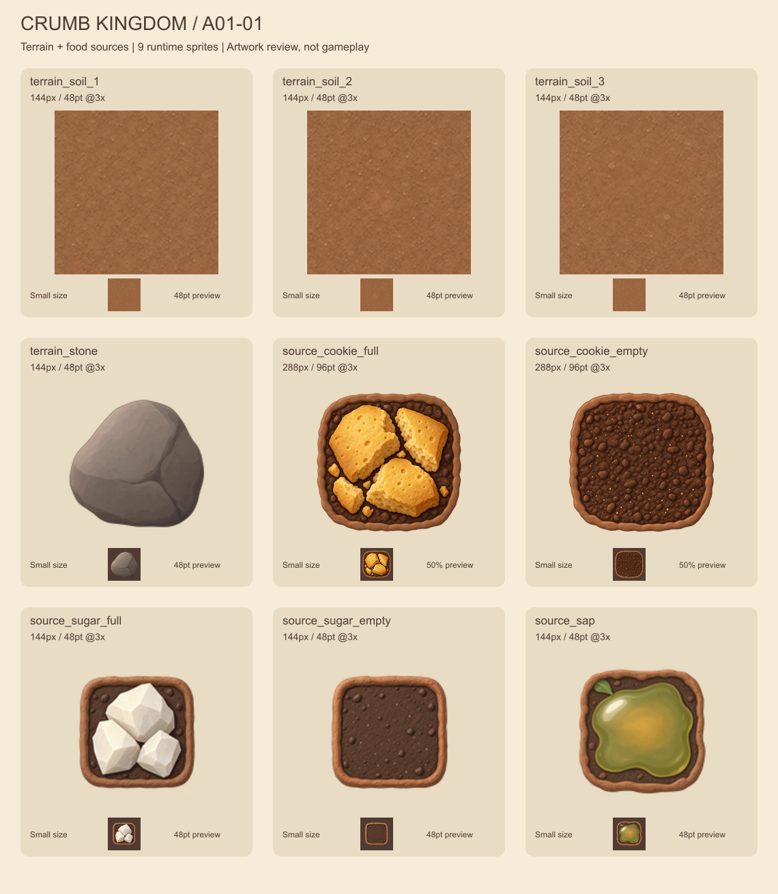
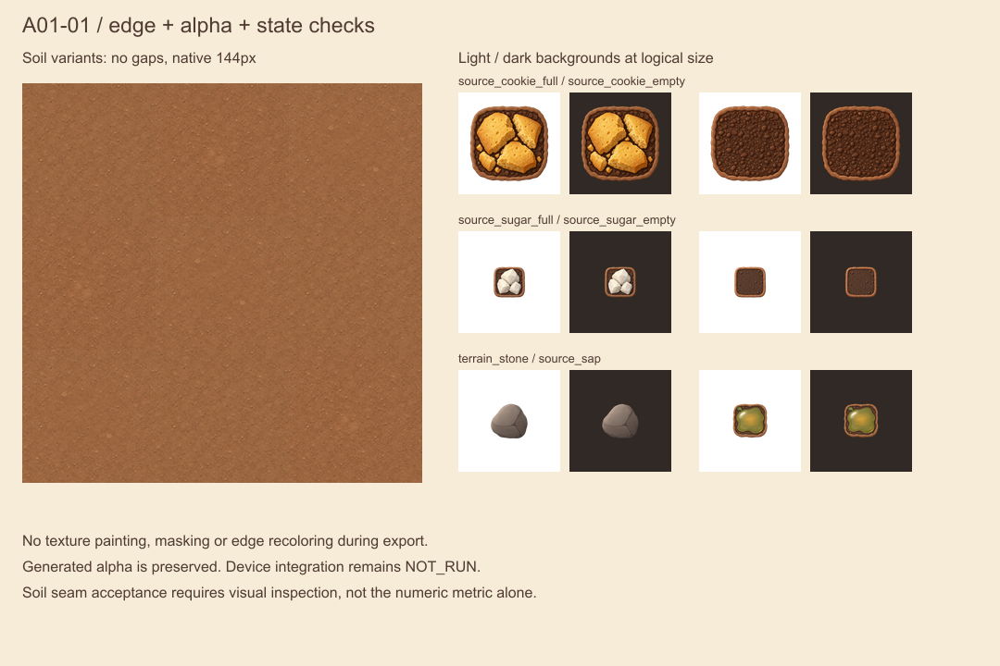

# A01-01：地形与食物源正式制作首批

版本 `1.0.0`，2026-10-11，制作/桌面检视 Codex，客户端接入 Claude。**9 张运行时 PNG，覆盖 5 个 manifest 资源组，状态 reviewed，供内部包集成验证。** A01 尚未全部完成；通路 16 遮罩、房间、地表背景留在下一批。蚂蚁、UI、音频也未由本批交付。

本批使用内置 `image_gen` 生成原稿，Sharp 0.35.5 仅做尺寸导出、sRGB 编码和检视表排版，未在导出时绘画、去背或改色。图内无玩家文字；文案继续由 SwiftUI 使用英文显示。

后续交付：[A01-02 通路与房间](../a01-02/README.md)已提供 16 种通路与 Queen/Pantry，执行 [Issue #13](https://github.com/qianquandong/AntKingdom/issues/13)；本页保留首批制作时的交付范围与检视记录。

## 文件与规格

路径均相对仓库根目录，名称对齐 Claude `86a7654` 的 `design/asset_runtime_names.json` / `AssetNames`，不需要另起别名。所有锚点 `(0.5, 0.5)`，静态单帧，@3x。

| 运行时名称 | PNG 路径 | 像素 / 逻辑大小 | 透明 |
|---|---|---|---|
| terrain_soil_1 / 2 / 3 | `assets/game/terrain/soil/terrain_soil_{1,2,3}.png` | 各 144×144 / 48×48pt | 不透明，填满一格 |
| terrain_stone | `assets/game/terrain/stone/terrain_stone.png` | 144×144 / 48×48pt | 是 |
| source_cookie_full / empty | `assets/game/sources/cookie/source_cookie_{full,empty}.png` | 各 288×288 / 96×96pt | 是 |
| source_sugar_full / empty | `assets/game/sources/sugar/source_sugar_{full,empty}.png` | 各 144×144 / 48×48pt | 是 |
| source_sap | `assets/game/sources/sap/source_sap.png` | 144×144 / 48×48pt | 是 |

- [metadata.json](metadata.json)：每个原稿/运行时文件路径、实际尺寸、逻辑尺寸、锚点、来源和 SHA-256。
- [prompts.md](prompts.md)：实际使用的英文提示词；[masters](masters/) 保留生成原稿。
- [qa.json](qa.json)：工程检查数据；[export.cjs](export.cjs) 可复现导出。
- [资源总清单](../../../design/asset_manifest.json)：分组状态。

## 预览与检查结果

以下是资产检视图，**不是游戏或商店实机截图**。





2026-10-11 桌面检查：

| 检查 | 结果与限制 |
|---|---|
| 文件/尺寸/色彩 | 9/9 PNG 尺寸正确，嵌入 sRGB profile；土层全不透明 |
| 透明边界 | 6 张 cutout 保留原生 alpha；以 alpha≥16 统计可见内容，四边至少留 4% 空间 |
| 近透明残留 | cookie_full 的最外边有 alpha=1/255 残留（小于 0.4% 不透明度），其余 cutout 最外边为 0。未强制清边；白/深底未见可辨色边。QA 容差明确记录，不宣称所有边缘逐像素为 0 |
| 土层 | 3×3 混合拼接桌面检视无明显直线/透明缝；所有 9 种有序配对的水平/垂直边 RGB 平均绝对差约 3.46–4.83/255。不是逐像素周期相同，最终仍要检查运行时采样接缝 |
| full / empty 配对 | 饼干/糖块 alpha≥128 轮廓交并比 99.22% / 99.36%；包围盒差异最大 1px（@3x 为 0.33pt）。AI 编辑未做到逐像素同轮廓；需要连续切换的真机观察 |
| 小尺寸 | Cookie 96pt、Sugar/Sap/Stone 48pt 的深浅底可辨；完整预览中 Cookie 底部小图特意缩至 50%，实际尺寸见 qa-proof |
| 游戏内 / 真机 | NOT_RUN；本批不更新 integrated 或 verified_on_device |

生成来源为本项目文字提示词与本批原稿，没有引入外部摄影、商标、字体或第三方贴图。生成原稿是栅格文件，不是可分层工程；来源登记不表示独占版权保证。

## 给 Claude 的接入顺序

**先完成 [D-13 / Issue #11](https://github.com/qianquandong/AntKingdom/issues/11) 的修复与核心可安装包交付。** 本批集成可以在生命周期基线稳定后独立提交，不让换美术掩盖 D-13 的回归差异。

1. 合入本次美术/文档提交；保留当前开发分支代码与真实测试记录，不用 main 的历史阶段表覆盖更完整的报告。
2. 只将 `assets/game/` 下本批 9 张 PNG 导入同名 imageset，作为 @3x 源。可使用单份带明确 scale 的资源，或由同一原稿导出 1x/2x；不能把 144px 误当作 144pt，也不能把原稿打包进 App。两个 target 共享同一命名映射。
3. 保持 PRD 占地、中心锚点、路径/碰撞不变。Cookie 仍占 2×2，Sugar/Sap/Stone 仍占 1×1。**empty 仍是不可通行源地块**。Sap 当前是连续源，仅一态。
4. 检查当前 GameScene 的源 SKShapeNode：贴图自带土边，加载成功时移除占位填色/轮廓线，避免双重边框；选中状态另用原有可交互描边。不要裁掉透明 padding。Stone 透明区应露出土层，避免用原占位灰色底形成方块底板。
5. 检查 source 现有 inset=3pt 的映射：标明实际绘制尺寸，不改变逻辑格。若缩小后 Sugar 太小或自动裁边引起跳动，回传对照图给 Codex；不要自行重画、拉伸或改变资源的占地。
6. 土层纹理固定随格坐标选变体，不在每帧重新随机；不要镜像/任意旋转破坏固定光照。用现有绘制和采样策略检验总览/原尺寸/放大，不为图片改变通行算法。
7. `reviewed` 表示通过桌面资源检查、允许内部包试接，不等于发行 approved。接入后回传截图和证据，Codex 复核后更新 approved/integrated；物理设备完成后再标 verified_on_device。发行 strict 检查保持现有门槛，未交付资源不得用空 imageset 或批量改状态蒙混通过。

## 集成验收与回传

- 固定 build/SHA、资源版本 `A01-01 1.0.0`、设备和 iOS；两 target 各确认资源可加载，日志无回退占位。
- 原尺寸和总览下无地形漏线；浅色通路仍可辨，石头与食物不遮蔽入口/运输动画。
- Cookie/Sugar 分别在有货→耗尽→补给时连续切换，轮廓不发生可见跳动；贴图状态与真正库存一致。
- 最小支持屏幕/标准屏至少各一组全图截图，源详情面板保持英文、可点区域不因图缩小；实体 iPhone 至少一台，未测明确标 NOT_RUN。
- 回传默认地图、两种 depleted 状态、恢复后的状态和 3×3 土层近景。若存在色边/接缝，附缩放比例与原图，不只说“不好看”。
- 报告新增包大小和导入范围；不得把 `masters/`、接触表或提示词放进运行时 bundle。

## 复现导出

仓库根目录使用 Node.js 与 `sharp@0.35.5`；依赖可放在独立工具目录，通过 NODE_PATH 指向它，无需改游戏工程依赖：

```bash
node assets/source/a01-01/export.cjs
```

脚本从版本化 masters 读取，每次输出固定尺寸 PNG、更新哈希和 QA 数据。尺寸/色彩/透明范围或两态轮廓不符合已记录门槛时退出非零。拼接和可读性还必须人工看 qa-proof；不将数值检查当作美术终验。

本轮仓库验证：9 张文件的 PNG 头尺寸与 SHA-256 均匹配 metadata；9 个名称均匹配上述 Claude runtime 映射；5 个 manifest 分组一致；本轮涉及文档的 49 个本地链接存在。运行时 PNG 合计 507,738 bytes（约 496 KiB），不包含原稿和预览。main 的 30 项 Python 单元测试、economy_sim --check、check_map、check_strings 全部通过。这些结果验证本次交付，不代表 D-13 或 iOS 构建已经修复/通过。
