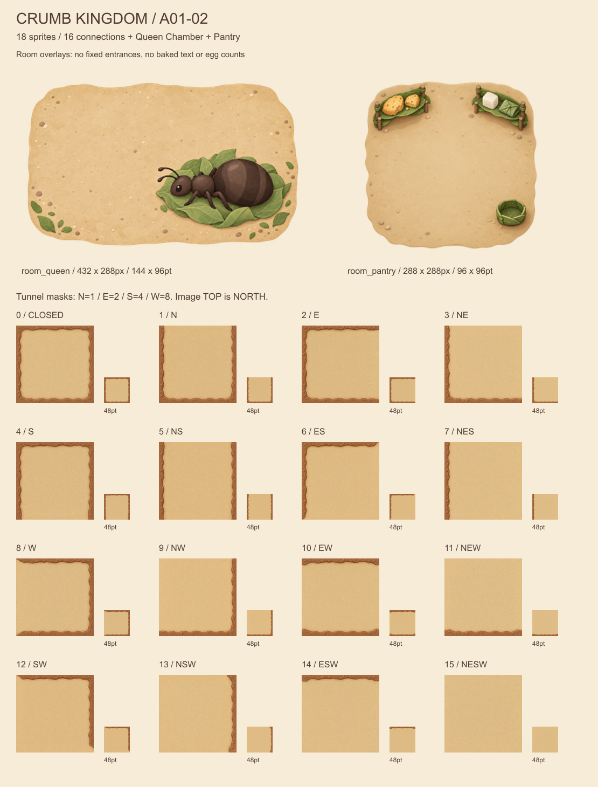
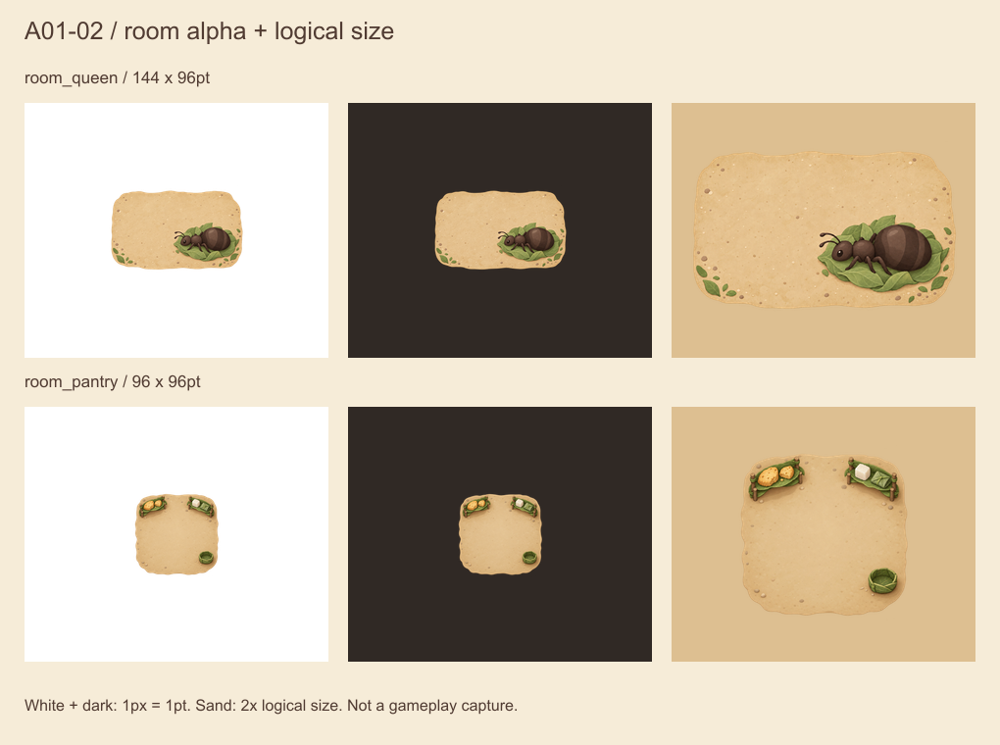
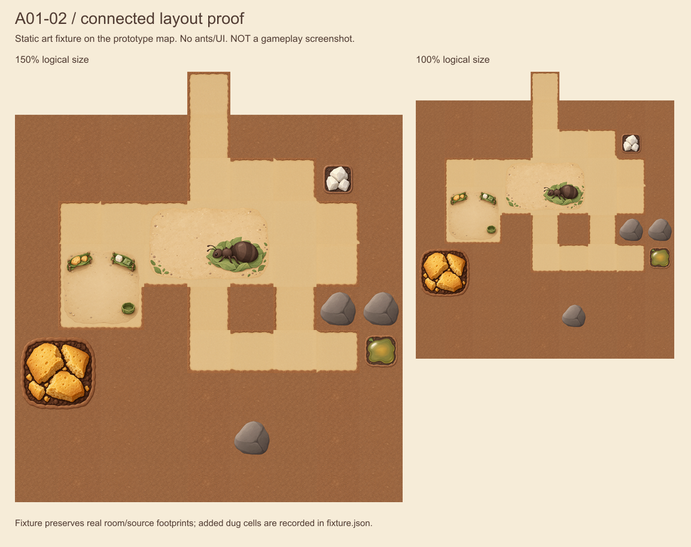

# A01-02：通路、蚁后房间与仓库

版本 **1.0.0**，2026-10-11。Codex 正式制作第二批，**18 张运行时 PNG / 3 个资源组**；已通过桌面资源检查，状态 reviewed。客户端接入与真机验收仍为 NOT_RUN，执行入口为 [Issue #13](https://github.com/qianquandong/AntKingdom/issues/13)。本批不包含地表背景、工蚁动画或商品皮肤。

## 文件与来源

| 资源组 | 文件（相对仓库根目录） | 像素 / 逻辑大小 | 属性 |
|---|---|---|---|
| terrain_tunnel_masks | `assets/game/terrain/tunnel/terrain_tunnel_masks_0.png` … `_15.png` | 每张 144×144 / 48×48pt @3x | 不透明完整地形，不能作为只有土边的 alpha 遮罩叠加 |
| room_queen | `assets/game/rooms/queen/room_queen.png` | 432×288 / 144×96pt @3x | 透明，3×2 格，中心锚点 |
| room_pantry | `assets/game/rooms/pantry/room_pantry.png` | 288×288 / 96×96pt @3x | 透明，2×2 格，中心锚点 |

所有名称与 Claude `86a7654` 的 AssetNames / runtime 映射一致；所有图均为 sRGB、单帧、锚点 (0.5,0.5)，没有烘焙文字。

- [metadata.json](metadata.json)：文件路径、实际生成尺寸、运行时尺寸、逻辑大小、来源、SHA-256、生成修订与状态。
- [masters/](masters/)：最终采用的 18 张生成原稿；[reference_sources/](reference_sources/)：地面与 Queen 的前置编辑输入，不进入 App。
- [prompts.md](prompts.md)：实际英文生成提示词，末尾明确标注 mask 4/15 最终修订。
- [qa.json](qa.json)：导出与方向/接缝检查；[fixture.json](fixture.json)：静态布局使用的已挖格与房间位置。
- [export.cjs](export.cjs)：可复现工程尺寸导出和检视图；[资源清单](../../../design/asset_manifest.json)：项目整体进度。

原稿全部由内置 image_gen 制作/修订，每个资产独立调用。导出工具 Sharp 0.35.5 只按原比例缩放、编码 sRGB，保留生成 alpha；不重新绘画、去背、旋转、镜像或统一改色。预览排版不是新的游戏贴图。未引入第三方照片、贴图、商标或字体资源；生成源为栅格，不是可分层绘画工程，来源记录不宣称独占版权。

## 方向表

图片上方是地图北方（y−1）。编号代表开放边的位和；0 是无连接，15 是全连接。每张都按固定光照独立生成，不通过旋转贴图凑数。

| 编号 | 开放方向 | 编号 | 开放方向 |
|---|---|---|---|
| 0 | 无 | 8 | W |
| 1 | N | 9 | NW |
| 2 | E | 10 | EW |
| 3 | NE | 11 | NEW |
| 4 | S | 12 | SW |
| 5 | NS | 13 | NSW |
| 6 | ES | 14 | ESW |
| 7 | NES | 15 | NESW |

## 桌面检视







以上为资产检视图，**不是游戏截图、性能结果或 App Store 宣传实机图**。布局底图来自真实原型地图，额外已挖格记录在 fixture.json；没有修改关卡或数值。

| 检查 | 结果与边界 |
|---|---|
| PNG 尺寸/比例/sRGB | 18/18 通过；Queen 源稿与输出均保持 3:2 |
| Alpha | 16 张通路完全不透明；两间房间最外一圈 alpha=0，无可见黑白边；Queen / Pantry 的 alpha≥128 内容最小留白约 3.2% / 5.6% |
| 开口方向 | 16×4=64 条边全部符合 N1/E2/S4/W8；检查每边中央 50% 的 3px 深区域，结合完整总览目检 |
| 可连接配对 | 水平 64 + 垂直 64 = 128 对通过；中央通口 RGB 平均绝对差最大 4.531/255，门槛为 18/255 |
| 修订 | 南向尽头两侧土边延伸至底部；四向通路改用同一母稿重新补齐地面，降低初版接缝差异；修订后复测通过 |
| 小尺寸与叠加 | 48pt 通路、144×96pt Queen、96pt Pantry 可辨；房间无固定门洞，Queen 顶部保留动态卵区 |
| 仍需检查 | 生成原稿存在轻微纸张色调/纹理变化，不是逐像素周期一致；动态采样、缩放接缝、角色遮挡、触摸和实际 @2x/@3x 清晰度要在客户端/真机检查 |
| iOS / 真机 | NOT_RUN；本次未修改游戏实现，不把静态图通过当设备终验 |

仓库检查：本批 18 个名称与 Claude 映射一致，PNG 头/尺寸/SHA-256 与 metadata 一致，65 个本地文档链接有效；布局新增已挖格均为原图合法 Soil，未修改关卡。18 张 runtime PNG 合计 781,979 bytes（约 764 KiB，不含原稿/预览）。本轮 main 的 30 项 Python 单元测试、economy_sim --check、check_map、check_strings 全部通过；这些不是 iOS 或 D-13 验收结果。

## 复现导出

仓库根目录使用 Node.js 与 `sharp@0.35.5`（依赖可放在独立工具目录，通过 NODE_PATH 引用，不必修改游戏依赖）：

```bash
node assets/source/a01-02/export.cjs
```

导出从本批 masters 读取；布局检视另外读取 A01-01 metadata/runtime PNG 与 design/map_prototype.txt。尺寸、alpha、方向或通口差异超出记录门槛时非零退出。数值检查只覆盖记录的区域与指标，还必须查看完整检视图；预览含静态装饰，不代表可交互实现。

## Claude 接入与验收交接

以下与 Issue #13 对齐；保持 D-13 的既有优先级。

### 交付与顺序

Claude 负责接入/测试，Codex 负责美术复核，用户负责物理 iPhone 操作。**D-13 / #11 仍先修复并交付核心可安装包**；本项在生命周期基线稳定后独立提交，不把换图和 D-13 修复混在同一个验收结论中。

Codex 已完成 A01-02 v1.0.0：**18 张 PNG、3 个资源组**，状态 reviewed，可用于内部包接入。资源说明将随本轮 main 提交位于 [assets/source/a01-02/README.md](https://github.com/qianquandong/AntKingdom/blob/main/assets/source/a01-02/README.md)，每个文件的尺寸、SHA-256、提示词与 QA 均在同目录。此前 A01-01 的 9 张资源仍有效。

- terrain_tunnel_masks_0 … terrain_tunnel_masks_15：144×144px，48×48pt @3x，完全不透明，N1 / E2 / S4 / W8；图片上方是北。
- room_queen：432×288px，144×96pt @3x，3×2 格，透明背景，中心锚点。
- room_pantry：288×288px，96×96pt @3x，2×2 格，透明背景，中心锚点。

### 接入要求

1. 同名 imageset 导入本批全部 18 张；两个 target 共用名称映射。正确声明 scale，不将像素当 pt。保持 PNG 原比例，不旋转或镜像去拼缺失编号。
2. 通路保持现有四邻 walkable 规则。N 对应地图 y−1；SpriteKit 坐标翻转只影响位置，不再上下翻转图片/交换 mask。开格后更新当前格及四邻；建仓/移动、读取存档后重算正确的纹理。
3. **GameScene.roomNode** 加载正式房间图后清除占位 fill/stroke；子贴图以完整逻辑占地的 144×96pt / 96×96pt 居中绘制。原 insetBy(3,3) 不得把 Queen 拉成 138×90pt。保留素材透明 padding；选择框、命中区域与逻辑占地分别处理。
4. **GameScene.renderPantry** 当前无条件叠加三条占位 shelves 线；正式贴图加载成功时移除/不创建这些线。贴图不可用时仍允许原占位回退。
5. 两间房间都是可通行装饰层，无固定门洞。保留底下通路；不根据 alpha/家具/蚁后轮廓生成碰撞。蚂蚁、货物、动态卵及选择/放置反馈按现有语义显示在正确层级，不能被房间装饰遮没。
6. Queen 上方保留动态卵区，现有参考卵中心为房间左上起 (22,22)pt 和 (40,22)pt；检查 0/1/2 卵状态、孵化暂停与完成。不能画死卵数或用图中装饰决定库存。Pantry 货架食品是静态装饰，不是库存计数。
7. 默认 Queen/Pantry 贴图不替代未交付的 Garden Decor Pack。商业化开关、数值、存档和路径算法保持原规则；缺失皮肤继续明确登记，不能将本批接入当全部发行资源齐备。
8. 美术图集/采样方式由 Claude 按 SpriteKit 工程选择；检验缝隙和 alpha，不能用放大贴图遮缝而跨格覆盖源或更改碰撞。只将 runtime PNG 放入 App bundle，排除 masters、reference_sources、提示词、QA 图和导出脚本。

### 必须回填的验收证据

- [ ] 18 个名称都加载成功；检查实际图片可解码、尺寸、scale、alpha，不以空 imageset 文件夹存在代替通过。
- [ ] 16 种 mask 的 64 条边逐项正确；直道、四种转角、四种三岔、四向、尽头、独立格均有截图，开口没有横向土边。
- [ ] 连续挖格、保存重开后，当前格和相邻格没有旧边残留。移动 Pantry 前后不留下旧图、不重复、不改变可通行性/卸货点。
- [ ] 默认视图、总览与放大检查采样接缝；慢速平移和缩放检查闪线。桌面原稿仍有轻微纸张色调变化；若在设备上出现清楚的方格线/白线/黑线，保留截图和缩放值回传 Codex，不能直接标美术终验通过。
- [ ] Queen 的 0/1/2 卵、蚂蚁经过房间、Pantry 建造/移动/取消/非法位置、选中房间均可辨；无占位外框/货架线，英文原生文案正常。
- [ ] 两个 scheme 均编译和加载默认资源；小屏与标准屏模拟器至少各一组同场景对照。实际使用 @2x/@3x 设备时核对清晰度与比例，不声称未测设备通过。
- [ ] 至少一台物理 iPhone：型号/iOS/build/SHA/资源版本、默认/总览截图、平移缩放与仓库移动短录像。无条件保持 NOT_RUN，与模拟器结果分开。
- [ ] 提交接入 PR、CI/日志、资源报告与新增 bundle 大小。报告本批 3 组的实际状态，保持其他缺失资源状态与 strict 发行检查。不要批量把全部 manifest 改为 approved。

### Codex 已完成的桌面检查

18/18 文件尺寸、sRGB 与透明/不透明属性通过；64/64 边方向通过；128/128 可连接通口配对通过，中央接缝 RGB 平均绝对差最大约 4.531/255。白/深底、48pt 通路、144×96pt Queen、96pt Pantry 和连通布局已检视。南向尽头与四向地面各修订一次后复测。

这些是静态美术检视，不是 iOS 构建或真机证据。状态流：reviewed → 接入回传 → Codex 复核 approved/integrated → 真机 verified_on_device。未完成接入和设备检视前保留本 issue 开放。
