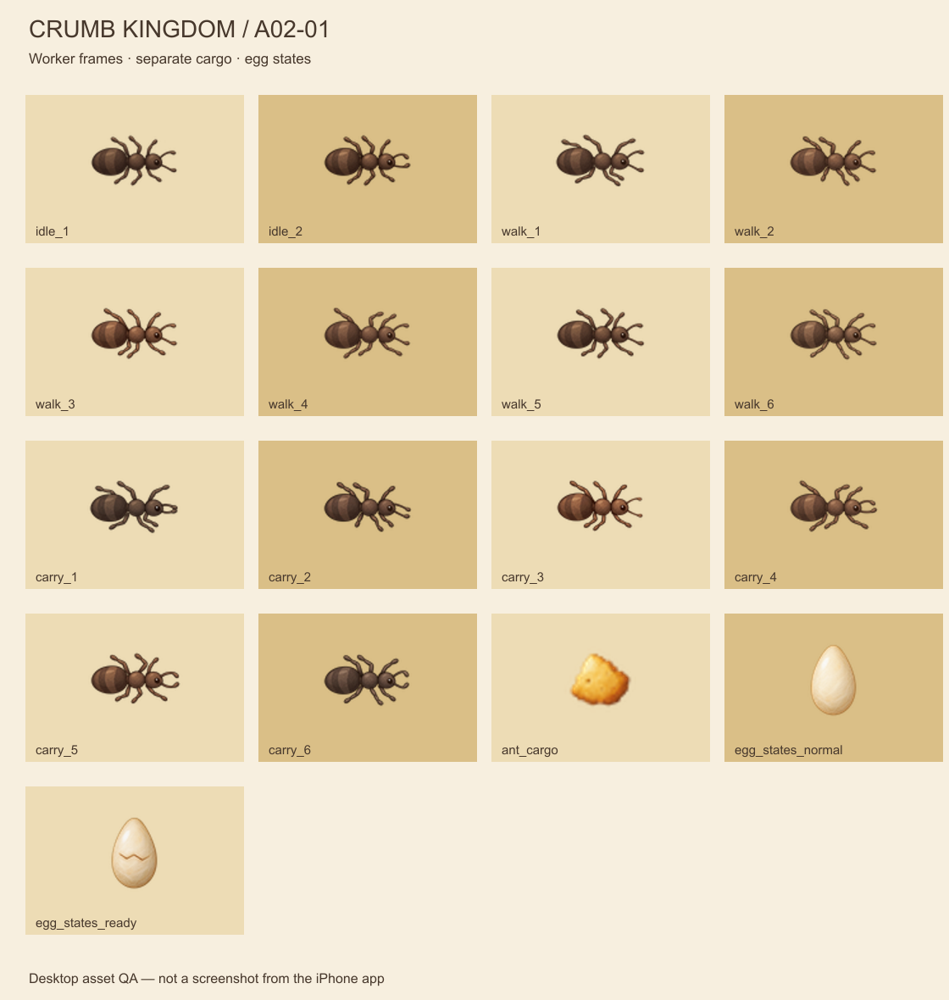
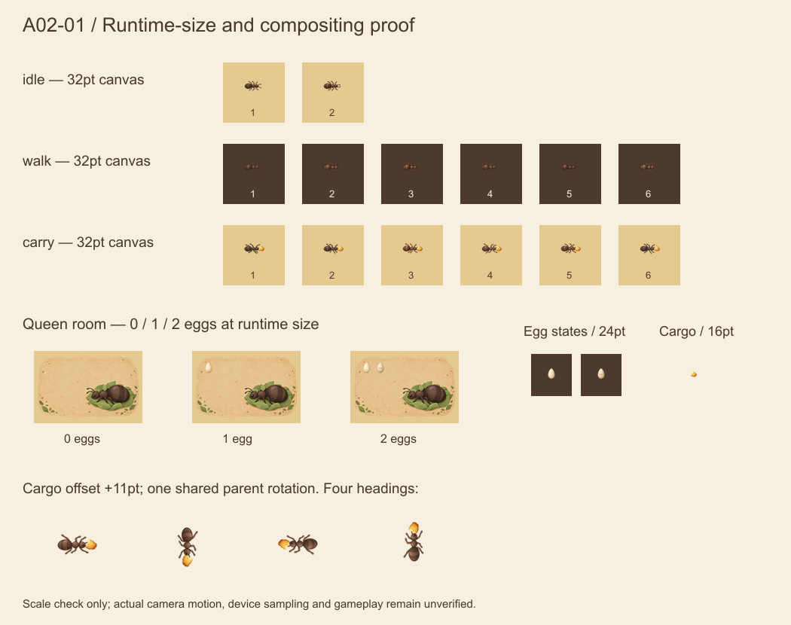
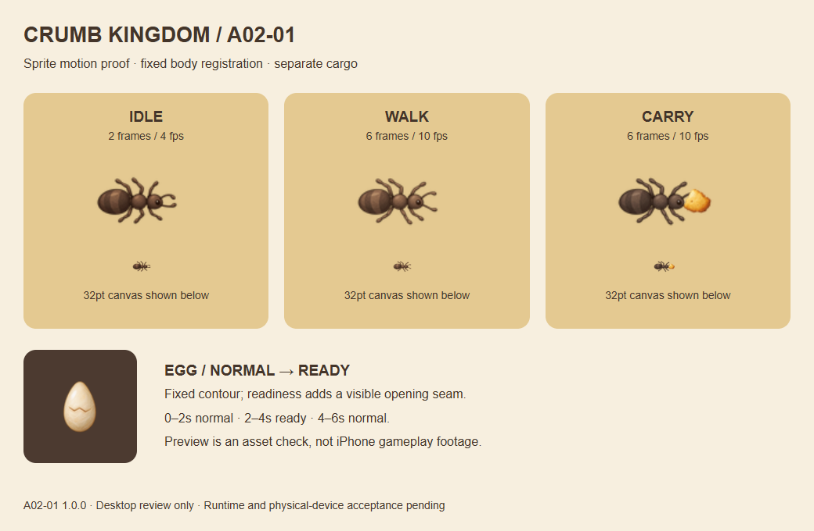

# A02-01：工蚁、独立货物与卵

版本 **1.0.0**，2026-10-12 交付（制作始于 10-11）。Codex 正式制作第三批：**17 张运行时 PNG / 3 个资源组**，桌面检查完成，状态 `reviewed`，供内部包接入。Claude 按 [Issue #17](https://github.com/qianquandong/AntKingdom/issues/17) 实现和测试；本批不阻塞 [Issue #16 的核心真机包交付](https://github.com/qianquandong/AntKingdom/issues/16)。客户端集成与物理 iPhone 验收均未完成，不能据此标记 `approved` 或 `verified_on_device`。

## 文件与显示契约

名称与 Claude 核心分支 `d5251f6` 的 `design/asset_runtime_names.json` / AssetNames 一致。

| 资源组 | 路径（相对仓库根目录） | 数量与像素 | 实际显示与状态 |
|---|---|---|---|
| ant_worker | `assets/game/ants/worker/ant_worker_{idle,walk,carry}_{序号}.png` | idle 2 + walk 6 + carry 6；每张 96×96px | @3x，32×32pt；idle 4fps，walk/carry 10fps |
| ant_cargo | `assets/game/ants/cargo/ant_cargo.png` | 1 张，48×48px | @3x，16×16pt；独立货物层 |
| egg_states | `assets/game/ants/egg/egg_states_normal.png`、`egg_states_ready.png` | 2 张，每张 96×96px | catalog @3x；**节点显式显示 24×24pt**，不能直接用 UIImage 的 32pt 默认大小 |

全部为带透明背景的 sRGB PNG，统一中心锚点 `(0.5,0.5)`，无文字。工蚁基础朝右，身体的绘画轮廓约占画布宽度的 2/3；不裁透明留白。货物相对工蚁父节点中心 `(11,0)pt`，与身体共同旋转。身体动画没有烘焙食物，避免两份货物。

- 帧序为数字递增并回到 1：idle 1→2→1，walk/carry 1→2→3→4→5→6→1。idle 不做整体位置呼吸；walk/carry 只表达运动，世界坐标由现有逻辑控制。
- 卵的两种状态保持相同位置和尺寸。按现有客户端阈值，剩余孵化时间 `<= 2s` 使用 ready；不改变 PRD 孵化时长、离线推进或人口规则。**“暂停孵化”开关只停新订单，已有卵继续完成；满仓使运输待命，不冻结已有卵。** 发行支线的主动广告暂停是另一种状态，按 D-14 修复契约停止模拟。
- Queen 房间 144×96pt，动态卵中心参考房间左上起 `(22,22)` / `(40,22)pt`；SpriteKit 翻转坐标时保持实际屏幕位置。实际 0 枚卵就不显示卵，不在房间底图上补画固定卵。
- 不按 alpha 轮廓做碰撞、不按动画走完/货物到达发放收益。沿用已有运输平均流量、人口、拥堵、路径和保存规则。

## 来源与工程导出

- [metadata.json](metadata.json)：17 文件的像素、锚点、SHA-256、引用源、生成修订、导出位移与状态。
- [masters/](masters/)：17 张最终生成原稿，实际均为 **1254×1254px**；[reference_sources/](reference_sources/)：5 张被修订的前置原稿。
- [prompts.md](prompts.md)：本轮 **22 次**内置 image_gen 调用的实际英文提示词。5 次修订分别修正缺腿、交叉腿和 3 张搬运帧偏亮/身体偏移。
- [export.cjs](export.cjs)：Sharp 0.35.5 工程导出及静态检视页；[qa.json](qa.json)：尺寸、alpha、对齐和文件校验。
- [preview/](preview/)：6 秒 HyperFrames 动作检视页；[preview-qa.json](preview-qa.json)：浏览器逐帧/往返 seek 检查；[preview-tool-checks.json](preview-tool-checks.json)：工具检查和已解释的提示。

原画全部由内置 image_gen 生成/编辑，保留原始栅格；没有用代码重画、去背或统一改色。导出先将工蚁完整画布缩到 192px，在固定身体 ROI 内寻找整体平移，使胸部落在一致中心，再统一缩到 96px。每帧位移已记录；没有按每帧外轮廓单独裁切/拉伸。cargo/egg 仅等比例缩放。Sharp 只负责工程缩放、平移、sRGB 与编码，检视图中的排版与旋转不是新游戏贴图。

复现：仓库根目录使用 Node.js 与 `sharp@0.35.5` 运行 `node assets/source/a02-01/export.cjs`。检视图另读取 A01-02 Queen 图片。依赖可安装到独立工具目录，通过 NODE_PATH 引用，无需给 iOS 项目增加依赖。

未引入第三方照片、游戏贴图或商标；生成来源不宣称独占版权。预览页使用本地 GSAP 3.14.2，保留版权头与条款链接，见 [GSAP-NOTICE.txt](preview/GSAP-NOTICE.txt)；它只供 QA，不能打入 App。

## 桌面检视与结果边界

以上是资产检视页，不是游戏截图或设备性能结果。

| 检查 | 结果 |
|---|---|
| 文件 / 尺寸 / sRGB | 17/17；14 张身体帧文件互不重复；runtime 合计 **98,425 bytes**（约 96.1 KiB） |
| 透明边界 | 所有图片最外圈 alpha=0；alpha≥16 内容距离四边至少 4px，腿/触角无裁边 |
| 身体配准 | 固定 ROI 的预乘 RGBA 平均绝对差最大 **13.7862/255**，低于本批 14 门槛；已修正三张初版超阈值帧 |
| 卵状态轮廓 | alpha≥128 的交并比 **99.25%**；ready 增加开口纹，不通过变大表示即将孵化 |
| 小尺寸与组合 | 工蚁 32pt、货物 16pt、卵 24pt 检视；浅色通路可辨。深土上角色对比较弱，实际路径应仍只在可通行地面；客户端若有遮挡/看不清须回传 |
| 动作与工具 | 64 次浏览器逐帧/反向 seek 检查通过，见 preview-qa.json；HyperFrames 校验/布局检查无错误。静态 lint 的重复媒体与单页层级提示是大小双视图及单页 QA 布局，详见工具记录 |
| 未验收范围 | AI 帧的局部纹理/腿部轮廓仍有细微变化，数值门槛不保证 iOS 动画观感；实际 6→1 循环、转弯、镜头采样、24 只并行和真机清晰度待验证 |

本轮 main 的 30 项 Python 单元测试、economy_sim --check、check_map、check_strings 全部通过；这些是仓库基准检查，不是 iOS 或 D-14 修复验证。

## Claude 接入要求

1. 独立提交本批 **17 个同名 imageset**。两个 target 共用资源和映射，正确登记 @3x；按整组加载全部 14 身体帧，不以找到 walk_1 或目录存在作为动画完整性证据。
2. idle/walk/carry 使用各自完整序列和既有 4/10/10fps 设置；切换不积累 SKAction、不叠两套身体、不改变世界位置或路径进度。物理移动由既有模拟控制；不引入 root motion。
3. 货物独立绘制，位置为父节点局部 `(11,0)pt`，随工蚁父节点一起旋转；不能再按世界坐标重复旋转。装载后才显示、卸货/取消后移除；满仓/等待/返程行为按逻辑状态决定，不能仅因播放 carry 就记账。
4. 正式纹理成功加载时移除对应占位身体/圆点/卵；缺失资源仍有清晰回退且报告缺项。卵绑定实际数量和剩余秒数；孵化订单开关关闭时已有卵仍可切换 ready 并完成，动画自身不能孵化出新蚂蚁。
5. 保持蚂蚁、cargo、动态卵、选中/放置反馈的层级；经过 Queen/Pantry 不被装饰遮没。保留原图透明 padding，不通过扩大画布或截去腿部改善可见性。
6. 仅将 `assets/game/ants/` 的 17 张 runtime PNG 导入 App；不包含原稿、前置图、提示词、QA 图、预览 HTML/GSAP 和导出脚本。禁止顺带批量批准未交付的地表/反馈/UI/音效/皮肤。

## 接入后的复现测试与验收标准

| 用例 | 操作 | 必须达到 |
|---|---|---|
| A02-T01 文件加载 | 两个 scheme 各加载 17 张；核查解码/尺寸/scale/hash | 14+1+2 全部成功，与 metadata 相符；没有空 imageset、大小混用或占位残留 |
| A02-T02 动作循环 | 固定镜头，idle/walk/carry 各播放至少 5 个循环，慢放 6→1 | 中心不跳、身体不明显闪亮/忽大忽小，无断腿/重复帧停顿；32pt 与放大录屏均可辨 |
| A02-T03 装卸与朝向 | 同一蚂蚁完成取货→四向转弯→卸货→返程；取消/改路 | 货物仅一份、跟随嘴前、不绕错轴、不留下孤立节点；收入完全由原逻辑控制 |
| A02-T04 卵状态 | 构造实际 0/1/2 卵，进入最后 2s、关闭/开启孵化订单、满仓待命、完成孵化；发行另测广告主动暂停 | 数量准确、两态位置不跳；关订单或满仓都不冻结已有卵，关闭订单不新增卵；广告主动暂停遵守 D-14；不重复孵化，0 卵无残留 |
| A02-T05 场景与缩放 | 工蚁穿过通路/Queen/Pantry，移动仓库；默认/总览/放大慢速平移 | 无遮没、矩形底板、白黑边或货物错位；先修 D-15，不能用新角色掩盖旧问题 |
| A02-T06 回归与设备 | 核心/发行两 scheme，小屏/标准屏；一台物理 iPhone | 运行原规则与适用 UI 测试，保存/重开/后台恢复无新问题；记录设备、iOS、build、SHA、资源版本和 24 只工蚁帧率/内存观察 |

必须回填接入 PR、固定 SHA/CI run、两个 scheme 的截图/短录像、资源报告和 App bundle 大小增量。真机有条件后执行，缺设备/签名则记录明确阻塞，不能用模拟器代替。Codex 根据回传画面复核；本批 `reviewed` → 实际接入复核 → 真机验收的各段分别登记。

执行顺序以 [最新复核](../../../docs/reviews/2026-10-11-followup-review.md) 为准：先交核心可安装包，修发行 D-14、视觉 D-15，本批随后独立接入。若设备实测出现明显身体闪烁或循环跳动，附原速/慢放和帧号回传 Codex 修图，不调整经济/运输来迁就动画。
