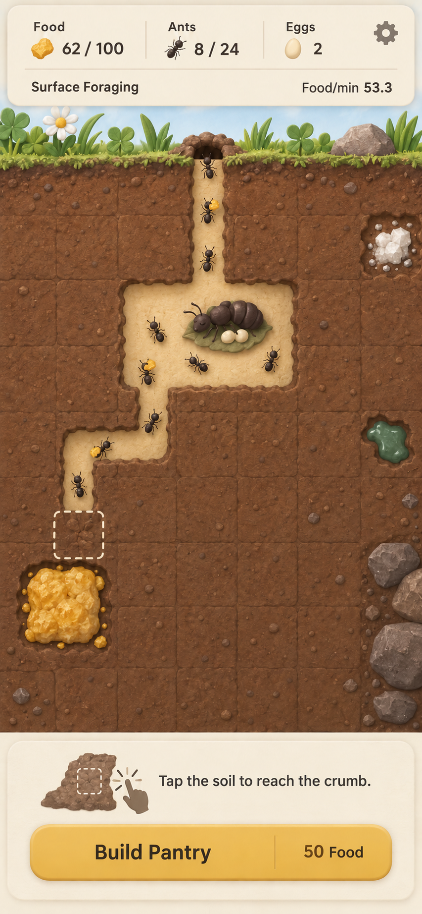

# A00 主界面样张 · 温暖的微缩地下标本盒

日期：2026-10-11。主责：Codex。版本：v1（界面预览数值勘误为 v2）。状态：**draft**，主界面方向已制作，尚未完成用户方向确认、小屏适配与运行时集成。属于设计样张，不是实机截图。

## 本次交付

| 文件 | 用途 | 可用于运行时？ |
|---|---|---|
| [main-screen-v2.png](main-screen-v2.png) | 英文 HUD 与美术组合预览 | 否，文字为样张示意，客户端必须使用原生文字 |
| [world-plate-v1.png](world-plate-v1.png) | 无文字、无 UI 的同方向美术底稿 | 否，仍是包含角色/场景的整体方向图，不是独立地形贴图 |
| [prompts.md](prompts.md) | 实际生成与修订提示词 | 作为制作记录 |
| [metadata.json](metadata.json) | 来源、尺寸、哈希、状态 | 作为交付记录 |

## 视觉决定

- 奶油纸张面板与蜂蜜金主要按钮；土层呈温暖黏土与纸纹质感，通路明亮，工蚁深色，轮廓相互分离。
- 第一眼看到饼干、蚁后房间和搬运队伍；一格裂纹土块配虚线描边，说明下一次可挖的位置。
- 地表只保留一条草叶边带，主体是地下。房间和路线以平面正交关系表达，不把装饰画成新增通路。
- 当前画面只呈现 Food / Ants / Eggs、当前运输来源与速率、挖掘引导、Build Pantry；商业化入口不进入核心主界面。
- 主画面上的英文：Food、Ants、Eggs、Surface Foraging、Food/min、Tap the soil to reach the crumb.、Build Pantry、50 Food。

## 这张样张的使用边界

样张用于确认材质、配色、视觉焦点和界面层级。它不改变 PRD、地图尺寸、碰撞、资源位置或任何数值。画中的格数、蚂蚁数量与房间比例是绘画示意；接入时始终以 `design/map_prototype.txt`、`PRD.md` 和实际 SessionSnapshot 为准。

预览数字为 Food 62/100、Ants 8/24、Eggs 2。v2 把 Surface Foraging 的速率从 33.3 修为 53.3，仅对应“8 工蚁、18 秒周期、每次搬运 2”的说明例：8×2÷18×60≈53.3，不代表该生成图已由实际存档验证。运行时必须从核心计算，不抄图片数字。生成画面中的搬运物泛指食物，不表示未接通的 Cookie 已开始扣库存。

无文字底稿保留了场景内角色，不能直接铺成游戏背景，否则会出现不受模拟控制的蚂蚁/卵。后续必须分别制作地形、房间、食物、角色、裂纹和指示器。底稿也不是已导出的 144px 地形或 96px 动画帧。

## Claude 接入时的约束

1. 使用现有资源 ID 和尺寸契约，不根据样张改网格逻辑。Queen 仍为 3×2，Pantry/Cookie 为 2×2，其他规格见 ART_DIRECTION。
2. HUD、数字、按钮与指引全部保留 SwiftUI 原生文字；不要裁下图中的文字、数字、图标或按钮做客户端控件。文案来自 String Catalog。
3. 资源图进 Assets.xcassets 之前，由 Codex 完成拆分、透明底、锚点、尺寸和来源登记。当前两张整体图只进入 source/keyframe，不能加入 App 构建资源。
4. 默认 48pt 游戏格与至少 44pt 控件触区不变。地图通过镜头适配，不能把整个样张缩放成可点击页面。
5. 实际路况必须由模拟驱动。正常/繁忙同时使用形状或线型；拥堵时减少重叠、错开动画相位，不伪造避让路径或改变分流规则。
6. 运输周期 Trip 仍按原 PRD 显示。本张风格预览省略了 Trip；正式 HUD 需补齐并在小屏以两行排版，不能把资源名截成无法辨认的前缀。
7. 真实设备必须尊重 safe area。样张不是包含状态栏/灵动岛的最终布局坐标稿，不能按图片顶边硬贴 HUD。
8. 保留正常/仓满/无食物/建造合法与非法/移动预览等状态；本次只画普通探索状态，不代表其他面板已设计完。

## 本次检查与下一轮工作

| 检查 | 结果 |
|---|---|
| 英文界面文案与主要数字 | 已目视核对；运输速率已勘误 |
| 土层/通路/蚂蚁/食物的明暗区分 | 方向成立，仍需在实际 24px 蚂蚁尺寸复核 |
| 无文字美术底稿 | 已生成并目视核对，无 HUD/按钮/文字 |
| PNG 完整性、实际像素尺寸、SHA-256 | 见 metadata.json |
| 与 9×9 真地图逐格一致 | 未验收，样张不作为地图数据 |
| 390×844pt 原生布局 | 待制作/集成验证 |
| 375×667pt、小屏文字、触区、对比度 | 待制作/设备验证 |
| 地形接缝、透明边、角色锚点和动作帧 | 待 A01/A02 独立资源生产 |
| 用户方向确认与真机终验 | 未发生 |

下一轮美术重点：降低土层细碎颗粒；把工蚁稳定为三节身体、六腿、两触角的简化俯视轮廓；在角色参考中统一蚁后与工蚁视角；将原生 HUD 的 Trip 和小屏换行补齐；补工蚁/土块/Queen 的独立近景稿。因此 A00 仍为 draft，不能标为 approved 或 DONE。

来源：本次使用内置 image_gen 生成与定向编辑，输入为本项目原创文字描述和本次生成图；未导入第三方画作、游戏截图或外部商标。不存在图层源文件，只有 PNG 和可复用提示词。来源记录不等同于已经完成商标检索或商店素材验收。
