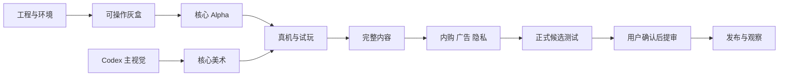

# 从分工到 App Store 的交付总计划

更新：2026-10-11。计划基线：核心规则提交 `eae0215`。本文件是工作流程，不是完成报告。

已确认：Claude 有 Mac，可安装 Xcode；沟通与文档中文，游戏内容英文；正式版免费，采用内购和/或可选奖励广告；Codex 主责计划与美术，Claude 主责代码。

## 1. 谁负责什么

| 工作 | 主责与交付 | 验收/决定 |
|---|---|---|
| 产品定位、范围、数值、地图设计 | Codex：PRD、规则基准、地图与任务规范 | 用户决定方向；Claude 反馈实现成本 |
| 主视觉、UI、角色、场景、图标、商店素材 | Codex：设计稿、分层源文件/生成记录、资源清单、英文素材 | 用户确认主视觉；Claude 验证导入与性能 |
| 工程、游戏逻辑、存档、离线、UI 实现 | Claude：可运行工程、代码、构建说明、回归测试 | 自动测试；Codex 核对体验与规则 |
| 美术集成、运行时动画、音效接入 | Claude：资源加载、图集、状态绑定、设备演示 | Codex 按美术规范验收 |
| 自动化、模拟器、商业化沙盒测试 | Claude：测试与原始日志、可复现缺陷 | Codex 审查覆盖；用户看可玩结果 |
| 实体 iPhone 与观察试玩 | 用户/招募测试者操作；Claude 提供包与记录工具 | Codex 分析反馈与调整计划 |
| Apple/广告账号、合同、税务、银行资料 | 用户：账号与真实资料；Claude 协助技术配置 | 用户或其指定账号管理员 |
| TestFlight、打包、提审资料 | Claude：签名构建、上传与技术资料；Codex：文案/美术 | 用户授权对应外部动作与发行范围 |
| 提审、售价、地区、上线 | 用户作最终决定；Claude 按 runbook 执行 | 用户 |
| 上线后问题与迭代 | Claude 修复，Codex 排优先级/做素材，用户处理经营决定 | 对应测试与版本验收 |

“负责验收”不等于每次小改都停工等待。Claude 可继续执行已经明确的独立任务；只有依赖特定资源、真实测试结果或发行决定的阶段需要等待对应交付。

## 2. 三个版本，不混在一起

| 版本 | 用途 | 范围 |
|---|---|---|
| Core / 0.1.x | 内部与 TestFlight 核心验证 | PRD v0.2 的单地图、24 只、一个 Pantry，无商业化 |
| Content + Commerce / 0.9.x | 正式版候选与外部测试 | 同一规则上的三个小地图、完整结束/重玩、一个外观 IAP、一个可选奖励广告 |
| Release / 1.0 | App Store 正式产品 | 完整、稳定、无占位、有支持与隐私资料，达到发行门槛 |

原型只走 TestFlight；正式版要形成独立完整体验。Apple 明确将 beta/demo 分发与正式 App Store 区分，见 [Review Guidelines 2.1–2.3](https://developer.apple.com/app-store/review/guidelines/#performance)。本项目据此设置 M4 内容完整度门槛，不保证审核结果，也不把内容量当唯一标准。

## 3. 阶段与依赖

下列工期是一个主要实现者与并行美术工作的初始估算，按真实速度重估；不含账号审批、招募等待和 Apple 审核等待。目标约 8–12 周可提交完整版本，核心试玩目标仍为 2–4 周。

| 阶段 | 估算 | 主责 | 前置依赖 | 必须交付/通过的门槛 |
|---|---|---|---|---|
| M0 环境与工程 | 1–2 天 | Claude | Mac；现有仓库 | 工程可构建、模拟器启动、核心包测试、环境/账号缺口表 |
| A00 主视觉定标 | 2–3 天，与 M0/M1 并行 | Codex | PRD/美术规范 | 一张主界面稿、角色/土块样张、小屏检视，状态记入资源清单 |
| M1 可操作灰盒 | 3–5 天 | Claude | M0 | 真格网、挖土、源/房间、路径、三夹具与 Python 一致 |
| M2 核心 Alpha | 5–7 天 | Claude | M1 | 孵化/仓库/补给/保存/离线；600 秒回放一致；用户可玩 |
| A01–A03 核心美术交付 | 4–7 天，与 M1/M2 并行 | Codex | A00 样式确定 | P0 图集、UI 状态、音效清单、来源与导入规格 |
| M3 真机与核心验证 | 4–7 天 | Claude + 用户 + Codex | M2、A01–A03 | 美术集成；设备测试；8–12 人观察记录；核心指标结论 |
| M4 完整内容 | 5–8 天 | Codex 设计；Claude 实现 | M3 有继续证据 | 三地图、目标/章节/重玩、正式版文案；各地图无付费可完成 |
| M5 商业化与隐私 | 4–7 天 | Claude；Codex 配置/素材 | M4；用户账号商品资料 | 外观 IAP 与恢复/退款；奖励广告/拒绝/断网；隐私资料一致 |
| M6 Release Candidate | 5–7 天 | Claude + 用户 | M4/M5、最终资源 | 外部 TestFlight、完整回归、升级存档、稳定性、正式素材 |
| M7 App Store 提审 | 1–3 天准备，审核时间另计 | 用户 + Claude + Codex | M6 | runbook 全部必填项与证据；用户确认地区/价格/提审包 |
| M8 发布与观察 | 发布后至少 7 天 | 用户 + Claude + Codex | 审核通过、用户发行决定 | 商店实际下载安装验证；问题处理；七天复盘 |

## 4. Claude 可直接领的任务

每行是一项可独立验收的任务；细则见 [技术交接](TECHNICAL_HANDOFF.md) 与 [测试计划](QA_TEST_PLAN.md)。按依赖执行，不需要一次写完整个游戏。

| ID | 任务/交付物 | 前置 | 完成证据 |
|---|---|---|---|
| C00 | 环境与账号清单、Xcode 工程、shared scheme、构建 README | 无 | 干净 checkout 可构建；模拟器截图 |
| C01 | 纯 Swift 核心包、地图解析、命令/状态/时间接口 | C00 | 单元测试；主地图占地/边界一致 |
| C02 | BFS、候选路、共享拥堵、分流 | C01 | 三夹具 + 多源共享 + 更长旁路差分测试 |
| C03 | 0.25 秒经济、容量/源守恒、孵化/人口 | C02 | 600 秒回放一致；逐步断言 |
| C04 | SpriteKit 地图、镜头、挖土手势、选中、HUD | C01 | 小屏点击/拖动互斥；UI 不穿透 |
| C05 | Pantry 建造/移动、源补给与英文引导 | C03/C04 | 真格网操作录像；非法操作不扣费 |
| C06 | 版本化保存、备份、恢复、离线与生命周期 | C03 | 重启/杀进程/时钟/损坏/升级测试 |
| C07 | 核心资源集成、音效/触觉、可访问设置 | C04/C05/A01–A03 | 核心资源无占位；静音/减少动态测试 |
| C08 | Mac CI、差分报告、TestFlight Alpha 打包 | C02–C07 | 构建号、CI、内部包与检查清单 |
| C09 | 配合真机/观察试玩，修复并报告 | C08 | M3 测试报告和缺陷闭环 |
| C10 | 章节数据加载、三地图、目标/解锁/重玩 | M3 通过、Codex 地图交付 | 每章可从新档免费完成；存档互不污染 |
| C11 | 外观商品、StoreKit 2、恢复/撤销/价格 | C10、商品配置 | 本地 StoreKit + Sandbox + TestFlight 证据 |
| C12 | 奖励广告、授权、回调幂等、boost 数值扩展 | C10、广告配置 | 测试广告；成功/拒绝/失败/后台/重复全覆盖 |
| C13 | 正式资源/英文内容、设置支持入口、隐私清单 | C07/C10–C12 | SDK 清单、权限/网络检查、文字/美术终验 |
| C14 | 外部测试、性能、完整回归、发行候选冻结 | C13 | M6 报告；零未解决 SEV0/SEV1 |
| C15 | Archive、上传、商品附件、商店资料包 | C14 | 对应 commit/build 的可审核资料包 |
| C16 | 用户授权后提审；处理拒审；发布后验证 | C15、用户发行决定 | App Store 记录、商店安装验证、复盘 |

Codex 对应交付 A00 主界面/风格样张，A01 核心环境，A02 蚂蚁/房间，A03 UI/反馈，A04 两张新增地图及基准操作，A05 外观商品资源，A06 图标/商店截图版式。所有资源目前为待制作；详见 [资源清单](../design/asset_manifest.json)。

## 5. 阶段完成如何判定

- M1/M2：算法结果、可运行构建与操作证据都齐全；“脚本通过”不能代替 UI 能玩。
- M3：按 PRD 的观察标准记录人数和分母。未达成时做一轮交互/反馈修正再测；连续两轮核心问题仍在，则用户与 Codex 决定调整定位，不继续堆商业化。
- M4：无广告、不购买也可完成全部正式内容；有开端、目标、结束和重玩，原型说明/占位/开发菜单不进入发行包。
- M5/M6：购买、广告、存档与隐私是发行阻断项；缺账号/设备不能写成通过。
- M7/M8：必须能把商店的 build 追溯到测试过的 commit、资源版本、商品 ID 和报告。

## 6. 日常合作与变更

Claude 每次交付更新 [执行看板](EXECUTION_BOARD.md) 并创建小 PR。Codex 依据同一个 build 检查设计、美术和数值。用户把需要 Codex 的报告带回本对话，或提供 PR 链接；不用在多个会话之间靠口头转述版本号。

玩法改变先改 PRD/增量规格和夹具再实现；修 bug 不需要重做整个计划。新增地图、美术、广告 SDK 都必须写影响到哪些测试。正式版增量只在 M4 后生效，不能覆盖核心基线使旧夹具失效。

预算由用户掌握：Apple 开发者资格、真实设备、素材/音效授权、广告账号与网站托管按实际报价记录，不预设已付费、不擅自购买。首发地区、正式名称、商品价格、支持邮箱和开发者实体在 M0 登记，M7 必须有确定值。

## 7. 本次交付边界

本次已完成的是整个执行计划、技术交接、美术规范、资源待办、测试矩阵、正式版规格和上架手册。未创建 iOS 项目，未生成正式美术，未执行真机/支付/广告测试，未上传 Apple。这样 Claude 可以明确从 C00 开始，而不会把计划中的未来工作误判为已经完成。
