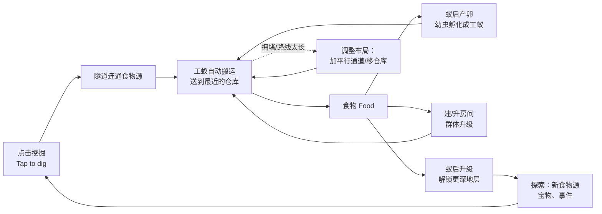

# 《一厘米蚂蚁王国》MVP 产品需求文档（PRD）

> 英文工作名（玩家可见）：**Crumb Kingdom**　｜　App Store 名称草案：**Crumb Kingdom: Ant Colony**
> 版本 v0.1（评审稿）　｜　日期 2026-10-11　｜　状态：待评审　｜　适用范围：iPhone 首版 MVP

---

## 0. 文档说明

### 0.1 阅读约定

| 标记 | 含义 | 处理方式 |
|---|---|---|
| 【事实】 | 有公开来源可查的信息，附来源与检索日期 | 引用前复核来源是否更新 |
| 【假设】 | 规划前提，尚未验证 | 集中列在 0.2，评审时逐条确认或修改 |
| 【决定】 | 本文做出的设计决定 | 评审可推翻，推翻时同步修改所有引用处 |
| 【待验证】 | 需要用测试数据证明的判断 | 在第 11 章有对应埋点与判断标准 |

- 本文所有数字都是**初始设计值**，统一由仓库内 `tools/economy_sim.py` 复算（第 6 章说明用法）。改数值时先改脚本常量，再回填本文表格。
- 玩家可见文案一律为英文，正文中以 `String ID` 引用，完整文案见**附录 A**。正文里的中文解释不进入游戏界面。
- 坐标写法：地图格子用 `(列, 行)` 表示，列 0–8 从左到右，行 0 为地面、1–36 为地下，从上到下。

### 0.2 集中假设清单

| 编号 | 假设 | 影响范围 | 何时确认 |
|---|---|---|---|
| A01 | 团队为 1 名程序、1 名 2D 美术、1 名兼任产品与数值的策划；音效外包 | 排期、范围 | 立项会 |
| A02 | 程序熟悉一款 2D 引擎（Unity 或 SpriteKit 二选一），引擎尚未确定；本文不依赖具体引擎 | 技术方案、广告 SDK 接入成本 | 第 1 周 |
| A03 | 平台仅 iPhone，最低 iOS 16（待程序确认 SDK 要求）；iPad 不做专门适配 | 性能目标、测试机型 | 第 1 周 |
| A04 | 玩家可见文本只有英文，不做其他语言 | 文案、首测地区 | 已定 |
| A05 | 首版为单机 + 离线收益，无账号、无游戏服务器；数据分析与远程配置使用第三方 SDK | 存档、作弊、成本 | 第 2 周 |
| A06 | 典型玩家每天打开 3–5 次，每次 2–5 分钟；数值模拟按每次 4 分钟计算 | 全部节奏数值 | 测试数据回填 |
| A07 | 人民币价格只是商业化测试假设，最终以 App Store Connect 可选价格点为准 | 商业化 | 上架前 |
| A08 | 首测（soft launch）只在英语地区进行（推荐见 1.2） | 文案、买量、数据 | 第 12 周 |
| A09 | 广告使用一家主流聚合 SDK，仅激励视频，无插屏、无横幅 | 商业化、隐私 | 第 10 周 |
| A10 | 不进入 App Store Kids 分类；年龄分级以分级问卷结果为准（预计 4+ 或 9+） | 广告合规、目标用户 | 上架前 |
| A11 | 竞品分析只基于官方商店页描述，团队尚未试玩；试玩拆解列为第 1–2 周任务 | 1.6 节结论 | 第 2 周 |
| A12 | 首张地图为手工设计的固定地图，不做程序生成 | 关卡、工作量 | 已定 |
| A13 | 美术采用 2D 序列帧（或骨骼动画，由美术决定），统一 2D 剖面视角 | 内容量 | 第 2 周 |
| A14 | MVP 内容量覆盖活跃玩家约 8 天、轻度玩家约 13 天（见 6.4）；30 天留存依赖 P1 内容 | 留存目标 | 首测后 |

### 0.3 术语表（中文功能名 ↔ 游戏内英文名）

| 中文功能名 | 游戏内英文名 | 说明 |
|---|---|---|
| 食物 | Food | 唯一可花费的货币 |
| 蚁后 / 蚁后等级 | Queen / Queen Level | 主进度，Lv1–10 |
| 皇家成长 | Royal Growth | 蚁后升级时的计时过程 |
| 工蚁 | ant / ants | 所有成年蚂蚁，按岗位分工 |
| 卵 / 幼虫 | egg / larva, larvae | 卵为表现，逻辑上只有“幼虫” |
| 搬运工 / 保育工 / 建造工 / 挖掘工 / 休息 | Haulers / Nurses / Builders / Diggers / Resting | 岗位 |
| 蚁后室 | Queen's Chamber | 初始房间，3×2 |
| 仓库 | Pantry | 储存食物，送货终点 |
| 育婴室 | Nursery | 提供幼虫位（cribs） |
| 宿舍 | Den | 提供人口上限（beds） |
| 建造队 | Build Crew | 同时进行的建造/升级数量 |
| 搬运力 / 步速 / 挖掘力 | Carry / Speed / Dig Power | 三项群体升级 |
| 表土 / 黏土 / 砾石 / 深土 | Topsoil / Clay / Gravel / Deep Soil | 四个地层 |
| 地面觅食 | Surface | 洞口外的无限食物源 |
| 树液根 | Sap Root | 地下无限食物源 |
| 天降美食 | Falling Treat / Giant Treat | 事件生成的大块食物 |
| 宝物 / 图鉴 | Treasure / Journal | 8 件可收集物 |
| 金色碎屑 | Golden Crumb | 点击奖励 |
| 交通拥堵 | Traffic Jam | 隧道负载超过容量 |
| 目标 | Goals | 当前 3 个短期目标 |
| 标记挖掘 | Mark to Dig | 让挖掘工自动挖 |
| 优先 | Priority | 食物源优先分配搬运工 |
| 暂停孵化 | Pause Hatching | 让蚁后停止消耗食物产卵 |
| 翻倍 / 加速 / 蚁群狂奔 | Double It / Rush / Ant Frenzy | 三个激励广告位 |
| 免看视频领奖励 | Instant Rewards | 广告替代商品 |
| 生态瓶外观 / 巢穴主题 | Jars / Nest Themes | 外观商品 |

---

## 1. 产品定义与立项判断

### 1.1 一句话定位

**一个竖屏、单手玩的“地下蚂蚁观察箱”：从一个小洞开始亲手挖隧道，看蚁群因为你挖的路线变得更忙、更快、更大。**

商店副标题（`store.subtitle`）：*Dig tunnels. Grow a colony.*

### 1.2 目标用户与首测地区

| 层级 | 人群描述 | 他们为什么会玩 | 判断依据 |
|---|---|---|---|
| 核心用户 | 18–44 岁、习惯在 iPhone 上玩放置/经营/治愈类游戏的成年人，碎片时间多、单次 2–5 分钟 | 低压力的掌控感、可观赏、离线也有进展 | 【假设】需首测验证 |
| 次级用户 | 喜欢蚂蚁工坊、生态瓶、微观自然的人（含养蚁爱好者） | “蚂蚁真的在搬我挖出来的路”这一幻想 | 【假设】人群小但口碑价值高 |
| 非目标 | 追求 PvP、联盟战、重度策略的玩家；13 岁以下儿童 | 我们不提供竞争内容；不做儿童分类 | 【决定】 |

**首测地区推荐：加拿大、澳大利亚、新西兰（英文商店）**，先做 TestFlight 封闭测试，再做 4–6 周软发布。理由：

1. 玩家可见文本只有英文（A04），英语母语地区的文案理解成本最低，留存数据不会被语言问题污染。
2. 这三个地区的玩家习惯通常被视为接近美国，适合在进入美国前校准留存与付费；具体买量单价、iOS 占比需要团队向买量渠道询价后确认【待验证】，本文不引用未核实的市场数据。
3. 规模可控，测试预算和舆情风险小于直接上美国。
4. 不建议首测选中国大陆：【事实】在中国大陆 App Store 上架含内购的游戏需要取得游戏版号（自 2020 年起 Apple 要求提供审批号，上架前请法务复核现行要求），且本作首版无中文界面。
5. 封闭测试招募可优先找养蚁、生态瓶相关的英文社区，作为次级用户的早期反馈来源（需遵守各社区规则）。

### 1.3 核心需求

| 需求 | 本作如何满足 | 对应章节 |
|---|---|---|
| “这是我亲手做出来的” | 除起始的 2 格隧道和蚁后室外，所有隧道、房间位置都由玩家决定 | 4.1、4.4 |
| 看得懂自己的操作带来的变化 | 每次挖通、放仓库、加通道，5 秒内在路线卡和地图上显示单程时间、每分钟产量、拥堵标记的变化 | 4.5、7.4 |
| 看着蚁群忙碌很解压 | 默认画面永远有蚂蚁在动；可缩放观察 | 9.2 |
| 碎片时间能完成一件事 | 每次 2–5 分钟内至少能完成一个建造、一条新路线或一个目标 | 2.3 |
| 不在时也有进展 | 离线搬运与孵化，回来时结算 | 4.12 |

### 1.4 产品支柱

| 支柱 | 具体规则（用于评审时判断一个功能该不该做） |
|---|---|
| **P1 亲手挖出的世界** | 地图上可通行的空间只能由玩家挖出（或事件揭示）；系统不自动铺路。 |
| **P2 看得懂的效率** | 任何改变路线的操作，必须在 5 秒内给出可见反馈：蚂蚁改道动画 + 路线卡数字变化 + 拥堵格颜色变化。 |
| **P3 忙碌可观赏** | 只要有食物源连通，画面里就有蚂蚁在搬运；房间入住、幼虫蠕动、挖掘碎土都有动画。 |
| **P4 短而完整** | 一次 4 分钟的游玩至少有 1 个可完成的有意义操作；所有计时在离开期间继续推进。 |

### 1.5 主要卖点（商店与买量素材方向）

1. **你挖哪里，它们就去哪里**：挖通一条隧道，几十只蚂蚁立刻排队搬运巨大饼干。
2. **路线真的有用**：仓库放近一点、多挖一条平行通道，蚂蚁就跑得更快、不再堵车。
3. **一路挖到地底**：四个地层、8 件埋藏宝物、巨型零食从天而降。
4. **短时间也能玩**：一次几分钟，离开后蚂蚁继续干活。
5. **没有弹出广告**：只有玩家主动选择观看的激励视频（`store.desc.4`）。

### 1.6 竞品研究（检索日期：2026-10-11）

> 以下“官方描述”全部来自各产品 App Store 美区页面的开发者文字【事实】；“推断的核心循环”是根据官方描述的推断，团队尚未试玩【待验证】。按 A11，第 1–2 周需完成每款至少 2 小时的试玩拆解，并更新本表。评分人数等数字只用于说明信息来源，不作为市场判断依据。

| 产品（开发商） | 官方商店页可见的商业模式 | 官方描述中的玩法要点 | 推断的真实核心循环 |
|---|---|---|---|
| **Idle Ant Colony – Sim Game**（Bling Bling Games GmbH）[S1] | 免费 + 内购（$0.99–$49.99 的礼包、30 天 Nuggets 配送）；页面写明含“非强制”广告 | 建蚁丘、照顾蚁后；升级王座室孵化更多蚂蚁、升级巢室容纳更多蚂蚁；**创建并改进蚁路运输资源，管理仓储与生产线**；研究科技与配方；征服新大陆开新殖民地；收集经理蚁；离线产出蚂蚁与研究点 | 放置经营：升级节点 → 产出↑ → 解锁新区域/新殖民地（类似“重置换地图”）；蚁路与仓储是升级项而非自由布局（需试玩确认） |
| **Pocket Ants: Colony Simulator**（Ariel Games / Ariel Villafane）[S2] | 免费 + 宝石内购（$0.99–$99.00） | 采集资源带回巢穴；升级巢室获得加成；喂蚁后、繁殖工蚁与兵蚁；击败并捕获其他生物加入军队；**掠夺其他玩家的蚁巢**；防守资源；每日挑战红蚁巢；**部落（clan）与部落战** | 采集 → 繁殖 → 战斗/掠夺 → 升级巢室；有明显的 PvP 与社交层（描述未提到自由挖掘，需试玩确认） |
| **The Ants: Underground Kingdom**（ChengDu Starunion / StarUnion）[S3] | 免费 + 内购（$0.99–$99.99 礼包）+ **$4.99 周订阅**；页面标注含随机物品（loot boxes） | 建蚁丘、保护蚁后；**蚁穴之间以蚁道连接**；孵卵获得特殊蚂蚁组成战斗力；驯服野生生物参战；**联盟、协同作战、争夺资源点** | 典型 SLG：资源 → 建筑升级 → 养成兵种/英雄 → 联盟 PvP；蚂蚁是题材包装 |
| **Little Ant Colony – Idle Game**（Gismart）[S4] | 免费 + 内购（宝石、加速、离线收益包、皮肤）+ $6.99 月订阅；有“去插屏”商品 | 从一只蚂蚁开始，收集食物、扩大蚁群，蚂蚁越多收入越多 | 放置吃食物：蚂蚁数量/速度/力量升级 → 收入↑ |
| **Idle Ants – Simulator Game**（MADBOX）[S5] | 免费 + 内购（$9.99 去广告、宝石、蚂蚁皮肤）；页面写明含广告 | 指挥蚁群吞噬虫子、热狗甚至飞机；赚钱升级蚂蚁速度与力量；开蛋解锁战斗蚂蚁、保卫巢穴 | 超休闲放置：看蚂蚁把大物体吃光 → 三项升级 → 下一个物体 |

**真实核心循环对比（按时间尺度）**

| 时间尺度 | Idle Ant Colony | Pocket Ants | The Ants | Little Ant Colony / Idle Ants | 本作（Crumb Kingdom） |
|---|---|---|---|---|---|
| 秒级操作 | 点击升级按钮（推断） | 指挥采集/战斗（推断） | 点按建筑、收资源（推断） | 点按升级（推断） | **点击土块挖掘**；点金色碎屑 |
| 分钟级 | 节点升级、蚁路改进 | 采集、孵化、打怪 | 建造队列、行军 | 吃完一个物体 | **挖新路线连到食物、放仓库、处理拥堵** |
| 日级 | 研究、换大陆 | 每日挑战、掠夺 | 联盟活动、PvP | 解锁新场景 | 蚁后升级章节、进入新地层、找宝物 |
| 社交/竞争 | 无（推断） | 有：掠夺、部落战 | 有：联盟、争夺 | 无 | **无（MVP 不做）** |
| 布局是否由玩家自由决定 | 待试玩确认 | 待试玩确认 | 建筑位置有一定自由（推断） | 否 | **是：隧道拓扑与仓库位置完全由玩家决定** |

### 1.7 已有机制与待验证差异

| 机制 | 竞品中是否已有 | 本作定位 |
|---|---|---|
| 蚂蚁搬运食物回巢、喂蚁后、孵化工蚁 | 已有（S1–S5 均有类似描述） | 基础机制，不作为卖点 |
| 蚁路/运输线 + 仓储管理 | **已有**：Idle Ant Colony 官方描述明确包含“蚁路运输资源、管理仓储与生产线” [S1] | 不能宣称“首创运输系统”；差异只能建立在“自由挖出的拓扑”上 |
| 离线收益 | 已有（S1、S4） | 基础机制 |
| 看大量蚂蚁吃掉巨大物体的观赏性 | 已有（S5 的核心卖点） | 借用已被验证的观赏点：巨大饼干 |
| 蚁穴之间用蚁道连接 | 已有（S3） | — |
| **玩家逐格挖出的剖面隧道网络，路线长度和拥堵完全由玩家挖出的形状决定，并以单程时间和拥堵格实时显示** | 公开描述中未见【待验证】 | **核心差异假设 H1**：玩家能看懂并主动优化 |
| **仓库位置作为空间决策（送货到最近的仓库）** | 公开描述中未见【待验证】 | 差异假设 H1 的一部分 |
| 无 PvP、无联盟、短时单机、无软货币以外的付费货币 | Little Ant Colony/Idle Ants 也无 PvP；但均有宝石货币 | 定位差异：“观察箱”而非“战争” |

### 1.8 主要风险

| 编号 | 风险 | 后果 | 预防措施 |
|---|---|---|---|
| R1 | 布局差异太小，玩家感觉不到“挖哪里有用” | 核心差异失效，退化成普通放置 | 路线卡强制显示单程时间与前后对比；教程第 7–8 分钟做一次拥堵→疏通；埋点 `route_connected`、`jam_cleared` 验证（第 11 章） |
| R2 | 后期只剩数值增长 | 中期流失 | 蚁后章节绑定地层、宝物、房间解锁（2.7）；单张地图有明确终点 Heart Geode |
| R3 | 大量蚂蚁的渲染与路线计算拖垮性能 | 掉帧、发热 | 逻辑按路线聚合，视觉限量（4.5、9.3、10.6） |
| R4 | MVP 内容只够 8–13 天 | 30 天留存偏低 | 首测只以 D1/D7 为主要判断指标；P1 准备第二张地图 |
| R5 | 无消耗品、无付费货币，收入偏低 | 商业化不达预期 | MVP 先验证外观与便利型非消耗品意愿；消耗品放在 P1 做对照实验 |
| R6 | 1 名程序工期过紧 | 延期 | 12.3 给出可砍清单；第 2、6 周设立项闸门 |
| R7 | 题材同质、名字冲突 | 商店检索被淹没、商标风险 | “Crumb Kingdom”为工作名，上架前完成商标与商店重名检索（未决事项 O1） |

### 1.9 立项判断

**结论：有条件立项。** 先用 2 周灰盒原型验证核心差异，再决定是否投入完整美术与商业化开发。

| 闸门 | 时间 | 通过条件（全部为实验假设，非行业基准） | 不通过时 |
|---|---|---|---|
| G1 灰盒原型 | 第 2 周末 | 8 名外部测试者中 ≥6 人能在不提示的情况下说出“为什么这条路线变快/变慢了”；≥5 人在教程后主动再挖一条路线 | 调整可视化与拥堵规则，最多再给 2 周；仍不通过则放弃“布局差异”定位，改做纯放置或停止 |
| G2 垂直切片 | 第 6 周末 | 10 名测试者完成前 10 分钟的比例 ≥80%；平均主动挖出 ≥2 条非教程路线 | 删减系统、简化教程后再测一次 |
| G3 软发布 | 第 16 周后 4–6 周 | 见 11.5 判断标准 | 迭代或停止 |

---

## 2. 核心循环与成长结构

### 2.1 循环总览



### 2.2 10 秒循环：一次挖掘

| 步骤 | 玩家做什么 | 系统给什么 | 时长 |
|---|---|---|---|
| 1 | 点一块与隧道相邻的土 | 裂纹 + 碎土 + 轻震动 | 每下 ≤50 ms 响应 |
| 2 | 再点 2–4 下 | 裂纹加深，第 3 阶段后碎裂，“pop”音 + 中震动 | 1–2 秒 |
| 3 | 土块变成隧道 | 附近蚂蚁转头；若连通了食物源，搬运工 ≤1 秒内开始改道 | 即时 |
| 4 | （可选）点食物源 | 弹出路线卡：单程时间、蚂蚁数、每分钟产量 | — |

挖掘始终是最快的推进方式：手动 5 下/秒 × 挖掘力，挖掘工每只只有 0.5 × 挖掘力/秒（4.1）。即使解锁自动挖掘，手动点击仍快 10 倍，这是“自动化后仍有价值的短时操作”的主要来源。

### 2.3 3 分钟循环：一次打开游戏

| 阶段 | 典型行为 | 设计目的 |
|---|---|---|
| 0:00–0:20 | 离线结算面板 While You Were Away：领取食物，可选看视频翻倍 | 回报感；告诉玩家仓库是否满了 |
| 0:20–1:00 | 花掉食物：群体升级、建/升房间、开始皇家成长 | 把离线收益转化为可见变化 |
| 1:00–2:30 | 挖向下一个目标：新食物源、天降美食、宝物或下一层 | 核心操作，验证 H1 |
| 2:30–3:30 | 处理拥堵/事件，点金色碎屑，设置挖掘标记 | 短时有价值的操作 |
| 离开前 | 排上下一个建造或皇家成长 | 给下次回来一个理由 |

### 2.4 1 天循环

- 3–5 次打开，每次 2–5 分钟。
- 计时器跨越两次游玩之间：房间建造/升级（最长 6 小时）、皇家成长（最长 16 小时）。
- 离线搬运：按当前蚁后等级的离线上限（2–4 小时）以 25% 效率结算（4.12）。
- 天降美食每 30 分钟（真实时间）生成一个，离线期间最多保留 1 个待领取。
- 激励广告次数每天本地时间 0 点重置。
- 本地通知（玩家授权后）每天最多 2 条，21:00–09:00 不发送（7.7）。

### 2.5 30 天循环

| 时间 | MVP 中玩家在做什么 | 需要的后续内容 |
|---|---|---|
| D1 | 教程 → 蚁后 Lv4，挖到黏土层 | — |
| D2–D4 | Lv5–Lv8：砾石层、深土层，前 3–5 件宝物 | — |
| D5–D13 | Lv9–Lv10，找到 Heart Geode，首张地图完成（活跃玩家约 D8，轻度约 D13，见 6.4） | — |
| 完成后 | 补齐图鉴、收集天降美食、更换外观、优化布局冲更高产量 | **P1**：第二张地图（New Colony）、每周访客事件、季节外观 |
| D14–D30 | MVP 本身不足以支撑 | 【决定】首测不把 D30 作为成败指标；P1 内容按首测结果排期 |

### 2.6 点击、自动生产、扩建、探索如何衔接

| 从 | 到 | 衔接规则 |
|---|---|---|
| 点击挖掘 | 自动生产 | 隧道一旦连到食物源，系统在下一个交通刷新（≤1 秒）自动分配搬运工；玩家不需要“派遣” |
| 自动生产 | 扩建 | 食物达到房间/升级价格时，对应按钮出现角标；人口满、仓库满时 HUD 变黄并给出一句话原因 |
| 扩建 | 自动生产 | 仓库建在食物源旁边 → 送货距离变短 → 产量上升，路线卡显示前后对比 |
| 扩建 | 探索 | 蚁后升级解锁更深地层（黏土 Lv2、砾石 Lv5、深土 Lv7） |
| 探索 | 点击 | 新地层的土更硬，需要升级挖掘力；新食物源、宝物、天降美食都需要亲手挖过去 |
| 探索 | 自动生产 | 无限食物源（树液根）越深，可容纳的搬运工越多（8 → 12 → 20 → 36） |

### 2.7 目标层级（避免只剩数值膨胀）

| 层级 | 时长 | 例子 | 非数值回报 |
|---|---|---|---|
| 短期 | 一次游玩内 | 挖到糖块；建好一个宿舍；清掉一次拥堵；完成 1 个 Goal | 新路线动画、房间入住动画、拥堵消失 |
| 中期 | 1–3 天 | 一次蚁后升级章节；进入下一地层；找到 1 件宝物 | 新地层美术、新房间等级外观、宝物进图鉴 |
| 长期 | 1–2 周 | 找到 8 件宝物；挖到第 36 行的 Heart Geode；蚁后 Lv10 | 水晶王座外观、“王国完成”演出、图鉴全满 |
| 长期（P1） | 2–4 周 | 第二张地图、季节外观 | 新场景 |

### 2.8 成长结构：蚁后章节

| 章节 | 进入条件（摘要，完整见 6.3） | 本章新内容 | 本章主要目标 |
|---|---|---|---|
| Lv1 | 开局 | 表土、仓库/育婴室/宿舍各 1 | 教程 |
| Lv2 | 10 只蚂蚁 + 三种房间 + 200 Food | 黏土层、第 2 宿舍、房间与群体升级 Lv2、Goals、天降美食 | 挖到黏土层 |
| Lv3 | 18 只 + 到达黏土层 + 720 Food | 挖掘工与标记挖掘、第 2 个仓库 | 建第 2 个仓库 |
| Lv4 | 30 只 + 2 个仓库 + 2,600 Food | 第 2 建造队、第 3 宿舍、第 2 育婴室、房间 Lv3、渗水事件 | 连通 3 个树液根 |
| Lv5 | 45 只 + 3 个树液根 + 9,300 Food | 砾石层、第 3 仓库 | 到达砾石层 |
| Lv6 | 60 只 + 到达砾石层 + 34,000 Food | 树根可挖（需挖掘力 Lv6）、房间 Lv4、第 4 宿舍 | 找到 3 件宝物 |
| Lv7 | 80 只 + 3 件宝物 + 120,000 Food | 深土层、第 4 仓库、第 3 育婴室 | 到达深土层 |
| Lv8 | 100 只 + 到达深土层 + 440,000 Food | 房间 Lv5、第 5 宿舍 | 找到 6 件宝物 |
| Lv9 | 125 只 + 6 件宝物 + 1,600,000 Food | 第 5 仓库 | 找到 Heart Geode |
| Lv10 | 150 只 + Heart Geode + 5,600,000 Food | 第 6 宿舍、群体升级 Lv10、王国完成 | 补齐图鉴、外观 |

---

## 3. 前 10 分钟完整体验

### 3.1 开局状态

- 食物 0，工蚁 5 只，蚁后 Lv1。蚁后室位于 (3–5, 3–4)，自带 100 食物储量、2 个幼虫位、10 人口。
- 洞口在地面 (4, 0)，预挖隧道 (4, 1)、(4, 2) 连到蚁后室顶部。
- 巨大饼干 Giant Cookie（600 Food）位于 (0–1, 6–7)，离蚁后室 3 格土。
- 只有表土层可挖；黏土层显示锁定线。
- 教程期间不弹广告入口、不弹商店、不触发渗水事件。

### 3.2 时间线

| 时间 | 画面状态 | 玩家操作 | 反馈 | 奖励 | 系统解锁 | 引导文案（String ID） |
|---|---|---|---|---|---|---|
| 0:00–0:15 | 地面草叶与阳光；有翅蚁后降落、脱翅、钻进小洞；镜头下移到剖面，看见蚁后和 5 只工蚁 | 观看；3 秒后可点击跳过 | 环境音，音乐淡入 | — | — | `intro.caption`、`intro.skip` |
| 0:15–0:45 | 饼干方向的土块上飘出“香味线”；手指图标指向 (2, 4) | 点 (2, 4)、(2, 5)、(2, 6)，每格 3 下，共约 9 下 | 每下：裂纹 1→3 阶段 + 碎土粒子 + 轻震；碎裂：pop 音 + 中震；被挖开的格子 0.15 秒碎裂动画 | — | 挖掘 | `tut.dig_first` → 第 1 格挖开后 `tut.dig_more` |
| 0:45–1:15 | (2, 6) 打通，饼干完整显露，镜头轻推 | 无需操作；可点饼干看路线卡 | 5 只工蚁 ≤1 秒内转向并排队，咬下碎屑送回蚁后室；HUD 出现 “+2” 飞字；单程 6 秒 | 约 100 Food/分钟 | 搬运、路线卡 | `tut.cookie_found` |
| 1:00–2:10 | 食物 ≥12 时蚁后产下 2 枚卵，变成幼虫在蚁后室蠕动 | 可点幼虫看剩余时间（约 56 秒） | 孵化时 “+1” 气泡，新蚂蚁自动加入搬运 | +2 只蚂蚁 | 产卵、孵化 | `tut.eggs` → `tut.hatched` |
| 2:30–3:30 | 食物接近蚁后室上限 100，食物数字变黄；Build 按钮脉冲 | Build → Pantry（50 Food）→ 按高亮挖 (1, 4)、(1, 5) → 点绿色位置 → Build Here | 建造 10 秒，2 只建造工动画；完成后所有搬运工改送仓库，路线卡显示 `Trip: 4s (was 6s)` | 储量上限 1,100；产量约 +50% | 建造、Build Crew ×1、房间放置 | `tut.pantry_need` → `tut.pantry_space` → `tut.pantry_place` → `tut.pantry_done` |
| 3:30–4:30 | 幼虫位满；Nursery 解锁提示 | Build → Nursery（40 Food）；**玩家自选位置**：先挖出任意 2×2 空间再放置（第一次自主布局） | 合法位置绿色、不合法红色；空间不够时提示 | +3 幼虫位 | Nursery | `tut.nursery`，必要时 `build.need_space` |
| 4:30–5:30 | 蚂蚁 10/10，人口数字变黄，蚁后停止产卵 | Build → Den（30 Food），自选位置 | 宿舍建成后，蚂蚁一只只进去躺下（Zzz） | 人口上限 20 | Den | `tut.den` |
| 5:30–7:00 | 饼干剩不到 15%，饼干卡显示剩余量；右上糖块 Sugar Cube (7, 2) 和右侧树液根 Sap Root (8, 6) 同时飘香味线 | **自由选择**挖向其中一个或两个 | 打通后新路线 ≤1 秒生效；路线卡显示单程时间、每分钟产量；树液根标注 Never runs out | 糖块 150 Food；树液根无限 | 第二食物源、Priority 开关 | `tut.food_low` → `tut.choice` |
| 7:00–8:30 | 首次天降美食（教程固定：300 Food、上限 12 只，生成在仓库附近，最短路经过仓库前一个单格通道）；该格负载 >4，变橙色并出现 “!” | 挖到美食；看到拥堵后按提示在旁边挖一条平行通道 | 拥堵格橙色、蚂蚁减速挤在一起、飘字 Traffic Jam!；平行通道打通后 ≤2 秒内约 25% 的蚂蚁改走新路，橙色消失 | 300 Food | 拥堵显示、自动改道 | `tut.treat` → `tut.jam` → `tut.jam_cleared` |
| 8:30–9:15 | 蚁后卡上 3 项条件全部打勾：10 只蚂蚁、三种房间、200 Food | 点蚁后 → Start Royal Growth（Lv1→2 无需等待） | 2 秒升级演出 + 解锁清单 | 蚁后 Lv2 | 黏土层、第 2 宿舍、群体升级 Lv2、Goals | `tut.queen_ready` → `queen.levelup` |
| 9:15–10:00 | 第一个金色碎屑出现在某只搬运工身上；Goals 面板首次弹出 3 个目标 | 点金色碎屑；可选把仓库升到 Lv2（300 Food） | 金色碎屑：飞字 +20 秒产量的食物 | 金色碎屑奖励 | Golden Crumb、群体升级面板 | `tut.golden` → `tut.pantry_upgrade` → `tut.away` |

**10 分钟结束时的预期状态**（与 6.4 模拟一致）：蚁后 Lv2、蚂蚁 15–20 只、仓库 1 个（Lv1 或 Lv2）、育婴室 1 个、宿舍 1–2 个、已连通 2–4 个食物源、总产量约 400 Food/分钟。

### 3.3 教程步骤与存档点

| 步骤 ID | 完成条件 | 中断后恢复到 |
|---|---|---|
| T01 开场 | 动画播完或跳过 | T02 开头 |
| T02 第一条隧道 | (2, 6) 打通 | T02（已挖的格子保留） |
| T03 首次搬运 | 第一次送达 | T03（自动完成） |
| T04 首批幼虫 | 2 只孵化 | T04（计时按真实时间继续） |
| T05 仓库 | 仓库建成 | T05 当前子步骤（挖格/放置/等待） |
| T06 育婴室 | 育婴室建成 | T06 |
| T07 宿舍 | 宿舍建成 | T07 |
| T08 第二食物源 | 连通任一新食物源 | T08 |
| T09 拥堵 | 拥堵格恢复为正常 | T09；若已离开超过 30 分钟，天降美食已被搬完则跳过本步 |
| T10 蚁后 Lv2 | 升级完成 | T10 |
| T11 金色碎屑 | 点中或 30 秒内未点（自动跳过） | T11 |
| T12 收尾 | 关闭离线说明 | 教程结束，进入自由游玩 |

### 3.4 卡住、误触与离开

| 情况 | 判定 | 处理 |
|---|---|---|
| 不操作 | 强制步骤中 8 秒无输入 | 手指图标重新出现并脉冲，引导文案再显示一次 |
| 长时间不操作 | 20 秒无输入 | 镜头自动回到目标位置 |
| 点了不相邻的土 | 连续 2 次 | Toast `err.dig_adjacent` |
| 点了岩石 | 1 次 | 岩石轻晃 + Toast `err.rock` |
| 中途关掉 Build 面板 | 当前步骤需要建造 | Build 按钮重新脉冲，步骤不前进 |
| 把仓库放在远处 | 放置合法 | 允许；建成后路线卡照常显示前后单程时间，玩家自己会看到差别 |
| 食物不够 | 教程要求花费但食物不足 | 不弹建造提示，显示 `tut.waiting_food`，等食物够了再提示（饼干 + 地面觅食保证一定会够） |
| 挖了教程以外的格子 | 任意 | 允许，挖掘没有成本；手指图标继续指向教程目标 |
| 离开游戏 | 切到后台或被杀进程 | 每个步骤完成即存档；回来后从该步骤开头恢复；离开 ≥10 分钟时显示 `tut.welcome_back`，教程期间不显示完整离线面板，离线收益直接入账 |
| 开场动画中被杀进程 | — | 下次启动开场动画可立即跳过 |
| 误点商店/设置 | 教程期间 | 商店入口在 T10 前隐藏；设置可开，关闭后回到原步骤 |

---

## 4. 功能规格

> 每项按“用途 / 入口 / 前置条件 / 输入 / 处理规则 / 输出 / 限制 / 异常 / 验收标准”定义。所有数值引用第 6 章表格，改数值不改规则。

### 4.1 挖掘（Dig）

| 项 | 规格 |
|---|---|
| 用途 | 玩家开辟通道、连通食物源与宝物；游戏最核心的手动操作 |
| 入口 | 主界面地图上直接点击；Lv3 起底部左侧出现 Mark 开关（`dig.mark`） |
| 前置条件 | 目标是“前沿土块”：未挖的土类地块（表土/黏土/砾石/深土/宝物/空腔/水囊/树根），且与任一可通行格上下左右相邻；所在地层已解锁 |
| 输入 | 单击；按住（≥0.4 秒）进入连点；Mark 开关打开时单击为标记/取消标记 |
| 处理规则 | ① 每次点击造成伤害 = 挖掘力（6.3.1）。② 地块生命值见 4.2；伤害累计 ≥ 生命值时碎裂，变成隧道。③ 裂纹按剩余生命值显示 3 个阶段（>66%、33–66%、<33%）。④ 手动点击最多计 8 下/秒，超出部分忽略；按住连点固定 5 下/秒。⑤ 未完成的伤害保留 30 秒，30 秒内没再点则清零（防止“攒伤害”歧义）。⑥ 碎裂后立即触发连通性重算（4.3）。⑦ 碎裂宝物格时发放宝物；碎裂空腔格时整片空腔一起打开并触发空腔事件；碎裂水囊格时触发漏水。 |
| 自动挖掘（Lv3+） | Mark 开关打开后，点击任意已解锁地层中的未挖土块进行标记，最多 12 格，按标记顺序排队。挖掘工只挖“已标记且是前沿”的格子；每只挖掘工每秒造成 0.5 × 挖掘力 的伤害（Fossil Shell 后 ×1.5），每格最多 2 只同时挖。手动点击已标记格子同样有效，并会叠加伤害。 |
| 输出 | 地块变为隧道；裂纹/碎土/音效/震动反馈；可能连通食物源、发现宝物、触发事件；`dig_tile` 埋点 |
| 限制 | 岩石不可挖；树根需要挖掘力 ≥7（即 Dig Power Lv6）；未解锁地层不可挖（黏土需蚁后 Lv2、砾石 Lv5、深土 Lv7）；不能挖地面行（第 0 行）；挖掘不消耗食物 |
| 异常 | 点到非前沿土：土块轻晃，连续 2 次弹 `err.dig_adjacent`；点岩石：`err.rock`；点树根且挖掘力不足：`err.root`；点锁定地层：`err.layer_locked`；标记已满 12 格：`dig.marked` 数字变红并轻晃 |
| 验收标准 | ① 挖掘力 1 时，表土格恰好在第 3 下碎裂；挖掘力 2 时黏土格在第 4 下碎裂。② 点击到出现裂纹反馈 ≤50 ms（60 fps 下 ≤3 帧）。③ 碎裂连通食物源后 ≤1 秒内至少 1 只搬运工开始转向。④ 每秒点 12 下，日志中最多 8 次生效。⑤ 关闭 Haptics 后无任何震动。 |

### 4.2 地块（Tiles）

| 地块 | 字符 | 可通行 | 可挖 | 生命值 | 显示 | 特殊规则 |
|---|---|---|---|---|---|---|
| 地面 | `~` | 仅洞口 (4, 0) | 否 | — | 草地、天空 | 洞口是地面觅食的出入点 |
| 预挖隧道 | `.` | 是 | — | — | 隧道底色 | 开局 2 格 |
| 表土 | `#` | 挖后 | 是 | 3 | 浅褐色 | 行 1–9 |
| 黏土 | `=` | 挖后 | 是（蚁后 Lv2） | 8 | 红褐色 | 行 10–18 |
| 砾石 | `%` | 挖后 | 是（蚁后 Lv5） | 20 | 灰褐带石子 | 行 19–27 |
| 深土 | `&` | 挖后 | 是（蚁后 Lv7） | 45 | 深紫褐 | 行 28–36 |
| 岩石 | `X` | 否 | 否 | — | 灰色石块，始终可见 | 永久障碍 |
| 树根 | `r` | 挖后 | 挖掘力 ≥7 | 80 | 粗根，始终可见 | 用来制造绕路选择 |
| 宝物 | `T`/`G` | 挖后 | 是 | 同所在地层 | 距可通行格 ≤2 格时闪光 | 碎裂即获得宝物 |
| 空腔 | `O` | 打开后 | 是 | 1 | 外观同所在地层；相邻格被挖开后出现“空心裂纹” | 打开任一格即整片打开 |
| 水囊 | `W` | 挖后 | 是 | 同所在地层 | 距可通行格 ≤2 格时显示湿润纹理 | 挖开时漏水（5.4） |
| 食物源 | 见 5.2 | 否 | 否（由搬运消耗） | — | 距可通行格 ≤4 格（曼哈顿距离）显示轮廓与香味线 | 耗尽后占用的格子变成隧道 |
| 树液根 | `R` | 否 | 否 | — | 同食物源 | 无限食物 |
| 房间 | 占地 | 是 | — | — | 房间美术 | 只能建在已挖开的 2×2 上 |

验收：首张地图载入后，各字符数量与 5.1 图例统计一致（表土 59、黏土 60、砾石 61、深土 58、岩石 14、树根 5、宝物格 6 + Heart Geode 1（另 1 件 Tin Soldier 在黏土空腔内）、空腔 10 格、水囊 3、树液根 8）。

### 4.3 连通性（Connectivity）

| 项 | 规格 |
|---|---|
| 用途 | 决定哪些食物源可被搬运、蚂蚁走哪条路 |
| 入口 | 无（系统内部）；结果通过路线卡与地图显示 |
| 前置条件 | 地图已载入 |
| 输入 | 可通行格集合 W（隧道、房间占地、洞口）；储存格集合 S（所有仓库占地 + 蚁后室占地）；被水淹的格子临时移出 W |
| 处理规则 | ① 以 S 为多源做广度优先搜索，得到每个可通行格到最近储存格的步数 D。② 食物源的“取货格” = 与其占地上下左右相邻的可通行格；存在取货格即为“已连通”。③ 路线长度 L = 取货格中最小的 D，若取货格本身是储存格则 L = 1。④ 地面觅食的取货格固定为洞口 (4, 0)。⑤ 触发重算：挖开地块、房间建成/移动、食物源耗尽、积水开始/结束。地图最多 333 格（9×36 + 地面），一次重算为 O(格数)。 |
| 输出 | 每个食物源的连通状态、L、主路径（4.5） |
| 限制 | 只走上下左右，不走斜线；房间可穿行，每格计 1 步 |
| 异常 | 积水把某条路线截断且无其他路可走：该食物源暂停，路线卡显示 `src.blocked`，水退后自动恢复 |
| 验收标准 | ① 新挖一格使 L 变短时，路线卡数字在 ≤1 秒内更新。② 在 (1–2, 4–5) 建仓库后，饼干路线 L 从 3 变为 1。③ 积水截断唯一路线时该源产量为 0，水退后 ≤1 秒恢复。 |

### 4.4 房间（Rooms）

| 项 | 规格 |
|---|---|
| 用途 | 储存食物、提供幼虫位与人口上限；仓库位置决定送货距离 |
| 入口 | 底部 Build 按钮 → 房间列表 → 选择房间 → 地图上点击绿色位置 → Build Here；点已建房间打开房间卡（升级、移动） |
| 前置条件 | 该类型数量未达当前蚁后等级上限（6.3.3）；有空闲建造队；食物 ≥ 价格；存在合法位置 |
| 合法位置 | 2×2 的四格全部是可通行隧道（不能是其他房间、洞口、食物源、积水格）；蚁后室固定为 3×2，不可建造/移动 |
| 输入 | 房间类型、左上角坐标 |
| 处理规则 | ① 扣除食物，占用 1 个建造队，开始计时（6.3.3）。② 建造期间该位置显示脚手架，仍可通行。③ 完成后房间生效，触发连通性重算。④ 升级：房间卡 → Upgrade to Level {level}，扣费、占用建造队；**升级期间房间按旧等级继续工作**。⑤ 取消建造/升级：全额返还食物（时间不返还）。⑥ 移动（Move）：选择新合法位置，免费，占用建造队 5 秒；旧占地变回隧道；建造/升级中的房间不能移动。⑦ 空腔事件选择 Move In 后，下一个占地与该空腔重叠的房间费用 −50%、时间减半（一次性）。 |
| 输出 | 仓库：储量上限；育婴室：幼虫位；宿舍：人口上限；蚂蚁入住/搬入动画 |
| 限制 | 等级上限 = min(5, 1 + ⌊蚁后等级 / 2⌋)；建造队数量：初始 1，蚁后 Lv4 起 2，购买 Extra Build Crew 后 +1；MVP 不提供拆除 |
| 异常 | 无合法位置：`build.need_space`；数量已满：`err.max_rooms`；等级已满：`err.max_level`；建造队全忙：`err.crew_busy`；食物不足：`err.not_enough_food` + 差额 `err.need_food_detail` |
| 验收标准 | ① 只挖开 3 格的 2×2 区域不显示为合法位置。② 升级仓库期间储量仍按旧等级计算，完成瞬间上限变化。③ 取消建造后食物精确返还。④ 移动仓库后 ≤1 秒所有相关路线 L 重算。⑤ 蚁后 Lv1 时第 2 个仓库按钮显示 `build.locked`（Unlocks at Queen Level 3）。 |

### 4.5 运输（Hauling）与拥堵规则

| 项 | 规格 |
|---|---|
| 用途 | 把食物从食物源搬到最近的储存格；玩家通过布局影响效率的唯一渠道 |
| 入口 | 自动；点食物源打开路线卡（名称、剩余量、`src.ants`、`src.trip`、`src.rate`、Priority 开关） |
| 前置条件 | 食物源已连通、未耗尽；储量未满 |
| 输入 | 各源分到的搬运工数 n（4.9）、路径、步速 v、搬运力 c、各格负载 |
| 处理规则 | 见下方“交通刷新”算法 |
| 输出 | 每源每分钟产量、单程时间；拥堵格颜色；可见蚂蚁的移动速度 |
| 限制 | 每格容量 C = 4；每个食物源最多 2 条路径（主路径 A、备选路径 B）；速度倍率下限 0.25 |
| 异常 | 储量满：所有路线产量为 0，搬运工停在储存格旁，HUD 显示 `hud.pantry_full`；路径被水截断：`src.blocked` |
| 验收标准 | 见本节末 |

**交通刷新（Traffic Tick）算法**（前台每 1.0 秒一次；地图变化时立即一次）

1. **分配**：按 4.9 得到每个已连通食物源的搬运工数 n_s。
2. **主路径 A**：从 D 最小的取货格出发（并列时取行号小、再取列号小），每步走向 D 减 1 的相邻格（并列按 上、左、右、下 的顺序），直到储存格。路径步数即 L。
3. **格负载**：对每条路径 k（人数 n_k、步数 len_k），给路径上每一格加 n_k / len_k。格负载 ρ = 所有经过该格的路径贡献之和。
4. **速度倍率**：m = clamp(C / ρ, 0.25, 1)；ρ ≤ 4 时 m = 1。
5. **单程时间**：T_k = 2 × Σ(1 / (v × m_格)) + 装货 2.0 秒 + 卸货 1.0 秒（地面觅食再加 12 秒屏幕外往返）。无拥堵时 T = 2L / v + 3。
6. **产量**：rate_k = n_k × c / T_k（Food/秒）；食物源产量 = 各路径之和；蚁群狂奔（Ant Frenzy）期间 v × 2；排水奖励期间产量 × 1.2。
7. **备选路径 B**：以 1 / m_格 为每格权重做 Dijkstra，得到当前负载下最快的路径。若它不同于 A，且 T_B < 0.85 × T_A，则设为 B，并把 ⌈25% × n_A⌉ 只从 A 移到 B。之后每次刷新：若慢的一条比快的一条慢 15% 以上，从慢的移 ⌈25%⌉ 到快的；B 连续 10 次刷新为 0 人则删除。每个食物源每次刷新最多移动一次。
8. **显示**：ρ > 4 的格子显示橙色（busy）；m < 0.5 显示红色并飘字 `traffic.jam`（同一片拥堵 60 秒内只飘一次）。点击拥堵格显示 `traffic.tip`。颜色之外叠加斜纹和 “!” 图标，保证色弱玩家可辨认。

**计算示例（可复算）**：开局 5 只蚂蚁搬饼干，L = 3，v = 2.0，c = 2：T = 2 × 3 / 2.0 + 3 = 6.0 秒；产量 = 5 × 2 / 6 = 1.67 Food/秒 = 100 Food/分钟。建仓库后 L = 1：T = 2 × 1 / 2.0 + 3 = 4.0 秒，7 只蚂蚁时产量 = 7 × 2 / 4 = 3.5 Food/秒 = 210 Food/分钟。

**拥堵示例**：12 只搬天降美食（L = 3，负载 12/3 = 4），另有 2 只搬糖块（L = 2）共用仓库前一格（+2/2 = 1）→ 该格 ρ = 5，m = 0.8，变橙色。玩家在旁边挖出平行通道后，Dijkstra 找到绕开该格的路径，若更快则 3 只（⌈25% × 12⌉）改走新路，负载降到 ≤4，橙色消失。

验收标准：
- ① 上述两个计算示例在调试面板上显示的单程时间与产量与文中数值一致（误差 ≤1%）。
- ② 颜色边界：ρ = 8 时 m = 0.5，显示橙色；ρ = 9 时 m ≈ 0.44，显示红色并飘字；ρ ≥ 16 时 m 取下限 0.25。
- ③ 挖出平行通道后 ≤2 秒内出现改道，路线卡单程时间下降。
- ④ 连续 60 秒观察，任何食物源在 A/B 之间来回移动不超过 3 次（无振荡）。
- ⑤ 储量满时所有产量为 0，消费食物后 ≤1 秒恢复。

### 4.6 食物储存（Storage）

| 项 | 规格 |
|---|---|
| 用途 | 限制食物持有量，给仓库升级和放置以意义 |
| 入口 | HUD 食物显示 `hud.food_cap`；房间卡 |
| 前置条件 | — |
| 输入 | 送达的食物、奖励、花费 |
| 处理规则 | ① 全局一个食物池；上限 = 蚁后室 100 + 各仓库容量之和（找到 Bottle Cap 后仓库部分 × 1.1，向下取整）。② 蚂蚁送到任意储存格都进入同一个池，不存在仓库间转运。③ 食物永远不超过上限：搬运在满仓时暂停；Goal 奖励在满仓时按钮置灰并显示 `err.pantries_full`，奖励保留可稍后领取；储量 ≥95% 时不生成金色碎屑；满仓时 Double It 按钮不可用。④ 所有仓库视觉填充比例 = 全局食物 / 全局上限。⑤ 食物内部为浮点数，显示向下取整。 |
| 输出 | 储量变化、满仓提示 |
| 限制 | 上限随仓库数量和等级变化（6.3.3） |
| 异常 | 价格高于当前上限：购买按钮显示 `err.storage_too_small`（Needs {cost} Food. Your Pantries hold {cap}…） |
| 验收标准 | ① 任意时刻食物 ≤ 上限。② 满仓时离线面板出现 `away.full`。③ 价格高于上限的商品不会显示为“差一点就能买”，而是显示仓库不足提示。 |

### 4.7 蚁后（Queen）

| 项 | 规格 |
|---|---|
| 用途 | 主进度：每级解锁地层、房间数量、房间与群体升级等级上限 |
| 入口 | 点击蚁后室 → 蚁后卡（`queen.title`），列出下一级的全部条件及进度 |
| 前置条件 | 未满 10 级；当前没有进行中的皇家成长 |
| 输入 | 蚂蚁数、里程碑、食物 |
| 处理规则 | ① 三类条件全部满足后 `btn.royal_growth` 可点：蚂蚁数 ≥ 要求、里程碑完成、食物 ≥ 价格。② 点击扣除食物，开始皇家成长计时（Lv1→2 为 0 秒）。③ 计时期间蚁后照常产卵，不影响任何产出。④ 计时结束：等级 +1，播放升级演出，弹出解锁清单 `queen.unlocks`。⑤ 计时可被 Rush 广告每次减少 30 分钟。⑥ 蚁后卡内有 `queen.pause_hatching` 开关。 |
| 输出 | 新等级、解锁内容、`queen_level_up` 埋点 |
| 限制 | 皇家成长不占用建造队；同时只能进行一次 |
| 异常 | 条件未满足：对应条目显示灰色与进度（如 `Have 18 ants · 14/18`）；食物不足：`err.not_enough_food` |
| 验收标准 | ① 条件不足时按钮不可点，且每一项都显示当前进度。② 皇家成长期间产卵、搬运不变。③ 离线期间计时按真实时间完成，回来后离线面板列出升级结果。 |

### 4.8 幼虫（Larvae）

| 项 | 规格 |
|---|---|
| 用途 | 把食物转化为新蚂蚁 |
| 入口 | 自动；点幼虫显示剩余孵化时间；蚁后卡显示 `queen.larva_cost` |
| 前置条件 | 有空幼虫位；成年蚂蚁 + 幼虫 < 人口上限；食物 ≥ 幼虫价格；未开启暂停孵化 |
| 输入 | 幼虫位总数（蚁后室 2 + 育婴室之和）、人口上限、食物 |
| 处理规则 | ① 条件满足时蚁后立即产 1 枚卵并扣费，可连续产到条件不满足。② 价格 = 10 + round(0.4 × 成年蚂蚁数) Food。③ 孵化时间 = 45 × (1 + 成年蚂蚁数 / 20) × (1 − 0.04 × (蚁后等级 − 1)) 秒，产卵时确定，找到 Glass Marble 后 × 0.9。④ 育婴室里的幼虫需要保育工：需求 = ⌈育婴室幼虫数 / 3⌉；覆盖率 k = min(1, 保育工 × 3 / 育婴室幼虫数)；孵化速度 × (0.5 + 0.5k)。蚁后室的 2 只幼虫不需要保育工。⑤ 孵化后成为工蚁，按 4.9 立即分配。 |
| 输出 | 新蚂蚁、`ant_hatched` 埋点（批量合并，每 10 秒最多 1 条） |
| 限制 | 不存在蚂蚁死亡、饥饿或口粮消耗【决定】：避免离线惩罚与资源死锁 |
| 异常 | 人口满：HUD `hud.rooms_full`，蚁后卡显示 `err.rooms_full`；暂停孵化开启：HUD 显示 `queen.hatching_paused` |
| 验收标准 | ① 5 只成年蚂蚁时幼虫价格 12、蚁后 Lv1 孵化时间 56.25 秒。② 暂停孵化后食物不再因产卵减少。③ 离线 2 小时回来，幼虫按规则孵化，新蚂蚁数 ≤ 人口上限。 |

### 4.9 工蚁分工（Jobs）

| 项 | 规格 |
|---|---|
| 用途 | 让玩家看懂蚂蚁都在干什么，并在少数岗位上做选择 |
| 入口 | 底部 Jobs 按钮 → 岗位面板（`jobs.title`） |
| 前置条件 | Lv1 即可查看；挖掘工数量调节 Lv3 解锁 |
| 输入 | 成年蚂蚁总数；挖掘工设定值；食物源 Priority 开关 |
| 处理规则 | 按顺序分配：① 保育工（自动）= ⌈育婴室幼虫数 / 3⌉。② 建造工（自动）= 2 × 进行中的建造/升级数（皇家成长不需要）；建造工只是表现，建造时间不受人数影响，不足时按剩余人数显示。③ 挖掘工 = 玩家设定值（0 至 2 + 蚁后等级，解锁时默认 2）；没有可挖的标记格时显示为休息但不转为搬运工（保持玩家设定）。④ 侦察（空腔 Explore 事件）3 只，60 秒。⑤ 其余为搬运工：先填开启 Priority 的源（按开启先后），再按“单只蚂蚁单程时间”从短到长填满各源的人数上限（5.2）；同时间时剩余量大的优先。⑥ 填不完的为休息（Resting），在宿舍睡觉。 |
| 输出 | 各岗位人数；面板提示 `jobs.resting_hint`（有休息蚂蚁时） |
| 限制 | 只开放挖掘工数量与 Priority 两个手动入口【决定】：避免把轻经营变成排班表 |
| 异常 | 蚂蚁总数小于自动岗位需求：按 保育工 > 建造工 > 挖掘工 的顺序满足，其余为 0 |
| 验收标准 | ① 新增 1 个建造，搬运工立刻减少 2。② 打开某源 Priority 后，该源在下一次刷新被优先填满。③ 所有食物源都满员时，多出的蚂蚁显示为 Resting 并出现提示。 |

### 4.10 升级（Colony Upgrades）

| 项 | 规格 |
|---|---|
| 用途 | 提升搬运力、步速、挖掘力 |
| 入口 | 蚁后卡下方 Colony Upgrades 区；Build 面板顶部也有入口 |
| 前置条件 | 目标等级 ≤ 当前蚁后等级；食物 ≥ 价格 |
| 输入 | 升级项 |
| 处理规则 | 立即生效、无计时；数值与价格见 6.3.1；每次只升 1 级 |
| 输出 | 新数值；可见变化：搬运力提升后蚂蚁背的碎屑变大（3 档外观），步速提升后行走动画播放速度同步提高 |
| 限制 | 每项最高 Lv10 |
| 异常 | 达到蚁后等级上限：`err.max_level`；食物不足：`err.not_enough_food` |
| 验收标准 | ① 升级搬运力后，下一次刷新路线卡产量按新搬运力计算。② 蚁后 Lv3 时任一升级不能超过 Lv3。 |

### 4.11 探索（Exploration）

| 项 | 规格 |
|---|---|
| 用途 | 给“往哪里挖”提供理由：新食物源、宝物、地层、事件 |
| 入口 | 地图本身；Journal 按钮（宝物图鉴）；Goals |
| 前置条件 | 对应地层已解锁 |
| 输入 | 挖掘结果 |
| 处理规则 | ① 可见性：岩石、树根、地层分界线（带锁图标）始终可见；食物源与树液根在距可通行格 ≤4 格时显示轮廓和香味线；宝物 ≤2 格时闪光；水囊 ≤2 格时显示湿润纹理；空腔在相邻格被挖开后显示空心裂纹（`dig.hollow`）。② 首次挖开某地层任一格，弹横幅 `dig.layer_reached`。③ 宝物碎裂后飞入 Journal，弹出宝物卡（名称、效果）。④ 宝物效果永久生效（6.1）。 |
| 输出 | 宝物、图鉴进度 `journal.count`、新地层、事件 |
| 限制 | 首张地图 8 件宝物，固定位置 |
| 异常 | 无 |
| 验收标准 | ① 距饼干 5 格时看不到饼干轮廓，4 格时出现。② 8 件宝物各自只能获得一次，重复挖同一位置不可能（挖开后为隧道）。 |

### 4.12 离线收益（While You Were Away）

| 项 | 规格 |
|---|---|
| 用途 | 让玩家离开时也有进展，并给回来一个理由 |
| 入口 | 冷启动或从后台回到前台时自动结算；离开 ≥60 秒且有任何变化时弹出离线面板 |
| 前置条件 | 教程 T12 之后显示完整面板；教程期间直接入账 |
| 输入 | 可信离线时长 Δ（10.3）、离开时的路线与搬运工分配、储量、计时器 |
| 处理规则 | ① 经济模拟时长 = min(Δ, 离线上限)，离线上限随蚁后等级：Lv1–4 为 2 小时，Lv5–7 为 3 小时，Lv8–10 为 4 小时。② 以 10 秒为步长重放与在线相同的规则：搬运按在线产量的 25%（找到 Old Coin 后 30%）、幼虫产卵与孵化、有限食物源消耗、储量封顶；不生成金色碎屑，不触发渗水，蚁群狂奔与排水奖励失效。③ 建造、升级、皇家成长按完整的可信时长 Δ 完成（不受离线上限限制）；若离线期间仓库建成，从完成那一步开始按新路线计算。④ 天降美食：离线期间最多保留 1 个待处理。⑤ 面板显示：离开时长 `away.time`、是否超出上限 `away.capped`、获得食物 `away.food`、孵化数 `away.hatched`、完成的建造 `away.builds`、满仓提示 `away.full`。⑥ Claim 关闭面板；Double It（激励广告，8.3）再获得一份同额食物，但不超过剩余储量。 |
| 输出 | 食物、蚂蚁、完成的建造；`offline_claimed` 埋点 |
| 限制 | 离线 4 小时上限 × 1,440 步，单次计算目标 ≤50 ms（iPhone 11） |
| 异常 | 时钟回拨：本次离线时长按 0 计，弹 `err.clock`；离线计算出错：不发奖励，保留原存档，记录 `error_offline` |
| 验收标准 | ① 蚁后 Lv5、在线产量 30 Food/秒、离开 5 小时、储量足够：获得 30 × 0.25 × 10,800 = 81,000 Food（误差 ≤1%），并显示 `away.capped`。② 储量不足时获得量 = 剩余储量，面板显示满仓提示。③ 离开 30 秒回来不弹面板，但收益照常入账。④ 离开期间房间建造完成，回来时已生效。 |

### 4.13 金色碎屑（Golden Crumb）

| 项 | 规格 |
|---|---|
| 用途 | 观察时的小惊喜；让“看着蚂蚁”也值得点一下 |
| 入口 | 地图上某只搬运工背着闪光碎屑 |
| 前置条件 | 前台；教程 T11 后；至少 1 条活动路线；储量 <95% |
| 处理规则 | ① 每隔 90–150 秒（均匀随机）生成 1 个，挂在当前屏幕可见路线的一只搬运工上；不可见时挂在任意路线，并在屏幕边缘显示方向箭头。② 存在到该蚂蚁送达为止（一次单程）。③ 点中奖励 = 20 秒当前总产量的食物（最少 10），Tin Soldier 后为 30 秒；Heart Geode 后生成间隔减半。④ 未点中则正常送达，无额外奖励。 |
| 输出 | `golden.reward` 飞字；`golden_crumb_tapped` 埋点 |
| 限制 | 同时最多 1 个 |
| 验收标准 | ① 10 分钟前台内生成 4–6 个（600 秒 ÷ 90–150 秒）。② 奖励值 = 点击时总产量 × 20（或 30），不受 Ant Frenzy 影响。 |

### 4.14 目标（Goals）

| 项 | 规格 |
|---|---|
| 用途 | 给出 1 分钟内能看懂的下一步 |
| 入口 | HUD 下方目标条显示第 1 个目标；Goals 按钮打开完整列表 |
| 前置条件 | 蚁后 Lv2 |
| 处理规则 | ① 同时显示 3 个目标，来自首张地图的 40 条有序目标表（示例见附录 A 的 `goal.*` 模板）。② 完成后 Claim 获得 60 秒当前总产量的食物（最少 20）。③ 领取后补上表中下一条。④ 至少 1 个目标始终指向当前蚁后章节的里程碑。 |
| 输出 | 食物；`goal_claimed` 埋点 |
| 限制 | 奖励在满仓时等待（4.6） |
| 验收标准 | ① 每个目标的进度与实际状态一致（如 “Dig 20 tiles · 12/20”）。② 领取后列表 ≤0.5 秒补齐。 |

---

## 5. 地图与事件

### 5.1 首张地图：Backyard（9 列 × 36 行 + 地面）

列 0–8 从左到右；行 0 为地面，1–36 为地下。下图每个字符是一格（已由脚本校验：每行 9 格、所有非岩石格都可从洞口到达、绕开树根也能到达 Heart Geode）。

```
     012345678
r00  ~~~~E~~~~   地面（E = 洞口）
r01  ####.####   ┐
r02  ##s#.##S#   │
r03  ###QQQ###   │
r04  ###QQQ###   │
r05  #######XX   │ 表土 Topsoil（行 1–9，蚁后 Lv1）
r06  CC######R   │
r07  CC#T##s##   │
r08  #####X###   │
r09  s######S#   ┘
r10  =========   ┐
r11  =AA===W==   │
r12  =AA=X====   │
r13  ====X==R=   │
r14  R========   │ 黏土 Clay（行 10–18，蚁后 Lv2）
r15  ==OOO==S=   │
r16  ==OOO=T==   │
r17  =========   │
r18  X==S===XX   ┘
r19  %%%%%%%%%   ┐
r20  %BB%%%%R%   │
r21  %BB%XX%%%   │
r22  %%%%r%%%%   │
r23  R%%%r%%T%   │ 砾石 Gravel（行 19–27，蚁后 Lv5）
r24  %%%%r%%%%   │
r25  %%W%%%BB%   │
r26  %%%%%%BB%   │
r27  %T%%X%%%R   ┘
r28  &&&&&&&&&   ┐
r29  &KK&&&OO&   │
r30  &KK&X&OO&   │
r31  &&&&X&&&R   │
r32  R&&T&&&&&   │ 深土 Deep Soil（行 28–36，蚁后 Lv7）
r33  &&&&&&KK&   │
r34  &W&&r&KK&   │
r35  X&&&r&&T&   │
r36  &&&&G&&&&   ┘
```

**图例与统计**

| 字符 | 含义 | 数量 | 字符 | 含义 | 数量 |
|---|---|---|---|---|---|
| `E` | 洞口 | 1 | `s` | Seed Pile 种子堆（1×1） | 3 |
| `.` | 预挖隧道 | 2 | `S` | Sugar Cube 糖块（1×1） | 4 |
| `Q` | 蚁后室（3×2） | 1 间 | `C` | Giant Cookie 巨大饼干（2×2） | 1 |
| `#` `=` `%` `&` | 四个地层的土 | 59 / 60 / 61 / 58 格 | `A` | Apple Core 苹果核（2×2） | 1 |
| `X` | 岩石 | 14 | `B` | Bread Crust 面包皮（2×2） | 2 |
| `r` | 树根 | 5 | `K` | Candy Bar 糖果条（2×2） | 2 |
| `T` | 宝物 | 6 | `R` | Sap Root 树液根（1×1，无限） | 8 |
| `G` | Heart Geode（最终宝物） | 1 | `O` | 隐藏空腔（黏土 3×2、深土 2×2） | 2 处 / 10 格 |
| `W` | 水囊 | 3 | | | |

### 5.2 房间、资源点、障碍及解锁条件

**房间**

| 房间 | 占地 | 作用 | 首次可建 | 数量上限（随蚁后等级） |
|---|---|---|---|---|
| Queen's Chamber | 3×2，固定在 (3–5, 3–4) | 储量 100、幼虫位 2、人口 10 | 开局自带 | 1 |
| Pantry | 2×2 | 储量（6.3.3） | 蚁后 Lv1（教程 T05） | 1→2(Lv3)→3(Lv5)→4(Lv7)→5(Lv9) |
| Nursery | 2×2 | 幼虫位 | 蚁后 Lv1（教程 T06） | 1→2(Lv4)→3(Lv7) |
| Den | 2×2 | 人口上限 | 蚁后 Lv1（教程 T07） | 1→2(Lv2)→3(Lv4)→4(Lv6)→5(Lv8)→6(Lv10) |

**资源点（食物源）**

| 食物源 | 位置 | 地层 | 总量 | 搬运工上限 | 可挖到的蚁后等级 | 设计意图 |
|---|---|---|---|---|---|---|
| Surface（地面觅食） | 洞口 (4, 0) | 地面 | 无限 | 10 | Lv1 | 兜底：任何时候都有收入，防止死锁；单程额外 +12 秒 |
| Giant Cookie | (0–1, 6–7) | 表土 | 600 | 8 | Lv1 | 教程：第一条隧道 |
| Sugar Cube | (7, 2) | 表土 | 150 | 4 | Lv1 | 教程：第二食物源，近而少 |
| Sap Root | (8, 6) | 表土 | 无限 | 8 | Lv1 | 教程：远一点但无限，被岩石挡住需绕行 |
| Seed Pile ×3 | (2, 2)、(6, 7)、(0, 9) | 表土 | 各 60 | 3 | Lv1 | 零散小目标 |
| Sugar Cube | (7, 9) | 表土 | 150 | 4 | Lv1 | — |
| Apple Core | (1–2, 11–12) | 黏土 | 1,500 | 10 | Lv2 | 进入黏土层的奖励 |
| Sap Root ×2 | (7, 13)、(0, 14) | 黏土 | 无限 | 各 12 | Lv2 | 左右两侧，促使玩家在两侧放仓库 |
| Sugar Cube ×2 | (7, 15)、(3, 18) | 黏土 | 各 150 | 4 | Lv2 | — |
| Bread Crust ×2 | (1–2, 20–21)、(6–7, 25–26) | 砾石 | 各 4,000 | 10 | Lv5 | 中期爆发收入 |
| Sap Root ×3 | (7, 20)、(0, 23)、(8, 27) | 砾石 | 无限 | 各 20 | Lv5 | 中期主收入；被中间树根墙分隔 |
| Candy Bar ×2 | (1–2, 29–30)、(6–7, 33–34) | 深土 | 各 12,000 | 12 | Lv7 | 后期爆发收入 |
| Sap Root ×2 | (8, 31)、(0, 32) | 深土 | 无限 | 各 36 | Lv7 | 后期主收入 |
| Giant Treat（事件） | 动态 | 已解锁地层 | 300 × 2^(蚁后等级−1) | 12 | Lv2（教程中一次） | 每 30 分钟一次的“挖新路线”理由 |

**宝物（Treasures）**

| # | 名称 | 位置 | 地层 | 永久效果 |
|---|---|---|---|---|
| 1 | Bottle Cap | (3, 7) | 表土 | 仓库容量 +10% |
| 2 | Lost Button | (6, 16) | 黏土 | 步速 +5% |
| 3 | Tin Soldier | 黏土空腔 (2–4, 15–16) 内 | 黏土 | 金色碎屑奖励 +50% |
| 4 | Glass Marble | (7, 23) | 砾石 | 孵化时间 −10% |
| 5 | Fossil Shell | (1, 27) | 砾石 | 挖掘工速度 +50% |
| 6 | Old Coin | (3, 32) | 深土 | 离线效率 25% → 30% |
| 7 | Amber Drop | (7, 35) | 深土 | 搬运力 +10% |
| 8 | Heart Geode | (4, 36) | 深土 | 金色碎屑出现频率 ×2；解锁 Crystal Throne 外观；“王国完成” |

**障碍**

| 障碍 | 位置 | 作用 | 解除条件 |
|---|---|---|---|
| 岩石 ×14 | 多处，如 (7–8, 5) 挡住第一个树液根 | 制造绕路，让“怎么连”成为问题 | 永久 |
| 树根墙 | (4, 22–24)、(4, 34–35) | 把砾石层、深土层分成左右两半 | 挖掘力 ≥7（Dig Power Lv6，蚁后 Lv6 起） |
| 地层锁 | 行 10 / 19 / 28 的上边界 | 章节节奏 | 蚁后 Lv2 / Lv5 / Lv7 |
| 水囊 ×3 | (6, 11)、(2, 25)、(1, 34) | 挖开时漏水 | 可以绕开，也可以挖开承受 2 分钟积水 |

### 5.3 事件总表

| 事件 | MVP | 触发条件 | 频率上限 | 是否给选择 |
|---|---|---|---|---|
| Falling Treat 天降美食 | 必做 | 蚁后 ≥Lv2（教程中固定一次）；每 30 分钟真实时间生成 | 同时 1 个；离线最多保留 1 个 | 是：去挖 / 不管 |
| Rain Seep 渗水 | 必做 | 蚁后 ≥Lv4；本次游玩已在线 ≥60 秒；有 ≥3 格可通行隧道与洞口相连 | 每次游玩最多 1 次，每天最多 3 次；每 10 分钟在线检查一次，命中率 50% | 是：堵洞 / 挖排水 / 不管 |
| Hidden Cavity 地下空腔 | 必做 | 挖开任一空腔格 | 地图固定 2 处 | 是：探索 / 入住 |
| Water Pocket 水囊漏水 | 必做（Rain Seep 的简化变体，复用水的表现） | 挖开水囊格 | 地图固定 3 处 | 否（提前用湿润纹理预警） |
| Beetle Visitor 甲虫来访 | P1 | — | — | — |
| Rival Scouts 敌对侦察蚁 | P2 | — | — | — |
| Fungus Bloom 菌圃丰收 | P1（依赖 Fungus Garden） | — | — | — |

### 5.4 事件详细规则

#### E1 Falling Treat（天降美食）

| 项 | 规则 |
|---|---|
| 表现 | 地面上一块大零食掉落（Donut Chunk / Gummy Bear / Cheese Puff 三选一外观），砸进土里，画面轻震；地图上出现信标，屏幕外时边缘出现方向箭头 |
| 生成位置 | 已解锁地层内、完整位于未挖土中的 2×2 位置；与最近可通行格的距离 4–10 格；不与食物源、宝物、岩石、树根、水囊重叠；无合法位置则本次不生成 |
| 数值 | 总量 300 × 2^(蚁后等级 − 1)：Lv2 600 … Lv10 150,000；搬运工上限 12 |
| 玩家选择 | **去挖**：点信标可用免费的 `evt.treat.show_path` 高亮最短挖掘路线（不自动挖）；连通后变成普通食物源，不再变质。**不管**：从玩家第一次看到起 30 分钟后（真实时间，在线离线都算）变质消失 |
| 失败/忽略结果 | 弹 `evt.treat.lost`，无其他损失 |
| 文案 | `evt.treat.title`、`evt.treat.body`、`evt.treat.timer`、`evt.treat.connected`、`evt.treat.lost` |
| 验收 | 生成后 30 分钟内未连通即消失；连通后计时器隐藏并且不再消失；离开 3 小时回来最多看到 1 个 |

#### E2 Rain Seep（渗水）

| 项 | 规则 |
|---|---|
| 预警 | 地面开始下雨；弹窗 `evt.rain.title` + `evt.rain.body`；从洞口沿隧道最近的 6 格可通行非房间格标为“将被淹”；30 秒倒计时为真实计时 |
| 选择 A：Plug the Entrance | 不花费；不发生积水；地面觅食暂停 5 分钟 |
| 选择 B：Dig a Drain | 系统在“将被淹”区域下方选 1 个前沿土块作为排水点（离该区域 ≤3 格、地层已解锁中位置最低的前沿土块）；玩家 30 秒内挖开它 → 水流进排水点，变成带水纹的隧道（可通行），获得 5 分钟搬运产量 +20% |
| 选择 C：Let It Flow 或 30 秒内不选 | 标记的 6 格积水 3 分钟，期间不可通行；路线自动改道，无路可走的食物源暂停 |
| 失败结果 | 选了 B 但 30 秒内没挖开 → 按 C 处理 |
| 不可用情况 | 找不到合法排水点时选项 B 不显示 |
| 设计理由 | 让“隧道连成什么形状”在防水上也有意义：只有一条主干道的蚁巢受影响更大 |
| 验收 | 选 A 后 5 分钟内地面觅食产量为 0，之后恢复；选 C 时 3 分钟后积水格恢复可通行；整个事件中不会有蚂蚁或食物永久损失 |

#### E3 Hidden Cavity（地下空腔）

| 项 | 规则 |
|---|---|
| 触发 | 挖开任一空腔格（生命值 1），整片空腔立即变为可通行；黏土空腔里的 Tin Soldier 自动获得 |
| 选择 A：Explore | 派 3 只蚂蚁（从搬运工中抽调）侦察 60 秒，结束后获得 120 秒当前总产量的食物（最少 100），弹 `evt.cavity.found` |
| 选择 B：Move In | 下一个占地与该空腔重叠的房间费用 −50%、建造时间减半（一次性） |
| 忽略（关闭弹窗） | 空腔保持打开，空腔中央留一个小木牌，点击可在之后任何时候再选 A 或 B（只能选一次） |
| 失败结果 | 无失败；侦察期间少 3 只搬运工 |
| 验收 | 选择后木牌消失；B 的折扣只作用一次；两处空腔各自独立 |

#### E4 Water Pocket（水囊漏水）

| 项 | 规则 |
|---|---|
| 预警 | 距可通行格 ≤2 格时显示湿润纹理；点击湿润土块显示 `dig.wet` |
| 结果 | 挖开后与其相邻的可通行隧道格积水 2 分钟（不含房间），弹 `evt.water.leak` |
| 设计理由 | 低成本复用渗水表现，在深层给挖掘路线增加一个可预见的小代价 |

### 5.5 MVP 必做与后续内容

| 内容 | MVP（P0） | P1 | P2 |
|---|---|---|---|
| 地图 | Backyard（9×36） | 第二张地图 New Colony；扩展包地图 Expedition: Sunken Garden（9×24） | 程序化小地图 |
| 房间 | Queen's Chamber、Pantry、Nursery、Den | Fungus Garden（菌圃，消化休息蚂蚁）、Trophy Hall（展示宝物） | Aphid Ranch |
| 事件 | Falling Treat、Rain Seep、Hidden Cavity、Water Pocket | Beetle Visitor、Fungus Bloom、季节事件 | Rival Scouts |
| 宝物 | 8 件 | 每张新地图 6–8 件 | — |
| 隧道升级 | 无 | Wide Tunnel（单格容量 4 → 6） | — |

---

## 6. 数值与经济

> 所有数字均为**初始设计值**。复算方法：`python tools/economy_sim.py --tables`（打印本章表格）、`--check`（死锁检查）、无参数（成长路径），可加 `--layout poor`、`--casual`、`--ads`、`--crew 3` 对比。脚本与本章不一致时以脚本为准，并回填本文。

### 6.1 货币与资源

【决定】MVP 只有 **1 种可花费货币：Food**。不设付费货币（宝石等）。理由：① 单机小团队，少一种货币就少一套产出/消耗/商店/恢复购买逻辑；② 付费商品全部是非消耗品（第 8 章），不需要付费货币做中转；③ 让“布局 → 产量 → 进度”这条因果链只有一个计量单位，玩家最容易看懂。

| 资源 | 类型 | 来源 | 消耗 | 上限 | 用途 |
|---|---|---|---|---|---|
| Food | 货币 | 搬运；离线；金色碎屑；Goal 奖励；空腔探索；Double It | 幼虫、房间建造/升级、群体升级、皇家成长 | 储量上限 = 100 + Σ仓库容量（×1.1 若有 Bottle Cap） | 全部进度 |
| Ants 蚂蚁 | 人口 | 幼虫孵化 | 不消耗（不会死亡） | 人口上限 = 10 + Σ宿舍床位，最高 190 | 搬运、保育、建造、挖掘 |
| Larvae 幼虫 | 过程 | 蚁后产卵（花 Food） | 孵化后变蚂蚁 | 幼虫位 = 2 + Σ育婴室幼虫位，最高 26 | 增加人口 |
| Build Crew 建造队 | 并发数 | 初始 1；蚁后 Lv4 +1；Extra Build Crew +1 | 建造/升级期间占用 | 最多 3 | 并行建造 |
| Treasures 宝物 | 收集品 | 挖掘 | 不消耗 | 8 件 | 永久加成、图鉴 |
| 广告次数 | 每日额度 | 每天 0 点重置 | 观看激励视频 | Double It 3、Rush 3、Ant Frenzy 2 | 加速（8.3） |

### 6.2 公式与单位

| 编号 | 公式 | 单位 | 说明 |
|---|---|---|---|
| F1 | 单程时间 T = 2 × Σ(1 / (v × m)) + 2.0 + 1.0（+12 地面觅食） | 秒 | 无拥堵时 T = 2L / v + 3 |
| F2 | 路线产量 = n × c / T | Food/秒 | n 人数、c 搬运力 |
| F3 | 格负载 ρ = Σ(n_k / len_k)；m = clamp(4 / ρ, 0.25, 1) | 只/格 | 拥堵 |
| F4 | 步速 v = 2.0 × (1 + 0.1 × (Speed 等级 − 1))（× 1.05 若有 Lost Button） | 格/秒 | Lv1 2.0、Lv10 3.8 |
| F5 | 搬运力 c = 表 6.3.1（× 1.1 若有 Amber Drop） | Food/趟 | Lv1 2、Lv10 12 |
| F6 | 每下伤害 = 挖掘力；碎裂所需点击 = ⌈地块生命值 / 挖掘力⌉ | 下 | 挖掘工每只每秒 0.5 × 挖掘力 |
| F7 | 升级价格（到第 n 级）= round2(B × 3.6^(n−2))，B：Carry 100、Speed 150、Dig 80、Queen 200 | Food | round2 = 保留 2 位有效数字 |
| F8 | 仓库容量（第 l 级）= round2(1,000 × 6^(l−1)) | Food | 1,000 → 1,300,000 |
| F9 | 第 k 个房间建造价 = round2(B × 8^(k−1))，B：Pantry 50、Den 30；Nursery = 40 × 10^(k−1) | Food | — |
| F10 | 房间升级价（到第 l 级）= round2(B × 8^(l−2))，B：Pantry 300、Den 200、Nursery 200 | Food | — |
| F11 | 幼虫价格 = 10 + round(0.4 × 成年蚂蚁数) | Food | — |
| F12 | 孵化时间 = 45 × (1 + 成年蚂蚁数 / 20) × (1 − 0.04 × (蚁后等级 − 1))（× 0.9 若有 Glass Marble） | 秒 | 保育覆盖不足时速度 × (0.5 + 0.5k) |
| F13 | 离线食物 = min(Σ离线步长内的在线产量 × 25%（Old Coin 后 30%）, 剩余储量)，模拟时长 = min(离开时长, 离线上限) | Food | 10 秒步长重放 |
| F14 | 金色碎屑奖励 = max(10, 20 × 当前总产量)（Tin Soldier 后 30 ×） | Food | — |
| F15 | Goal 奖励 = max(20, 60 × 当前总产量)；空腔探索 = max(100, 120 × 当前总产量) | Food | — |
| F16 | 天降美食总量 = round2(300 × 2^(蚁后等级 − 1)) | Food | — |
| F17 | 房间等级上限 = min(5, 1 + ⌊蚁后等级 / 2⌋)；群体升级等级上限 = 蚁后等级 | 级 | — |

### 6.3 数值表

#### 6.3.1 群体升级（前 10 级）

| 等级 | Carry 搬运力 | 价格 | Speed 步速（格/秒） | 价格 | Dig Power 挖掘力 | 价格 | 需要蚁后等级 |
|---|---|---|---|---|---|---|---|
| 1 | 2 | — | 2.0 | — | 1 | — | 1 |
| 2 | 3 | 100 | 2.2 | 150 | 2 | 80 | 2 |
| 3 | 4 | 360 | 2.4 | 540 | 3 | 290 | 3 |
| 4 | 5 | 1,300 | 2.6 | 1,900 | 4 | 1,000 | 4 |
| 5 | 6 | 4,700 | 2.8 | 7,000 | 5 | 3,700 | 5 |
| 6 | 7 | 17,000 | 3.0 | 25,000 | 7 | 13,000 | 6 |
| 7 | 8 | 60,000 | 3.2 | 91,000 | 9 | 48,000 | 7 |
| 8 | 9 | 220,000 | 3.4 | 330,000 | 11 | 170,000 | 8 |
| 9 | 10 | 780,000 | 3.6 | 1,200,000 | 13 | 630,000 | 9 |
| 10 | 12 | 2,800,000 | 3.8 | 4,200,000 | 15 | 2,300,000 | 10 |

挖掘手感校验（⌈生命值 / 挖掘力⌉）：表土（3）Lv1 = 3 下；黏土（8）Lv2 = 4 下、Lv3 = 3 下；砾石（20）Lv5 = 4 下、Lv6 = 3 下；深土（45）Lv7 = 5 下、Lv9 = 4 下、Lv10 = 3 下；树根（80）Lv6 = 12 下、Lv10 = 6 下。只要挖掘力跟上蚁后等级，每格保持 3–5 下。

#### 6.3.2 蚁后等级

| 当前等级 → 下一级 | 价格（Food） | 蚂蚁数 | 里程碑 | 皇家成长 | 当前等级的离线上限 | 当前等级解锁 |
|---|---|---|---|---|---|---|
| Lv1 → 2 | 200 | 10 | 建好 Pantry、Nursery、Den 各 1 | 0 | 2 小时 | 表土；各房间 1 个 |
| Lv2 → 3 | 720 | 18 | 到达黏土层 | 2 分钟 | 2 小时 | 黏土层；Den 2；房间/升级 Lv2；Goals；天降美食 |
| Lv3 → 4 | 2,600 | 30 | 拥有 2 个 Pantry | 15 分钟 | 2 小时 | Pantry 2；挖掘工与 Mark to Dig |
| Lv4 → 5 | 9,300 | 45 | 连通 3 个 Sap Root | 2 小时 | 2 小时 | 建造队 2；Den 3；Nursery 2；房间 Lv3；渗水事件 |
| Lv5 → 6 | 34,000 | 60 | 到达砾石层 | 4 小时 | 3 小时 | 砾石层；Pantry 3 |
| Lv6 → 7 | 120,000 | 80 | 找到 3 件宝物 | 6 小时 | 3 小时 | Den 4；房间 Lv4；挖掘力 Lv6 可挖树根 |
| Lv7 → 8 | 440,000 | 100 | 到达深土层 | 8 小时 | 3 小时 | 深土层；Pantry 4；Nursery 3 |
| Lv8 → 9 | 1,600,000 | 125 | 找到 6 件宝物 | 12 小时 | 4 小时 | Den 5；房间 Lv5 |
| Lv9 → 10 | 5,600,000 | 150 | 找到 Heart Geode | 16 小时 | 4 小时 | Pantry 5 |
| Lv10 | — | — | — | — | 4 小时 | Den 6；群体升级 Lv10；王国完成 |

#### 6.3.3 房间

**容量**

| 等级 | Pantry 储量 | Den 床位 | Nursery 幼虫位 |
|---|---|---|---|
| 1 | 1,000 | 10 | 3 |
| 2 | 6,000 | 15 | 4 |
| 3 | 36,000 | 20 | 5 |
| 4 | 220,000 | 25 | 6 |
| 5 | 1,300,000 | 30 | 8 |

**建造价格（第 k 个，均为 Lv1）与时间**

| 第 k 个 | Pantry | Den | Nursery | 建造时间 |
|---|---|---|---|---|
| 1 | 50 | 30 | 40 | 10 秒 |
| 2 | 400 | 240 | 400 | 2 分钟 |
| 3 | 3,200 | 1,900 | 4,000 | 20 分钟 |
| 4 | 26,000 | 15,000 | — | 1 小时 |
| 5 | 200,000 | 120,000 | — | 3 小时 |
| 6 | — | 980,000 | — | 6 小时 |

**升级价格与时间**

| 升到 | Pantry | Den | Nursery | 升级时间 |
|---|---|---|---|---|
| Lv2 | 300 | 200 | 200 | 1 分钟 |
| Lv3 | 2,400 | 1,600 | 1,600 | 15 分钟 |
| Lv4 | 19,000 | 13,000 | 13,000 | 1 小时 |
| Lv5 | 150,000 | 100,000 | 100,000 | 3 小时 |

**各蚁后等级可达到的最大值（全部房间建满并升满）**

| 蚁后等级 | 最大储量（不含 Bottle Cap） | 最大人口 | 最大幼虫位 | 下一级蚂蚁要求 |
|---|---|---|---|---|
| 1 | 1,100 | 20 | 5 | 10 |
| 2 | 6,100 | 40 | 6 | 18 |
| 3 | 12,100 | 40 | 6 | 30 |
| 4 | 72,100 | 70 | 12 | 45 |
| 5 | 108,100 | 70 | 12 | 60 |
| 6 | 660,100 | 110 | 14 | 80 |
| 7 | 880,100 | 110 | 20 | 100 |
| 8 | 5,200,100 | 160 | 26 | 125 |
| 9 | 6,500,100 | 160 | 26 | 150 |
| 10 | 6,500,100 | 190 | 26 | — |

#### 6.3.4 孵化

| 成年蚂蚁数 | 幼虫价格 | 孵化时间（Lv1） | 孵化时间（Lv5） | 孵化时间（Lv10） |
|---|---|---|---|---|
| 5 | 12 | 56 秒 | 47 秒 | 36 秒 |
| 10 | 14 | 68 秒 | 57 秒 | 43 秒 |
| 20 | 18 | 90 秒 | 76 秒 | 58 秒 |
| 40 | 26 | 135 秒 | 113 秒 | 86 秒 |
| 60 | 34 | 180 秒 | 151 秒 | 115 秒 |
| 100 | 50 | 270 秒 | 227 秒 | 173 秒 |
| 150 | 70 | 382 秒 | 321 秒 | 245 秒 |
| 190 | 86 | 472 秒 | 397 秒 | 302 秒 |

（蚁后等级与蚂蚁数是两个独立输入；表中只是取样。找到 Glass Marble 后再 × 0.9。）

#### 6.3.5 搬运能力（单只蚂蚁，无拥堵）

| 路线长度 L | Carry/Speed 均为 Lv1 | Lv3 | Lv5 | Lv7 | Lv10 |
|---|---|---|---|---|---|
| 3 格 | 6.00 秒 / 0.33 Food/秒 | 5.50 / 0.73 | 5.14 / 1.17 | 4.88 / 1.64 | 4.58 / 2.62 |
| 6 格 | 9.00 / 0.22 | 8.00 / 0.50 | 7.29 / 0.82 | 6.75 / 1.19 | 6.16 / 1.95 |
| 10 格 | 13.00 / 0.15 | 11.33 / 0.35 | 10.14 / 0.59 | 9.25 / 0.86 | 8.26 / 1.45 |

读法：同样的升级，路线从 10 格缩短到 3 格，单只蚂蚁产量提高约 1.8–2.2 倍——这就是“仓库放哪里”的价值来源。

#### 6.3.6 离线收益示例

| 状态（取自 6.4 参考路径） | 在线总产量 | 离开时长 | 离线上限 | 效率 | 理论收益 | 储量约束 |
|---|---|---|---|---|---|---|
| 蚁后 Lv2 | 6.8 Food/秒 | 3 小时 | 2 小时 | 25% | 12,240 | 参考玩家此时储量 1,200 → 实得 ≤1,100。教程末尾提示升级仓库到 Lv2（储量 6,100–6,700） |
| 蚁后 Lv4 | 19.8 | 3 小时 | 2 小时 | 25% | 35,640 | 储量 13,300 → 满仓；全部仓库升满可达 72,100 |
| 蚁后 Lv6 | 63.8 | 3 小时 | 3 小时 | 25% | 172,260 | 储量 85,900 → 满仓 |
| 蚁后 Lv8 | 135.0 | 8 小时（过夜） | 4 小时 | 30% | 583,200 | 储量 968,100 → 全额 |
| 蚁后 Lv9 | 218.3 | 4 小时 | 4 小时 | 30% | 943,056 | 储量 5,720,100 → 全额 |

结论：前中期离线收益主要受**储量**限制，后期主要受**时长上限**限制。离线面板必须明确告诉玩家是哪一个限制在起作用（`away.full` 或 `away.capped`）。

#### 6.3.7 事件与小奖励

| 项 | 数值 |
|---|---|
| 天降美食总量（蚁后 Lv1…Lv10） | 300、600、1,200、2,400、4,800、9,600、19,000、38,000、77,000、150,000 |
| 天降美食搬运工上限 / 变质时间 | 12 只 / 30 分钟 |
| 金色碎屑 | 每 90–150 秒 1 个，奖励 20 秒产量（最少 10） |
| Goal 奖励 | 60 秒产量（最少 20） |
| 空腔探索 | 3 只蚂蚁 60 秒，奖励 120 秒产量（最少 100） |
| 排水奖励 | 搬运产量 +20%，5 分钟 |
| 渗水积水 / 水囊积水 | 3 分钟 / 2 分钟 |
| Ant Frenzy | 步速 ×2，3 分钟 |
| Rush | 计时 −30 分钟 |

### 6.4 一条可复算的完整成长路径

**参考玩家设定**（与 `tools/economy_sim.py` 默认参数一致）

| 项 | 设定 |
|---|---|
| 作息 | D1 09:00 首次启动：教程 10 分钟，之后 11:00、13:30、17:00、21:00 各 4 分钟；D2 起每天 08:00、11:00、14:00、18:00、22:00 各 4 分钟（轻度玩家：每天 3 次） |
| 布局 | “好布局”：各食物源路线长度取 5.2 节位置的合理值（表土 3–6 格、黏土 5–6、砾石 6–8、深土 7–9）；“差布局”= 所有路线 × 1.5 |
| 购买策略 | ① 条件满足就开始皇家成长；② 储量 < 1.1 × 下一级蚁后价格时优先建/升仓库；③ 人口接近上限时优先宿舍；④ 其他房间花费 ≤ 可用食物的 50% 才买；⑤ 其余买最便宜的群体升级；⑥ 攒蚁后费用期间只花超出部分 |
| 里程碑耗时 | 挖到新地层、找宝物需要实际游玩时间，模拟中用“累计在线分钟数”近似：Lv2→3 需 ≥12 分钟、→4 18、→5 26、→6 40、→7 60、→8 80、→9 110、→10 140 |
| 金色碎屑 | 70% 被点中（在线产量 +11.7%，Tin Soldier 后 +17.5%） |
| 宝物获得时间 | Bottle Cap 蚁后 Lv2；Lost Button、Tin Soldier Lv4；Glass Marble Lv6；Old Coin、Amber Drop Lv8 |
| 不计入 | Goal 奖励、空腔探索、排水奖励、Rush、Ant Frenzy（均为小额正收益，因此结果偏保守） |

**参考路径（活跃玩家、好布局、不看广告、不付费）**

| 蚁后等级 | 达到时间（首次启动后 / 当地时间） | 累计在线 | 蚂蚁 | 在线总产量 | 储量上限 | Carry/Speed/Dig |
|---|---|---|---|---|---|---|
| Lv2 | 0.2 小时 / D1 09:10 | 10 分钟 | 20 | 6.8 Food/秒（408/分钟） | 1,200 | 2/2/2 |
| Lv3 | 4.5 小时 / D1 13:30 | 14 分钟 | 40 | 13.6（816/分钟） | 6,700 | 2/2/2 |
| Lv4 | 12 小时 / D1 21:00 | 22 分钟 | 40 | 19.8（1,188/分钟） | 13,300 | 3/3/3 |
| Lv5 | 26 小时 / D2 11:00 | 30 分钟 | 60 | 38.8（2,328/分钟） | 13,300 | 4/4/4 |
| Lv6 | 37 小时 / D2 22:04 | 46 分钟 | 70 | 63.8（3,828/分钟） | 85,900 | 6/6/6 |
| Lv7 | 71 小时 / D4 08:00 | 66 分钟 | 110 | 104.3（6,258/分钟） | 726,100 | 6/6/6 |
| Lv8 | 95 小时 / D5 08:00 | 86 分钟 | 110 | 135.0（8,100/分钟） | 968,100 | 7/7/7 |
| Lv9 | 143 小时 / D7 08:00 | 126 分钟 | 160 | 218.3（13,098/分钟） | 5,720,100 | 8/8/8 |
| Lv10 | 173 小时 / D8 14:00 | 154 分钟 | 160 | 253.3（15,198/分钟） | 7,150,100 | 9/9/9 |

到达 Lv10 时累计花费：幼虫 8,805；房间 3,242,960；蚁后 7,806,820；群体升级 12,905,120；合计约 2,396 万 Food。（“达到时间”在会话边界取样，实际完成可能发生在前一段离线中。）

**敏感性对比（到达 Lv10 的当地时间）**

| 情景 | Lv10 | 与参考相比 | 说明 |
|---|---|---|---|
| 参考（活跃、好布局） | D8 14:00 | — | — |
| 差布局（路线 × 1.5） | D9 08:00 | 慢约 18 小时 | 同阶段在线产量低 20–25%，例如 Lv9 时 172 vs 218 Food/秒 |
| 轻度玩家（每天 3 次） | D13 08:00 | 慢约 4.7 天 | — |
| 每天看 3 次 Double It | D8 11:00 | 快约 3 小时 | 广告不改变章节节奏，只加快章节内购买 |
| 购买 Extra Build Crew | D8 14:00 | 无变化 | 章节节奏由皇家成长与里程碑决定；建造队只减少房间排队等待 |
| 取消里程碑耗时（理论最快） | D7 11:00 | 快约 1.1 天 | 证明即使玩家极快完成里程碑，食物与计时也能把进度控制在一周左右 |

**手算核对示例 1（教程）**：见 4.5 计算示例，100 → 210 Food/分钟。

**手算核对示例 2（蚁后 Lv5 某一刻）**：60 只蚂蚁 = 54 搬运工 + 2 挖掘工 + 2 保育工 + 2 建造工；Carry Lv4（c = 5），Speed Lv4（v = 2.6 × 1.05 = 2.73 格/秒）。按单程时间从短到长填人：

| 食物源 | L | 人数 | T = 2L / v + 3 | 产量 = n × c / T | 每格负载 n / L |
|---|---|---|---|---|---|
| Sap Root（表土） | 5 | 8 | 6.66 秒 | 6.00 Food/秒 | 1.60 |
| Sap Root（黏土 A） | 6 | 12 | 7.40 | 8.11 | 2.00 |
| Sap Root（黏土 B） | 6 | 12 | 7.40 | 8.11 | 2.00 |
| Bread Crust A | 6 | 10 | 7.40 | 6.76 | 1.67 |
| Sap Root（砾石 A） | 7 | 12（上限 20） | 8.13 | 7.38 | 1.71 |
| 合计 | | 54 | | **36.37 Food/秒 ≈ 2,182/分钟** | 均 <4，无拥堵 |

与模拟中 Lv5 时刻的 38.8 Food/秒同一量级（差异来自金色碎屑与人数）。

**蚁后升级价格相当于多少分钟的在线产量**（参考路径产量）：Lv1→2 约 2 分钟、Lv2→3 约 1.8、Lv3→4 约 3.2、Lv4→5 约 7.8、Lv5→6 约 14.6、Lv6→7 约 31、Lv7→8 约 70、Lv8→9 约 198、Lv9→10 约 428 分钟。离线收益与计时器承担了后期的大部分进度。

### 6.5 死锁、套利与指数增长检查

**资源死锁**

| 检查 | 结论 | 依据 |
|---|---|---|
| 价格高于可达到的最大储量 | 无 | `--check`：每个蚁后等级下最贵的一项占最大储量比例为 12%–86%，最紧的是 Lv9 → 10（5,600,000 / 6,500,100 = 86%）；Bottle Cap 再加 10% 余量 |
| 收入归零 | 不可能 | 蚂蚁不会死亡（最少 5 只）；地面觅食无限且永远连通（堵洞最多 5 分钟、积水最多 3 分钟） |
| 自动产卵把食物吃光 | 可控 | 产卵只在食物 ≥ 价格时发生；人口满自动停止；蚁后卡提供 Pause Hatching |
| 人口上限低于蚁后要求 | 无 | 6.3.3 最后一张表：每级最大人口均 ≥ 下一级要求（最紧 Lv7：110 vs 100） |
| 里程碑无法完成 | 无 | 地图校验：所有非岩石格可达；Heart Geode 绕开树根可达；3 个 Sap Root、3 件宝物、6 件宝物在对应地层解锁时都可获得 |
| 建造队永远被占 | 无 | 建造时间固定，不依赖人数或资源 |
| 没有空间建房间 | 无 | 挖掘不花食物；14 个房间最多占 56 格，地图有 238 格可挖土 |

**无限套利**

| 可能的套利 | 结论 |
|---|---|
| 卖出/转换资源 | 无任何卖出或兑换功能 |
| 取消建造全额返还 | 只返还食物，时间不返还，无收益 |
| 免费移动房间 | 不产生食物 |
| 金色碎屑 | 只在前台，同时最多 1 个，最多为在线收益 +17.5%（Heart Geode 后约 +35%） |
| 激励广告 | 每日次数上限；Double It 不超过离线所得与剩余储量 |
| 改系统时间 | 回拨 → 离线按 0；前拨 → 经济收益受 2–4 小时上限约束；同一次开机内用系统运行时间校验；重启后前拨可提前完成计时器——单机且无消耗品，接受此风险（10.3） |
| 重装重置广告次数 | 次数存在存档里，重装会同时丢失进度，无收益 |
| 刷天降美食 | 生成与玩家行为无关，固定 30 分钟一个 |

**指数增长**

- 收入有硬上限：人口最多 190、群体升级最高 Lv10、每个食物源有人数上限。理论最大产量（190 只、全部 Lv10、全部宝物、全部无限食物源、好布局）约 **401 Food/秒**，是开局 1.67 Food/秒的约 240 倍。
- 成本按每级 × 3.6 增长：蚁后价格从 200 到 5,600,000（2.8 万倍）。
- 因此“升一级需要的在线分钟数”从约 2 分钟增长到约 428 分钟，进度逐渐放缓且有终点；不存在复利循环（MVP 无重置/转生，无利息、无百分比叠加的自增长）。
- 后期大数字按附录 A.0 的数字格式缩写（如 13.3K、726K、5.60M），每个数字最多 5 个字符。

### 6.6 校准方法

1. **远程配置化**：6.2–6.3 的所有常量放进一份 JSON 远程配置（键名与 `economy_sim.py` 常量同名），客户端内置默认值，启动时拉取，拉取失败用内置值。
2. **先模拟后上线**：任何数值改动先改脚本跑 6 个情景，确认 `--check` 全部 OK、参考路径 Lv10 落在 D7–D10、差布局慢 10%–30%，再发布配置。
3. **测试数据回填**：首测后用埋点算出各章节耗时中位数，与 6.4 比较：

| 观测 | 判断 | 调整杠杆（每次只动一个） |
|---|---|---|
| Lv2→3 中位耗时 > 参考 × 1.5 | 早期卡住 | 降低 Lv3 蚂蚁要求或 Lv2→3 价格 |
| 离线面板中满仓比例 > 60% | 储量太紧，离线体验差 | 仓库容量公式底数 6 → 7，或教程末尾强制升级仓库 |
| 差布局与好布局玩家的产量差 < 10% | 布局不重要（威胁 H1） | 提高装卸外的步行占比：降低基础步速或增大地图上食物源距离 |
| 拥堵出现率 < 20% 的玩家遇到过 | 拥堵太少 | 单格容量 4 → 3 |
| 拥堵导致的平均产量损失 > 30% | 拥堵太重 | 单格容量 4 → 5，或速度下限 0.25 → 0.4 |
| Lv10 中位到达 < D6 | 内容消耗太快 | 延长 Lv7 以后的皇家成长，或 3.6 → 3.8 |

---

## 7. UI/UX

### 7.1 页面结构

| 层级 | 页面/组件 | 打开方式 | 关闭方式 |
|---|---|---|---|
| 主界面 | 地图 + HUD + 底栏 | 启动后常驻 | — |
| 底部抽屉（Sheet） | Build、Jobs、Goals、Journal、Shop | 底栏按钮 | 下滑或右上 X |
| 卡片（Card，半屏） | 食物源卡、房间卡、蚁后卡、宝物卡、拥堵提示 | 点地图对象 | 点卡片外区域、下滑、X |
| 弹窗（Modal） | While You Were Away、事件选择、蚁后升级、宝物获得 | 系统触发 | 按钮 |
| 模式 | 放置模式（建造/移动）、Mark 模式 | Build 选择房间 / Mark 开关 | Cancel 或再次点开关 |
| 设置 | Settings（全屏） | HUD 右上齿轮 | 返回 |

同一时间最多 1 个弹窗；多个弹窗排队，优先级：离线结算 > 蚁后升级 > 宝物 > 事件。

### 7.2 主界面线框图（iPhone 竖屏，参考宽度 375 pt）

```
┌──────────────────────────────────────────────┐
│ 9:41                                 ▮▮▮     │ iOS 状态栏（安全区）
│ [Food] 1,240/6,100   [Ants] 18/40      (⚙)   │ HUD：只读 + 设置
│ +408/min      [Goal] Reach the Clay layer >  │ 产量 + 当前目标条
│~~~~~~~~~~~~~~~~~~~~(E)~~~~~~~~~~~~~~~~~~~~~~~│ 地面（E = 洞口）
│ ##   ##   ##   ##   ..   ##   ##   ##   ##   │ r1
│ ##   ##   s    ##   ..   ..   ..   S    ##   │ r2
│ ##   ##   ##   [Queen's      ]##   ##   ##   │ r3
│ ##   [Pantry  ][      Chamber]..   ##   ##   │ r4
│ ##   [  Lv2   ][Nursery ]##   ..   XX   XX   │ r5
│ (Giant   )..   [        ]##   ..   ..   R    │ r6
│ ( Cookie )..   T~   ##   ##   s    ##   ##   │ r7
│ ##   ##   [Den     ]##   XX   ##   ##   ##   │ r8
│ s    ##   [        ]##   ##   ##   S~   ##   │ r9
│────────────────── Clay ──────────────────────│ 地层分界（未解锁时显示锁与等级，如 Gravel · Queen Level 5）
│                                              │
│ (Overview)                    (Ant Frenzy ▶) │ 浮动按钮；Lv3 起左侧另有 (Mark)
├──────────────────────────────────────────────┤
│  Jobs   Goals   [  BUILD  ]   Journal   Shop │ 底栏：拇指区
└──────────────────────────────────────────────┘
```

说明（不进入界面）：画面为教程刚结束、蚁后 Lv2 的状态。`##` 未挖土，`..` 隧道，`s`/`S` 种子堆/糖块，`T~`/`S~` 表示带闪光或香味线的目标，`XX` 岩石，`R` 树液根；`[Food]`、`[Ants]` 为图标占位。蚂蚁、路线高亮、拥堵颜色未画出。

### 7.3 关键卡片与弹窗线框

```
食物源卡                                  蚁后卡
┌──────────────────────────────┐         ┌──────────────────────────────┐
│ Giant Cookie             (X) │         │ Queen · Level 3          (X) │
│ 420 left                     │         │ Next: Level 4                │
│ Ants: 8/8                    │         │ ✓ Have 30 ants · 30/30       │
│ Trip: 4s (was 6s)            │         │ ✗ Own 2 Pantries · 1/2       │
│ 240 Food/min                 │         │ ✓ 2,600 Food                 │
│ Priority              ( o  ) │         │ [ Start Royal Growth ] (灰)  │
│ Send ants here first.        │         │ Pause Hatching        (  o ) │
└──────────────────────────────┘         │ Each egg costs 26 Food       │
                                         │ Colony Upgrades              │
离线面板                                  │ Carry  Lv3>4  1,300 [Upgrade]│
┌──────────────────────────────┐         │ Speed  Lv3>4  1,900 [Upgrade]│
│ While You Were Away          │         │ Dig Power Lv3>4 1,000 [Upgrade]│
│ Away for 3h 12m              │         └──────────────────────────────┘
│ Your ants work up to 2 hours │
│ while you're away.           │         建造抽屉
│ +4,820 Food                  │         ┌──────────────────────────────┐
│ 3 new ants hatched.          │         │ Build        Crews: 0/1 busy │
│ [ Double It ▶ ]              │         │ Pantry   1/2   [Build · 400] │
│ Watch a short video · 2 left │         │ Nursery  1/1   Max for now   │
│ today                        │         │ Den      2/2   Unlocks at    │
│ [          Claim          ]  │         │                Queen Level 4 │
└──────────────────────────────┘         └──────────────────────────────┘
```

### 7.4 核心操作路径

| 操作 | 路径 | 点击数 |
|---|---|---|
| 挖一格 | 点土块 × 3–5 | 3–5（可按住代替） |
| 查看路线效率 | 点食物源 | 1 |
| 建仓库 | Build → Pantry → 点绿色位置 → Build Here | 4 |
| 移动仓库 | 点仓库 → Move → 点新位置 → Confirm | 4 |
| 群体升级 | 点蚁后 → Upgrade | 2 |
| 蚁后升级 | 点蚁后 → Start Royal Growth | 2 |
| 领取离线 | 回到游戏 → Claim | 1 |
| 离线翻倍 | Double It → 看完视频 → 自动关闭 | 1 + 视频 |
| 设置优先 | 点食物源 → Priority | 2 |
| 标记挖掘 | Mark → 点若干格 → Mark | 2 + N |
| 处理拥堵 | 点拥堵格看提示 → 挖平行通道 | 1 + 挖掘 |

### 7.5 按钮优先级与位置

| 优先级 | 控件 | 位置 | 视觉 |
|---|---|---|---|
| 1 | 地图本身（挖掘） | 屏幕中部 60% | — |
| 2 | BUILD | 底栏正中，最大（≥ 64×52 pt） | 主色实心；可建时角标 |
| 3 | 弹窗主按钮（Claim、Build Here、Start Royal Growth） | 弹窗底部，全宽 | 主色实心，高 50 pt |
| 4 | Jobs、Goals、Journal、Shop | 底栏两侧 | 图标 + 文字，可领取时红点 |
| 5 | 激励广告按钮（Double It、Rush、Frenzy） | 紧邻但不覆盖主按钮；位于主按钮上方 | 次要样式（描边），带 ▶ 图标与剩余次数 |
| 6 | 设置 | HUD 右上 | 小图标（触控区仍 ≥44×44 pt） |

【决定】广告按钮永远不是默认/最大按钮，Claim 永远可用且不需要看广告。

### 7.6 单手触达

- 竖屏锁定。所有高频操作（底栏、弹窗按钮、卡片按钮、浮动按钮）位于屏幕下方 45% 区域；HUD 顶部只展示信息，唯一可点的是设置。
- 地图上下拖动滚动；左下角浮动按钮 `nav.overview` / `nav.closeup` 在“正常 / 总览”两档缩放之间切换（总览约 0.6 倍，可看到约 24 行），也支持双指缩放。不使用双击手势，避免与连续点击挖掘冲突。
- 卡片从底部弹出，高度 ≤55% 屏幕；关闭手势为下滑。
- 触控目标 ≥44×44 pt（Apple HIG 常用推荐值，待核实原文，见 [S7]）。地块渲染宽度 = (屏幕宽 − 12 pt) / 9（375 pt 宽约 40 pt），低于 44 pt，因此点击判定为“距离点击点 22 pt 内最近的可挖前沿土块”，因为同一时刻可挖的格子很少，误触率低【待验证：G1 灰盒测误触率】。

### 7.7 状态反馈规则

| 状态 | 表现 | 文案 | 玩家下一步 |
|---|---|---|---|
| 食物不足 | 价格数字变红；点击按钮轻晃 | `err.not_enough_food` + `err.need_food_detail` | 不跳转商店（无可购买的食物）；附提示 `tip.more_food` |
| 价格超过储量 | 价格旁出现仓库图标 | `err.storage_too_small` | 点提示直接打开 Build 并高亮 Pantry |
| 房间满员（人口满） | HUD 蚂蚁数变琥珀色 + 小标签 | `hud.rooms_full` | 点标签打开 Build 并高亮 Den |
| 仓库满 | HUD 食物数变琥珀色 + 小标签；搬运工停在仓库旁 | `hud.pantry_full` | 点标签打开 Build 并高亮 Pantry |
| 建造队全忙 | Build 顶部 `Crews: 2/2 busy` | `err.crew_busy` | 显示最快完成的剩余时间；可 Rush |
| 离线结算 | 离开 ≥60 秒弹面板（4.12） | `away.*` | Claim / Double It |
| 暂停与返回 | 本作没有手动暂停：时间始终流动。切到后台立即存档；电话/控制中心等打断时音频暂停；回来不满 60 秒直接继续；Settings、Shop 打开时模拟照常运行 | — | — |
| 事件倒计时遇到离开 | 渗水预警期间切到后台 → 本次渗水取消，不积水 | — | 离开不受惩罚 |
| 存档恢复 | 读档失败用备份 | `err.save_restored` | Got It |

**本地通知**（玩家授权后；第 2 次游玩结束时才请求权限，不在首次启动请求）：建造完成 `notif.build_done`、皇家成长完成 `notif.royal_done`、仓库将满 `notif.pantry_full`、天降美食 `notif.treat`。每天最多 2 条，当地 21:00–09:00 不发送，同类通知只保留最新一条。

### 7.8 可读性、音效与震动

| 项 | 规格 |
|---|---|
| 字体 | 一款圆润无衬线字体（需可商用授权）+ 系统字体兜底；游戏内任何文字 ≥13 pt；卡片正文 17 pt；HUD 数字 17 pt 半粗、等宽数字 |
| 大字号 | 卡片与弹窗支持系统 Dynamic Type 到 AX1；设置中 `set.large_text` 让地图标签与 HUD 放大 20% |
| 对比度 | 文字与背景对比 ≥4.5:1；隧道与土层明度差 ≥30%；深土层使用更亮的隧道描边 |
| 色弱 | 拥堵用颜色 + 斜纹 + “!”；锁定用锁图标；可领取用红点 + 数字 |
| 动效 | 跟随系统“减弱动态效果”，另有 `set.reduce_motion`：关闭镜头震动、粒子减半、升级演出缩短到 0.5 秒 |
| 音效 | `set.sound` 与 `set.music` 分开开关；使用 ambient 音频会话，静音拨片可静音；挖掘音每格碎裂 1 次，点击音量随连击降低防止刺耳 |
| 震动 | `set.haptics`：点击轻、碎裂中、宝物/升级成功型；同一类震动 ≥80 ms 间隔 |
| 节能 | `set.battery`：30 fps，总览模式视觉蚂蚁上限减半 |
| VoiceOver | MVP 只保证底栏、弹窗、卡片、设置的按钮有英文无障碍标签；地图挖掘不支持 VoiceOver【决定】，列入 P2 |

### 7.9 减少重复点击负担

1. **按住连挖**：按住前沿土块 ≥0.4 秒，自动 5 下/秒，直到碎裂或松手。
2. **Mark to Dig**（Lv3）：最多标记 12 格交给挖掘工。
3. **自动分配**：搬运、保育、建造都不需要手动派遣。
4. **连续升级**：蚁后卡里升级后卡片不关闭，可连续点。
5. **一键领取**：Goals 面板多个可领取时显示 `goals.claim_all`。
6. **点击上限**：每秒最多 8 下有效，消除“越快越好”的疲劳点击动机。
7. **不做每日签到式重复领取**【决定】：每天打开的理由来自离线收益、计时器和天降美食。

---

## 8. 商业化

### 8.1 原则

- 【决定】只做**非消耗型内购** + **玩家主动选择的激励视频**。无插屏、无横幅、无开屏广告。
- 【决定】不使用强制广告、假倒计时、虚假折扣、故意制造资源死锁、付费随机物品。
- 所有付费内容在单机条件下不会让免费玩家“过不去”：免费玩家可以完成首张地图全部内容（6.4 参考路径）。
- 购买前展示完整内容与价格；外观提供预览。

### 8.2 内购商品

| 商品（英文名） | 类型 | 内容 | 价格测试区间（¥，假设） | 购买动机 | 展示时机 | 可购买次数 | 恢复购买 | 对经济的影响 |
|---|---|---|---|---|---|---|---|---|
| **Instant Rewards** | 非消耗 | 所有激励广告位直接领取奖励，不播放视频；每日次数上限不变 | 18 / 30 | 想要奖励但不想看视频 | 玩家当天第 3 次看完激励视频后的结果页，显示一次（每个账号只显示一次）；商店常驻 | 1 | 是 | 与每天看满广告等价，不额外增加收益（6.4：Double It 让 Lv10 提前约 3 小时） |
| **Extra Build Crew** | 非消耗 | 建造队 +1（蚁后 Lv4 前 2 个，Lv4 后 3 个） | 30 / 45 | 少等房间、同时建多个 | 首次出现 `err.crew_busy` 时，在提示里出现一次商品入口；商店常驻 | 1 | 是 | 模拟中不改变章节节奏（受皇家成长与里程碑限制），只减少房间排队；【待验证】是否仍有足够购买动机 |
| **Mossy Jar**（生态瓶外观） | 非消耗外观 | 整个画面的瓶身外框、背景、光照换成苔藓玻璃瓶 | 12 / 18 | 观赏、个性化 | 蚁后 Lv3 后 Shop → Jars；可实时预览 10 秒 | 1 | 是 | 无 |
| **Night Glow Jar**（生态瓶外观，P1 美术） | 非消耗外观 | 夜光蘑菇照明，隧道发光 | 18 / 25 | 同上 | 同上 | 1 | 是 | 无 |
| **Candy Nest**（巢穴主题） | 非消耗外观 | 所有房间（含蚁后室）换成糖果装饰，5 个等级都有对应外观 | 18 / 30 | 同上 | 蚁后 Lv3 后 Shop → Nest Themes | 1 | 是 | 无 |
| **Crystal Cave**（巢穴主题，P1 美术） | 非消耗外观 | 房间换成水晶装饰 | 25 / 30 | 同上 | 同上 | 1 | 是 | 无 |
| **Founder's Bundle** | 非消耗组合 | Extra Build Crew + Mossy Jar + Golden Crown（蚁后头冠外观） | 30 / 45 | 早期支持 + 折扣 | 蚁后 Lv3 后在 Goals 面板底部推荐位展示 72 小时，之后移到 Shop → Bundles，**价格不变、一直可买**（推荐位时长不是限时折扣） | 1 | 是 | 同 Extra Build Crew |
| **Expedition: Sunken Garden**（探索内容包，P1） | 非消耗内容 | 一张 9×24 的独立小地图、4 件新宝物（只作用于该地图）、1 个专属外观 | 25 / 45 | 新内容 | 王国完成（Lv10）后；MVP 中仅在 Shop 显示 `shop.coming_soon` + `shop.notify` 卡片，用于测量兴趣（不可购买，不收集任何个人信息） | 1 | 是 | 不影响主地图 |

价格说明：人民币区间仅为测试假设（A07）；首测地区使用当地货币，选择 App Store Connect 中与之大致对应的价格点。价格测试方法：为同一商品准备两个产品 ID（例如 `crew_a`、`crew_b`），按安装时随机分组用远程配置决定展示哪一个；每组至少覆盖 2 周。需在提交前确认该做法符合当时的 App Store 审核指南。

**MVP 首批必做**：Instant Rewards、Extra Build Crew、Mossy Jar、Candy Nest、Founder's Bundle（共 5 个，美术需做 1 个瓶、1 套主题、1 个头冠）。Night Glow Jar、Crystal Cave、Expedition 放 P1。

**不在 MVP 做的商品与理由**

| 商品 | 理由 |
|---|---|
| 食物包（消耗品） | 会引入“花钱跳过玩法”的设计压力与恢复购买复杂度；P1 做对照实验 |
| 付费货币 | 见 6.1 |
| 订阅 | 内容量不足以支撑持续订阅价值 |
| 去广告（传统意义） | 本作没有强制广告，“去广告”名不副实；用 Instant Rewards 替代 |

### 8.3 激励广告

| 广告位 | 位置 | 出现条件 | 奖励 | 每日上限 | 其他限制 |
|---|---|---|---|---|---|
| Double It | 离线面板 Claim 上方 | 离开 ≥10 分钟；离线所得 ≥1；剩余储量 >0 | 再获得一份离线食物（不超过剩余储量） | 3 | 每次离线结算最多 1 次 |
| Rush | 任一进行中的计时卡片（房间、皇家成长） | 剩余时间 ≥1 分钟 | 计时 −30 分钟（不足 30 分钟则直接完成） | 3 | — |
| Ant Frenzy | 主界面右下浮动按钮 | 至少 1 条活动路线；教程结束后 | 3 分钟内步速 ×2 | 2 | 两次之间冷却 30 分钟；离线不生效 |

- 合计每天最多 8 次；次数在当地 0 点重置；剩余次数显示在按钮上（`ad.left_today`）。
- 只有玩家点击按钮后才请求并播放广告；无填充时按钮显示 `err.ad_unavailable` 且不扣次数；视频未看完不发奖励也不扣次数。
- 拥有 Instant Rewards 时按钮文字变为 `ad.instant`，点击直接领取，次数上限相同。
- 设置中提供 `set.report_ad`（App Store 审核指南 2.5.18 要求含广告的 App 提供举报不当广告的方式 [S6]）。
- 隐私：MVP 不弹 ATT 追踪授权，广告按非个性化请求【决定，需与广告 SDK 和法务确认】；隐私标签按实际 SDK 数据收集填写。

### 8.4 免费玩家与付费玩家

| | 免费玩家 | 付费玩家 |
|---|---|---|
| 能完成的内容 | 首张地图全部：蚁后 Lv10、8 件宝物、全部房间与升级、全部事件 | 相同 |
| 进度速度 | 参考路径 D8（活跃）/ D13（轻度）到 Lv10 | 看广告或买 Instant Rewards：约快 3 小时；买 Extra Build Crew：房间排队更少，章节节奏不变 |
| 观赏性 | 默认生态瓶与巢穴外观 | 额外外观 |
| 获得的价值 | — | 便利（不看视频、少等待）+ 个性化外观 + 支持开发者 |

### 8.5 展示时机总规则

- 首次启动与教程期间不出现任何商店入口或广告（T10 前隐藏 Shop）。
- 每个商品的“情境入口”（弹在提示里）一生只出现一次，之后只在 Shop 中。
- 不在玩家失败、损失或积水时推销任何商品。
- 评分请求：使用系统评分弹窗，仅在蚁后升到 Lv3 的升级演出结束后调用一次（系统自身也有频率限制）。

---

## 9. 内容与表现需求

### 9.1 MVP 美术清单

| 类别 | 内容 | 数量 | 复用方式 |
|---|---|---|---|
| 场景 | 地面条（草、天空、洞口，含雨天与掉落变体）；地下背景 4 层 | 1 + 4 | 生态瓶外观只替换外框、背景色板与光照，不重画地块 |
| 地块 | 4 个地层 × 16 种边缘拼接（四邻掩码）+ 隧道内壁 1 套 | 64 + 16 | 裂纹 3 阶段为通用叠加层；岩石、树根、水囊、空腔各 1–2 种 |
| 房间 | Queen's Chamber（10 级，靠道具叠加区分）；Pantry、Nursery、Den 各 1 个基础外壳 + 5 级道具叠加 | 4 外壳 + 约 25 个叠加件 | 等级 = 外壳 + 累加道具；巢穴主题只替换外壳与道具贴图，结构相同 |
| 角色 | 工蚁（行走 8 帧、背食物行走 8 帧、挖掘 6 帧、休息/睡觉 4 帧）；蚁后（待机 6、产卵 8、升级 12）；幼虫（蠕动 4）；卵（静态 + 缩放脉冲） | 4 个角色 | 保育工/建造工/挖掘工 = 工蚁 + 配件（叶子、小帽、小铲）；背的食物按搬运力 3 档 |
| 食物 | 饼干、糖块、种子、苹果核、面包皮、糖果条、树液根、天降美食 3 种 | 10 种 × 3 个消耗阶段 | 小块碎屑通用 |
| 宝物 | 8 件：地图内小图 + 图鉴大图 | 16 | — |
| 事件 | 雨、渗水水面（循环）、排水漩涡、空腔揭示、木牌 | 5 | 水的表现被渗水与水囊共用 |
| 特效 | 碎土粒子、碎裂、金色闪光、食物飞向 HUD、升级彩带、拥堵斜纹、香味线 | 7 | 粒子参数化复用 |
| UI | HUD、底栏、5 个抽屉、5 类卡片、4 类弹窗、设置、商店；图标约 40 个 | — | 统一 9 宫格面板与按钮 |
| 商品外观 | Mossy Jar、Candy Nest、Golden Crown | 3 | 见上 |
| 商店素材 | App 图标、6.7 寸与 6.5 寸截图各 5 张、可选预览视频 1 段 | — | 截图中的文字全部英文 |

### 9.2 音效与音乐（外包）

| 类别 | 内容 | 数量 |
|---|---|---|
| 挖掘 | 点击（4 个变体，按地层音色不同）、碎裂（4 个地层）、空心、湿土 | 10 |
| 蚁群 | 搬运窸窣环境声（按可见蚂蚁数量淡入淡出 3 层）、孵化“啵”、入住 | 5 |
| UI | 按钮、领取、升级、错误、通知 | 6 |
| 事件 | 天降美食撞击、雨声循环、水流、排水、空腔回声 | 5 |
| 奖励 | 金色碎屑、宝物发现、蚁后升级、王国完成 | 4 |
| 音乐 | 地面轻音乐循环、地下环境音乐循环（各 90–120 秒） | 2 |
| 合计 | | 约 32 个音效 + 2 段音乐 |

### 9.3 大规模蚁群的分层展示

【决定】**逻辑按路线聚合，视觉只是表现**。每只蚂蚁不做物理、不各自寻路。

| 层 | 内容 | 是真实逻辑还是视觉 | 规则 |
|---|---|---|---|
| L0 经济逻辑 | 每条路线的人数、单程时间、产量 | 真实逻辑 | 4.5 交通刷新，1 次/秒 |
| L1 路径 | 每条路线 1–2 条格子路径（折线） | 真实逻辑 | 地图变化时重算 |
| L2 可见搬运蚂蚁 | 沿路径折线移动的精灵 | 视觉 | 每条路径可见数 = min(该路径人数, 分配到的预算)；全屏预算：正常 150 只、总览 250 只（节能模式减半）；预算按人数比例分给屏幕内路径；精灵沿折线以 v × m 移动，所以拥堵处会变慢、变密；均匀错开相位循环往返；只更新屏幕内及上下 2 行缓冲区 |
| L3 房间内蚂蚁 | 宿舍睡觉、育婴室保育、建造工地 | 视觉 | 每间最多 12 只静态/循环动画，数量按比例显示 |
| L4 屏幕外 | 不渲染 | 只有 L0 逻辑 | 回到屏幕时按当前人数立即铺满，不做补间 |
| 特殊 | 金色碎屑蚂蚁、教程中第一批搬运工 | 视觉对象被标记 | 金色碎屑挂在一只可见精灵上；若该路线不可见则挂在任意路线并显示屏幕边缘箭头 |

渲染要求：所有蚂蚁精灵在同一张图集内，使用合批/实例化；单帧蚂蚁相关 CPU 时间 ≤2 ms（iPhone 11）。

---

## 10. 存档与产品技术约束

### 10.1 本地存档

| 项 | 要求 |
|---|---|
| 格式 | 单个 JSON 文件，含 `schemaVersion`（整数）、`appVersion`、`saveCounter`、`checksum`（对正文的 SHA-256） |
| 位置 | App 的 Application Support 目录（不放 Documents，避免被用户在“文件”App 中看到）；不排除 iCloud 设备备份 |
| 写入 | 后台线程；先写 `save.tmp` → 同步落盘 → 原子重命名为 `save.json`；重命名前把旧文件转为 `save.bak1`；每 10 分钟额外复制一份 `save.bak2` |
| 时机 | 在线每 30 秒；切到后台（resign active）；内购完成、蚁后升级、宝物获得、房间完成、教程步骤完成后立即 |
| 体积 | 目标 ≤20 KB |
| 内容 | 地图（已挖位图 324 位、房间列表、食物源剩余量、积水格与剩余时间、空腔选择、天降美食状态）；食物、成年蚂蚁、幼虫剩余时间列表、暂停孵化；蚁后等级与皇家成长剩余秒数；三项升级；建造列表（剩余秒数）；挖掘工设定、标记列表、Priority；宝物位图；Goals 进度；事件计数；广告日期与各位已用次数、Frenzy 冷却；教程步骤；设置；安装 ID（随机 UUID）、价格测试分组；时间锚点（见 10.3）；已购权益的**缓存**（非权威） |
| 计时器 | 一律存“剩余秒数”而不是“结束的系统时间”，在线按帧递减，离线按可信时长递减——修改系统时间不会直接改变计时器 |

### 10.2 离线结算

- 与在线共用同一套经济代码（交通刷新、分配、产卵、孵化、储量），只是步长 10 秒、跳过视觉层，保证在线/离线一致。
- 经济部分模拟 min(Δ, 离线上限) 秒，计时器按完整 Δ 递减；若离线期间有房间完成，在该步长切换到新路线。
- 4 小时上限 = 1,440 步，目标 ≤50 ms（iPhone 11）；超过 200 ms 时显示加载转圈，不阻塞主线程超过 1 帧。
- 结算结果先写入存档再显示离线面板；面板只是展示，关闭面板不影响已入账的收益（Double It 的额外部分在看完视频后再入账）。

### 10.3 系统时间变化

| 情况 | 判定 | 处理 |
|---|---|---|
| 存档时 | 记录 W0 = 系统时间，M0 = 包含休眠时间的单调时钟（程序确认 iOS 对应 API），B0 = 本次开机时间 | — |
| 回来时，未重启（B1 = B0） | 可信时长 Δ = M1 − M0 | 若与系统时间差 W1 − W0 相差 >120 秒，记录 `clock_anomaly` |
| 回来时，已重启 | Δ = W1 − W0 | Δ < 0：Δ = 0，弹 `err.clock`；Δ > 30 天：按 30 天处理计时器 |
| 在线运行中改时间 | 在线计时用帧时间，不读系统时间 | 无影响 |
| 每日广告次数重置 | 当地日期大于上次重置日期时重置 | 回拨日期不会重置；向后拨日期可多得一天广告次数，属可接受风险 |

风险说明：重启设备后把时间往后拨可以提前完成计时器。单机、无消耗品、离线经济有上限，【决定】MVP 接受此风险，不做联网校时；P1 可用任一 HTTPS 响应头的服务器时间做软校验。

### 10.4 崩溃恢复

1. 启动时依次尝试 `save.json` → `save.bak1` → `save.bak2`，任一份通过校验和解析即载入。
2. 从备份恢复时弹 `err.save_restored`；全部失败时新开一局并弹 `err.save_reset`（含 Contact Support 按钮），记录 `error_save`。
3. 已购权益不依赖存档（10.5），新开一局也会自动恢复。
4. 最多丢失 30 秒进度（自动存档间隔）。

### 10.5 内购恢复

- 使用 StoreKit 2：启动即监听交易更新；以“当前有效权益”列表作为唯一权威来源，存档中的权益只是缓存。
- 非消耗品在同一 Apple ID 的新设备、重装后自动恢复；设置与商店里提供 `shop.restore`（触发与 App Store 同步）——App Store 审核指南 3.1.1 要求可恢复的内购提供恢复机制 [S6]。
- 处理“询问后购买”（等待家长批准）状态：显示等待中，不发放权益。
- 退款/撤销：权益移除；正在使用的外观切回默认；Extra Build Crew 移除时，进行中的第 3 个建造继续完成，之后不再可用。
- 交易完成前不关闭交易；发放权益并存档后再结束交易。

### 10.6 版本迁移

- 每次修改存档结构 `schemaVersion` +1，提供 v(n) → v(n+1) 的迁移函数，逐级执行。
- 每个版本保留一份存档夹具，CI 或发布前手动执行“旧夹具 → 新版本载入”测试。
- 读到比当前程序更新的存档：不覆盖，提示 `err.save_newer`（Please update the game）。
- 数值改动通过远程配置下发，不写进存档；存档只存状态（等级、数量），不存派生值（容量、价格）。

### 10.7 云存档、账号与服务端

| 功能 | 是否进入 MVP | 理由 | 成本估计（程序） |
|---|---|---|---|
| iCloud 云存档 | 否（P1） | 首测目标是验证留存与核心行为；云存档需要处理两台设备进度分叉的冲突、增加测试矩阵 | 1–2 周 |
| 账号系统 | 否（P2） | 无社交与跨平台需求；有账号就要提供账号删除等合规流程（审核指南相关条款，待核实）、隐私负担增加 | 2–4 周 + 服务端 |
| 游戏服务器 | 否 | 单机，作弊不影响他人与收入 | 开发 + 持续运维 |
| 远程配置 | 是 | 数值校准必需（6.6） | 0.5 周（第三方 SDK） |
| 数据分析 | 是 | 验证核心假设必需（第 11 章） | 0.5 周 |
| 崩溃上报 | 是 | 质量底线 | 0.2 周 |

### 10.8 性能目标

| 指标 | 目标 | 测试机 |
|---|---|---|
| 帧率（正常视图，150 只可见蚂蚁） | 稳定 60 fps，5% 低帧 ≥55 fps | iPhone 11 |
| 帧率（总览，250 只） | ≥50 fps | iPhone 11 |
| 最低支持机型 | ≥30 fps | 由 O3 决定（iOS 16 可装的最老机型） |
| 冷启动到可操作 | ≤3 秒 | iPhone 11 |
| 交通刷新 | 单次 ≤1 ms | iPhone 11 |
| 离线结算（4 小时） | ≤50 ms | iPhone 11 |
| 内存 | ≤300 MB | — |
| 安装包 | ≤150 MB | — |
| 耗电 | 30 分钟前台 ≤8% 电量（首次实测后修订） | iPhone 12 |
| 存档 | 主线程零阻塞 | — |

### 10.9 主要技术风险

| 风险 | 影响 | 应对 |
|---|---|---|
| 蚁群渲染压力 | 掉帧、发热 | 9.3 分层；视觉上限可远程配置；节能模式 |
| 路线分流来回振荡 | 蚂蚁来回跑，看起来像 bug | 15% 滞后 + 每次最多移 25% + 每次刷新最多一次；验收 4.5 ④ |
| 在线/离线结果不一致 | 玩家觉得离线“少给了” | 共用经济代码；自动化测试：同一初始状态在线跑 1 小时 ×25% 与离线 1 小时结果误差 ≤1% |
| 广告 SDK 体积、稳定性、隐私 | 包体变大、崩溃、审核问题 | 只接 1 家聚合；只用激励视频；隐私标签按 SDK 文档填写 |
| StoreKit 边界情况 | 权益丢失、重复发放 | 以当前权益为唯一来源；Sandbox 与 StoreKit 测试配置覆盖购买、恢复、撤销、等待批准 |
| 存档损坏 | 进度丢失、差评 | 原子写 + 两份备份 + 校验和 |
| 单人程序 | 生病/离职即停工 | 每周可运行构建；关键算法（4.5、10.3）写进代码注释与本 PRD；第 6 周后冻结系统范围 |
| 地块拼接与房间叠加的美术接口 | 返工 | 第 2 周先定拼接规则与图集规格 |

---

## 11. 数据与验证

### 11.1 埋点原则

- 只用随机安装 ID，不收集姓名、邮箱、通讯录、精确位置等个人信息；隐私标签据实填写。
- 公共属性：`install_id`、`session_id`、`app_version`、`config_version`、`price_cohort`、`queen_level`、`ants`、`food`（分桶）、`active_minutes_total`、`days_since_install`。
- 事件本地缓存，批量上传；离线时排队。

### 11.2 埋点表

| 事件名 | 触发条件 | 关键属性 | 用途 |
|---|---|---|---|
| `app_open` | 冷启动或回到前台 | `is_cold`、`offline_seconds` | 会话、回访间隔 |
| `session_end` | 进入后台 | `session_seconds`、`taps`、`tiles_dug` | 单次时长 |
| `tutorial_step` | 每个教程步骤完成 | `step_id`（T01–T12）、`seconds_from_start` | 教程漏斗 |
| `tutorial_complete` | T12 完成 | `total_seconds` | 教程完成率 |
| `dig_tile` | 地块碎裂 | `x`、`y`、`stratum`、`method`（tap/hold/digger）、`taps_used` | 挖掘行为 |
| `route_connected` | 新食物源首次连通 | `source_type`、`source_id`、`L`、`prompted`（是否由教程/事件提示指向）、`minutes_since_tutorial` | **核心验证 V1/V2** |
| `route_changed` | 某食物源 L 变化 | `source_id`、`L_before`、`L_after`、`cause`（dig/build/move/flood/deplete） | **核心验证：布局优化** |
| `jam_started` | 某格首次 m < 1 | `x`、`y`、`rho`、`source_count` | 拥堵出现率 |
| `jam_cleared` | 拥堵格恢复 m = 1 | `duration_s`、`cause`（dig/build/move/natural） | **核心验证 V3** |
| `room_built` | 房间建成 | `type`、`index`、`x`、`y`、`dist_to_nearest_source` | **核心验证 V4**（仓库是否靠近食物） |
| `room_moved` | 房间移动完成 | `type`、`from`、`to`、`L_change_sum` | 布局迭代 |
| `upgrade_bought` | 群体升级 | `upgrade`、`level`、`cost` | 经济 |
| `queen_growth_started` | 开始皇家成长 | `target_level`、`active_minutes_total` | 章节节奏 |
| `queen_level_up` | 等级 +1 | `level`、`hours_since_install`、`active_minutes_total` | 与 6.4 对比 |
| `hatching_toggled` | 暂停孵化开关 | `paused` | 经济理解度 |
| `offline_claimed` | 关闭离线面板 | `offline_seconds`、`capped_by`（time/storage/none）、`food`、`doubled` | 离线体验、仓库压力 |
| `layer_reached` | 首次进入新地层 | `layer` | 章节 |
| `treasure_found` | 获得宝物 | `treasure_id` | 探索 |
| `event_shown` / `event_choice` / `event_result` | 事件出现 / 选择 / 结束 | `event_type`、`choice`、`result` | 事件可理解度 |
| `golden_crumb_spawned` / `golden_crumb_tapped` | 生成 / 点中 | `reward` | 观察与短时操作 |
| `goal_claimed` | 领取目标 | `goal_id` | 引导 |
| `watch_idle` | 有活动路线且 ≥10 秒无输入，结束时发送 | `seconds`、`zoom` | **核心验证 V5：是否在观察** |
| `zoom_changed` | 切换缩放 | `zoom` | 观察 |
| `ad_offer_shown` / `ad_started` / `ad_completed` / `ad_failed` | 广告按钮展示 / 开始 / 完成 / 失败 | `placement`、`reason` | 广告漏斗 |
| `shop_opened` | 打开商店 | `entry`（tab/contextual） | 商业化漏斗 |
| `iap_viewed` | 查看商品 | `product_id` | 同上 |
| `iap_purchase_started` / `iap_purchase_succeeded` / `iap_purchase_failed` | 购买流程 | `product_id`、`price_variant`、`error` | 付费 |
| `iap_restored` | 恢复购买完成 | `count` | 恢复可靠性 |
| `coming_soon_notify` | 点 Notify Me | `product_id` | 内容包兴趣 |
| `notification_permission` | 权限结果 | `granted` | 召回 |
| `error_save` / `error_offline` / `clock_anomaly` | 异常 | `code`、`delta` | 质量 |
| `perf_sample` | 每 5 分钟采样 | `fps_p50`、`fps_p5`、`visible_ants`、`device` | 性能 |

### 11.3 核心验证：玩家是否主动再挖一条路线并观察蚁群变化

| 指标 | 定义 | 实验假设目标 |
|---|---|---|
| V1 主动新路线率 | 完成教程的玩家中，前 2 次游玩内至少 1 次 `route_connected` 且 `prompted = false` 的比例 | ≥60% |
| V2 主动路线数 | D1 玩家人均 `prompted = false` 的 `route_connected` 次数（中位数） | ≥3 |
| V3 主动疏通率 | 遇到过拥堵的玩家中，2 分钟内以 dig/build/move 原因清除拥堵的比例 | ≥40% |
| V4 布局意识 | 第 2 个及以后的仓库中，距最近食物源 ≤3 格的比例 | ≥50% |
| V5 观察行为 | 每次游玩 `watch_idle` 总秒数中位数；含 ≥10 秒观察的游玩占比 | ≥15 秒；≥40% |

### 11.4 留存、核心行为、广告与付费指标

> 以下数值全部是本项目的**实验假设**，用于做继续/停止判断，不代表行业基准。

| 类别 | 指标 | 实验假设目标 |
|---|---|---|
| 留存 | D1 / D3 / D7 | ≥35% / ≥20% / ≥12% |
| 教程 | 教程完成率 | ≥80% |
| 活跃 | D1 玩家日均打开次数；单次时长中位数 | ≥3 次；2–5 分钟 |
| 进度 | 到达蚁后 Lv4 的 D1 回访玩家比例 | ≥50% |
| 广告 | 日活中至少看 1 次激励视频的比例；观看者人均次数；Double It 在可用时的使用率；无填充率 | ≥25%；≥2.5 次/天；≥30%；≤10% |
| 付费 | D7 付费率；Founder's Bundle 查看→购买转化 | ≥1.5%；≥2% |
| 质量 | 无崩溃会话率；存档错误用户比例 | ≥99.5%；≤0.1% |

样本量：每个对比组至少约 1,000 个安装，D1 留存在 35% 附近的 95% 置信区间约为 ±3 个百分点（二项分布估算）。

### 11.5 判断条件

| 结论 | 条件 | 动作 |
|---|---|---|
| **成功** | D1 ≥35% 且 D7 ≥12% 且 V1 ≥60% 且无崩溃会话 ≥99.5% | 准备 P1 内容，评估进入美国 |
| **继续迭代** | D1 25%–35% 或 D7 7%–12%，且 V1 ≥40%（核心行为成立，问题在节奏/内容/引导） | 按 6.6 调参或改教程，2–4 周后再测一轮 |
| **停止当前方向** | 连续两轮测试 D1 <25%，或 V1 <30%（玩家不主动挖路线，核心差异不成立） | 停止“布局差异”方向；评估转为纯观赏放置或终止项目 |
| 商业化单独判断 | 留存达到“成功”，但 D7 付费率 <0.5% 且激励视频使用率 <15% | 扩量前先做 P1 消耗品对照实验 |

---

## 12. 开发计划与验收

### 12.1 功能优先级

| 优先级 | 范围 |
|---|---|
| **P0（MVP 必做）** | 挖掘（点击、按住、地层锁）；地块与首张地图；连通性、路线、拥堵与分流；蚁群视觉分层；Queen's Chamber、Pantry、Nursery、Den（建造、升级、移动、取消）；建造队；蚁后 Lv1–10 与皇家成长；幼虫与暂停孵化；岗位（自动 + 挖掘工设定 + Priority）；Mark to Dig；三项群体升级；宝物 8 件与 Journal；事件 Falling Treat、Rain Seep、Hidden Cavity、Water Pocket；金色碎屑；Goals（40 条）；离线收益与离线面板；教程 T01–T12；全部 UI 页面；设置（声音、音乐、震动、大字、减弱动态、节能）；本地存档、备份、迁移、时间校验；StoreKit 2 内购 5 个商品与恢复购买；3 个激励广告位与 Instant Rewards；数据分析、远程配置、崩溃上报；本地通知 |
| **P1** | 第二张地图 New Colony；Expedition: Sunken Garden 内容包；Night Glow Jar、Crystal Cave；Fungus Garden、Trophy Hall；Beetle Visitor 等事件；iCloud 云存档；Wide Tunnel；消耗品对照实验；联网校时 |
| **P2** | 账号系统；程序化小地图；Rival Scouts；VoiceOver 挖掘支持；iPad 专门适配；多语言 |

### 12.2 不做清单（MVP）

实时 PvP、异步掠夺、联盟/部落；聊天与好友；完整昆虫生态模拟（捕食链、天气系统、季节）；遗传/育种系统、多蚂蚁物种；单只蚂蚁的物理与独立寻路；付费货币、消耗型内购、订阅、随机抽奖；插屏与横幅广告；每日签到、战令；排行榜；账号与服务器；多语言；Android。

### 12.3 阶段计划

| 阶段 | 周 | 目标 | 主要交付 | 依赖 | 工作量区间（人周：程序 / 美术 / 策划） | 可砍（★） |
|---|---|---|---|---|---|---|
| Ph0 预制作 | 1–2 | 验证 H1 的可读性 | 灰盒原型：挖掘 + 路线 + 拥堵 + 仓库放置（色块美术）；竞品试玩拆解；美术风格测试 2 套；引擎决定 | A02 | 2 / 2 / 2 | — |
| 闸门 G1 | 2 末 | 见 1.9 | 测试报告 | — | — | — |
| Ph1 核心切片 | 3–6 | 前 10 分钟可玩 | 地块与地层渲染、交通刷新、蚁群视觉层、蚁后/幼虫/三种房间、储量、存档 v1、教程 T01–T09 初版；首版正式美术（表土层、工蚁、蚁后、三种房间 Lv1） | Ph0 结论；地块拼接规范 | 4 / 4 / 3 | ★ 移动房间推迟到 Ph2 |
| 闸门 G2 | 6 末 | 见 1.9 | 测试报告 | — | — | — |
| Ph2 内容与系统 | 7–11 | 完整单机内容 | 全地图 4 地层；蚁后 Lv1–10；升级；岗位与 Mark to Dig；4 个事件；金色碎屑；Goals；离线与时间校验；全部 UI；音效接入；教程完整 | 音效外包交付（第 9 周） | 5 / 5 / 4 | ★ Water Pocket；★ Goals 40 条减到 20 条；★ 大字号开关（保留 Dynamic Type） |
| Ph3 商业化与数据 | 12–14 | 可上架的商业化与数据 | StoreKit 2 + 5 个商品；激励广告 3 位 + Instant Rewards；Mossy Jar、Candy Nest、Golden Crown 美术；埋点、远程配置、崩溃上报；本地通知；性能优化 | 广告 SDK、分析 SDK 选型（O4、O6） | 3 / 3 / 2 | ★ Ant Frenzy 广告位；★ Founder's Bundle；★ 本地通知 |
| Ph4 发布准备 | 15–16 | TestFlight 外测 + 提审 | 50–100 人外测；修 Bug；商店素材；隐私标签；审核提交 | 全部 | 2 / 2 / 2 | — |
| 缓冲 | 17–18 | 吸收延期 | — | — | — | — |
| 软发布 | 19 起 4–6 周 | 见 11.5 | 数据报告 | — | — | — |

### 12.4 工作量校验（程序）

| 模块 | 估计（周） |
|---|---|
| 工程框架、场景、相机、输入 | 0.5–1 |
| 地块、挖掘、地层、拼接渲染 | 1.5–2 |
| 连通性、路线、拥堵、分配 | 1.5–2.5 |
| 蚁群视觉层 | 1–1.5 |
| 经济：房间、建造队、蚁后、幼虫、升级、岗位 | 1.5–2 |
| 事件 ×4、金色碎屑、Goals | 1–1.5 |
| 教程 | 1–1.5 |
| UI 全部页面 | 2–3 |
| 存档、离线、时间校验、迁移 | 1–1.5 |
| 内购、激励广告、隐私 | 1–1.5 |
| 埋点、远程配置、崩溃上报、本地通知 | 0.5–1 |
| 性能、Bug、提审 | 2–2.5 |
| **合计** | **14.5–21** |

美术估计 13.5–17 周（风格 1–1.5、地块 1.5–2、角色动画 2–2.5、房间 2–2.5、食物/宝物/事件 1.5–2、特效 0.5–1、UI 与图标 2–2.5、商品外观 1.5–2、商店素材 1）。

**结论**：
- **12 周**只够完成 Ph0–Ph2 的核心可玩版本（无商业化、无完整数据），适合做封闭测试，不足以软发布。
- **16 周**完成全部 P0 的前提是程序与美术都落在估计区间的中下段，并在第 6、11 周按时砍掉标 ★ 的项目。
- **建议排期 16 周开发 + 2 周缓冲**，第 19 周软发布；美术侧把 App 图标与商店截图外包可节省约 1 周。

### 12.5 验收用例

| 编号 | 模块 | 前置条件 | 步骤 | 预期结果 |
|---|---|---|---|---|
| AC-01 | 教程 | 全新安装 | 按引导操作到结束 | 10 分钟内到达蚁后 Lv2；全程无卡死；每一步都有英文引导 |
| AC-02 | 教程恢复 | 进行到 T05 放置仓库前 | 强杀进程后重新打开 | 回到 T05 当前子步骤，已挖格子保留 |
| AC-03 | 挖掘 | 挖掘力 Lv1 | 点表土前沿格 | 第 3 下碎裂；前两下各出现一级裂纹 |
| AC-04 | 挖掘限制 | 蚁后 Lv1 | 点黏土格；点非前沿格 2 次；点岩石 | 分别出现 `err.layer_locked`（Needs Queen Level 2）、`err.dig_adjacent`、`err.rock` |
| AC-05 | 运输 | 开局 5 只蚂蚁 | 打通饼干 | ≤1 秒开始搬运；路线卡 Trip: 6s、100 Food/min |
| AC-06 | 仓库位置 | AC-05 后 | 在 (1–2, 4–5) 建仓库 | 路线卡显示 Trip: 4s (was 6s)；7 只时 210 Food/min |
| AC-07 | 拥堵与分流 | 调试场景：单格负载 >4 | 观察；再在旁边挖平行通道 | 拥堵格橙色 + 斜纹 + “!”；≤2 秒部分蚂蚁改道、橙色消失；之后 60 秒内同一源分流方向变化 ≤3 次 |
| AC-08 | 储量 | 储量差 10 即满 | 等待搬运 | 食物停在上限；HUD 显示 Pantries full；花费后 ≤1 秒恢复搬运 |
| AC-09 | 储量不足提示 | 蚁后 Lv5，储量上限 13,300，食物 13,300 | 打开蚁后卡 | 升级按钮显示 `err.storage_too_small`，点提示打开 Build 并高亮 Pantry |
| AC-10 | 人口 | 成年 + 幼虫 = 人口上限 | 等待 | 蚁后不再产卵；HUD 显示 Rooms full |
| AC-11 | 蚁后升级 | 蚁后 Lv3，条件全部满足 | Start Royal Growth | 扣 2,600 Food；计时 15 分钟；计时期间产卵与搬运不变；结束弹解锁清单 |
| AC-12 | 离线计算 | 调试存档：蚁后 Lv5、在线产量 30 Food/秒、储量充足 | 退到后台 5 小时后回来 | 获得 30 × 0.25 × 10,800 = 81,000 Food（误差 ≤1%）；显示 `away.capped`（上限 3 小时） |
| AC-13 | 离线满仓 | 剩余储量 5,000，预计离线所得 >5,000 | 离开后回来 | 获得 5,000；显示 `away.full`；Double It 不可用 |
| AC-14 | 时间回拨 | 已重启设备 | 把系统时间调早 2 小时后打开 | 离线按 0 计；弹 `err.clock`；建造计时不倒退 |
| AC-15 | 时间前拨 | 未重启设备 | 后台期间把系统时间调晚 1 天，实际只过 5 分钟 | 离线按约 5 分钟计算 |
| AC-16 | 崩溃恢复 | 调试开关：写入中途强杀 | 重新启动 | 载入备份并提示 `err.save_restored`；进度损失 ≤30 秒 |
| AC-17 | 版本迁移 | v1 存档夹具 | 用 v2 构建打开 | 全部字段正确迁移；用旧构建打开 v2 存档时提示更新且不覆盖 |
| AC-18 | 内购购买 | Sandbox 账号 | 购买 Extra Build Crew | 立即 +1 建造队；重启后仍有效；交易在发放后才结束 |
| AC-19 | 恢复购买 | 已购 3 个商品后删除重装 | 打开 Shop → Restore Purchases | 3 个商品全部恢复；未购账号显示 `err.restore_none` |
| AC-20 | 撤销 | StoreKit 测试环境 | 撤销 Mossy Jar 交易 | 外观切回默认，不崩溃 |
| AC-21 | 激励广告 | 离开 30 分钟回来，当天未看过 | 点 Double It 看完；再测中途关闭；再测当天第 4 次 | 看完：额外获得同额食物（不超过剩余储量）；中途关闭：无奖励、次数不变；第 4 次：按钮不可用并显示 `err.ad_limit` |
| AC-22 | Instant Rewards | 已购买 | 点 Double It | 不加载广告直接发奖励；当天仍最多 3 次 |
| AC-23 | 天降美食 | 蚁后 Lv3 | 不处理 30 分钟；另一次挖通它；另一次离开 3 小时 | 30 分钟后消失并提示；挖通后不再消失；离开 3 小时最多 1 个待处理 |
| AC-24 | 渗水 | 蚁后 Lv4，有 6 格以上隧道连洞口 | 分别选 A、B（成功/失败）、C；以及预警时切后台 | A：地面觅食停 5 分钟；B 成功：+20% 产量 5 分钟；B 失败与 C：6 格积水 3 分钟后恢复；切后台：事件取消 |
| AC-25 | 性能 | iPhone 11，150 只可见蚂蚁 | 连续运行 5 分钟 | 60 fps，5% 低帧 ≥55 fps |
| AC-26 | 文案 | 全部页面 | 在 375 pt 宽设备上逐页检查，并用最长数字（如 5,600,000）填充占位符 | 所有玩家可见文本来自字符串表、无中文、无截断、单复数正确 |
| AC-27 | 设置 | — | 分别关闭 Sound、Music、Haptics，开启 Reduce Motion | 对应输出完全停止；Reduce Motion 下无镜头震动 |

### 12.6 风险汇总

| 风险 | 概率 | 影响 | 负责人 | 应对（详见） |
|---|---|---|---|---|
| R1 布局差异不可感知 | 中 | 高 | 策划 | G1/G2 闸门；6.6 调参杠杆 |
| R2 后期纯数值 | 中 | 中 | 策划 | 2.7、5.2 |
| R3 性能 | 中 | 高 | 程序 | 9.3、10.8 |
| R4 内容只够约 1–2 周 | 高 | 中 | 策划 | 首测只看 D1/D7；P1 排期 |
| R5 商业化偏弱 | 中 | 中 | 策划 | 11.5 单独判断；P1 消耗品实验 |
| R6 工期 | 高 | 高 | 全员 | 12.3 可砍清单；2 周缓冲 |
| R7 名称/商标 | 中 | 中 | 策划 | O1 |
| R8 审核被拒（广告举报入口、价格测试、隐私标签） | 低 | 中 | 程序 | 8.3、10.5、提审前自查 |

### 12.7 未决事项

| 编号 | 事项 | 需要谁决定 | 截止 |
|---|---|---|---|
| O1 | 英文名 Crumb Kingdom 的商标与 App Store 重名检索；备选名 | 策划 + 法务 | 第 8 周 |
| O2 | 引擎：Unity 还是 SpriteKit | 程序 | 第 1 周 |
| O3 | 最低 iOS 版本与最低机型 | 程序 | 第 1 周 |
| O4 | 广告聚合 SDK 选择；是否弹 ATT；同意管理方案 | 程序 + 法务 | 第 10 周 |
| O5 | 字体商用授权 | 美术 | 第 4 周 |
| O6 | 数据分析与远程配置 SDK 选择 | 程序 + 策划 | 第 10 周 |
| O7 | 价格测试做法是否符合当时的审核指南 | 策划 | 第 12 周 |
| O8 | 年龄分级问卷结果 | 策划 | 第 14 周 |
| O9 | 音效外包预算与供应商 | 策划 | 第 4 周 |
| O10 | 首测是否展示 Expedition 的 Coming Soon 卡片 | 策划 | 第 12 周 |
| O11 | 竞品试玩拆解后是否需要调整差异定位（A11） | 策划 | 第 2 周 |

### 12.8 下一步要验证的 3 个关键假设

| 编号 | 假设 | 验证方法 | 通过标准（实验假设） |
|---|---|---|---|
| **H1 核心差异** | 玩家能看懂“挖哪里、怎么连、仓库放哪里”对效率的影响，并在教程后主动再挖路线、主动疏通拥堵 | 第 2 周灰盒 8 人测试（出声思考 + 录屏）；第 6 周切片 10 人；软发布 V1–V4 | 灰盒：≥6/8 能解释路线快慢原因、≥5/8 主动再挖；软发布：V1 ≥60%、V3 ≥40% |
| **H2 短时节奏与观赏** | 2–5 分钟的打开节奏、离线结算与“看蚂蚁忙碌”足以带来回访 | TestFlight 外测 + 软发布 | D1 ≥35%、D1 日均打开 ≥3 次、V5 观察游玩占比 ≥40% |
| **H3 商业化** | 只靠非消耗品（外观、便利、免视频）和自愿激励视频，能得到可接受的付费与广告参与 | 软发布 + 价格分组 | D7 付费率 ≥1.5%，或激励视频观看者人均 ≥2.5 次/天且日活观看率 ≥25% |

---

## 附录 A：玩家可见文案表（英文）

### A.0 文案规则

| 规则 | 说明 |
|---|---|
| 语言 | 所有玩家可见文本只用英文；本表“中文用途说明”只给团队看，不进入游戏 |
| 大小写 | 按钮与标题用 Title Case（Start Royal Growth）；正文、提示用句子大小写（Dig next to a tunnel.） |
| 语气 | 简短、友好、主动语态；一条消息最多一个感叹号；不用“Oops”之类的空话 |
| 长度上限（375 pt 宽） | 按钮 ≤18 字符；标题 ≤24；HUD 标签 ≤16；Toast ≤48；卡片正文 ≤90（两行）；App Store 名称 ≤30、副标题 ≤30 |
| 占位符 | `{count}` 整数，参与单复数；`{amount}`、`{cost}`、`{cap}` 食物数字；`{level}` 等级；`{time}` 时长；`{seconds}`、`{hours}` 整数；`{layer}`、`{room}`、`{treat}`、`{item}`、`{upgrade}`、`{goal}` 引用本表其他字符串；`{have}` 当前进度；`{busy}`、`{total}`、`{found}`、`{max}`、`{old}`、`{speed}`、`{power}`、`{version}`、`{list}` 见各条说明 |
| 单复数 | 含 `{count}` / `{hours}` 的条目在 String Catalog 中提供 one / other 两个变体，本表以 “one: … / other: …” 表示 |
| 数字格式 | <10,000 显示完整数字带千分位（9,870）；10,000–99,999 显示一位小数 K（13.3K）；100,000–999,999 显示整数 K（726K）；1,000,000–9,999,999 显示两位小数 M（5.60M）；≥10,000,000 显示一位小数 M（23.9M）。每个数字最多 5 个字符 |
| 时间格式 | ≥1 小时：`3h 12m`；≥1 分钟：`4m 05s`；<1 分钟：`45s` |
| 名词插入 | 被插入的名字（房间、食物、地层）都以辅音开头，可安全使用 “a”；新增名字需复查冠词 |
| 截图与线框 | 截图、线框与原型中的游戏文字一律使用本表英文 |

### A.1 商店与开场

| String ID | English Text | 中文用途说明 | 出现位置 |
|---|---|---|---|
| `app.name` | Crumb Kingdom | 设备主屏名称（13 字符，需真机确认是否被截断） | iOS 主屏 |
| `store.title` | Crumb Kingdom: Ant Colony | App Store 名称（25 字符） | App Store |
| `store.subtitle` | Dig tunnels. Grow a colony. | 副标题（27 字符） | App Store |
| `store.promo` | New treasures are buried deeper down. Start digging! | 推广文本 | App Store |
| `store.desc.1` | Start with one tiny hole. Tap to dig, and watch your ants rush to every crumb you uncover. | 描述第 1 段：核心幻想 | App Store |
| `store.desc.2` | Where you dig matters. Short tunnels mean faster trips. Crowded tunnels mean traffic jams. Put your Pantries in the right spots and watch your colony speed up. | 描述第 2 段：核心差异 | App Store |
| `store.desc.3` | Hatch larvae, fill cozy dens, and dig down through four layers of soil to find eight buried treasures. | 描述第 3 段：成长与探索 | App Store |
| `store.desc.4` | Play in short breaks. Your ants keep working while you're away, and ads only play when you choose to watch one. | 描述第 4 段：轻度与广告承诺 | App Store |
| `intro.caption` | Every kingdom starts with one little hole. | 开场字幕 | 开场动画 |
| `intro.skip` | Tap to skip | 开场 3 秒后出现 | 开场动画 |

### A.2 HUD 与导航

| String ID | English Text | 中文用途说明 | 出现位置 |
|---|---|---|---|
| `hud.food_cap` | {amount}/{cap} | 食物 / 储量上限 | HUD |
| `hud.ants_cap` | {count}/{cap} | 蚂蚁 / 人口上限 | HUD |
| `hud.rate` | +{amount}/min | 每分钟总产量 | HUD |
| `hud.pantry_full` | Pantries full | 满仓标签，点击打开 Build 并高亮 Pantry | HUD |
| `hud.rooms_full` | Rooms full | 人口满标签，点击打开 Build 并高亮 Den | HUD |
| `hud.goal` | {goal} | 目标条，显示第一个目标的文字 | HUD |
| `nav.build` | Build | 底栏主按钮 | 底栏 |
| `nav.jobs` | Jobs | 底栏 | 底栏 |
| `nav.goals` | Goals | 底栏 | 底栏 |
| `nav.journal` | Journal | 底栏 | 底栏 |
| `nav.shop` | Shop | 底栏（T10 后显示） | 底栏 |
| `nav.settings` | Settings | 齿轮图标的无障碍标签 | HUD |
| `nav.overview` | Overview | 切到总览缩放 | 浮动按钮 |
| `nav.closeup` | Close Up | 切回正常缩放 | 浮动按钮 |

### A.3 教程

| String ID | English Text | 中文用途说明 | 出现位置 |
|---|---|---|---|
| `tut.dig_first` | Tap the soil to dig. | T02 第一句 | 教程气泡 |
| `tut.dig_more` | Keep digging toward the smell! | 第 1 格挖开后 | 教程气泡 |
| `tut.cookie_found` | A Giant Cookie! Your ants know what to do. | 打通饼干 | 教程气泡 |
| `tut.eggs` | The Queen laid eggs! Food turns into new ants. | 首次产卵 | 教程气泡 |
| `tut.hatched` | Your first new ants have hatched! | 首批孵化 | 教程气泡 |
| `tut.pantry_need` | The Queen's room is almost full. Build a Pantry! | 储量接近 100 | 教程气泡 |
| `tut.pantry_space` | Pantries need a 2×2 space. Dig the marked tiles. | 引导挖出仓库空间 | 教程气泡 |
| `tut.pantry_place` | Tap a green spot to place your Pantry. | 放置模式 | 教程气泡 |
| `tut.pantry_done` | Shorter trips! Your ants now drop food at the Pantry. | 仓库建成，配合路线卡对比 | 教程气泡 |
| `tut.nursery` | More eggs need more cribs. Dig a 2×2 space anywhere and build a Nursery. | 第一次自主布局 | 教程气泡 |
| `tut.den` | Your ants need beds. Build a Den. | 人口满 | 教程气泡 |
| `tut.food_low` | The cookie is almost gone. Find more food! | 饼干剩余 <15% | 教程气泡 |
| `tut.choice` | Sugar is quick. Sap never runs out. Your call! | 第一个自由选择 | 教程气泡 |
| `tut.treat` | Something huge just fell from above! | 教程固定的天降美食 | 教程气泡 |
| `tut.jam` | Traffic jam! Dig a second tunnel to split the line. | 首次拥堵 | 教程气泡 |
| `tut.jam_cleared` | Jam cleared! Ants now use both paths. | 拥堵消失 | 教程气泡 |
| `tut.queen_ready` | Your colony is growing! Level up the Queen. | 蚁后条件满足 | 教程气泡 |
| `tut.golden` | Tap the shiny crumb! | 第一个金色碎屑 | 教程气泡 |
| `tut.pantry_upgrade` | Upgrade your Pantry so your ants can store more while you're away. | 教程收尾 | 教程气泡 |
| `tut.away` | one: Your ants keep working while you're away, up to {hours} hour. / other: Your ants keep working while you're away, up to {hours} hours. | 告知离线上限（当前为 2 小时） | 教程气泡 |
| `tut.waiting_food` | Your ants are gathering food… | 食物不够时等待 | 教程气泡 |
| `tut.welcome_back` | Welcome back! Let's keep digging. | 教程中离开 ≥10 分钟回来 | 教程气泡 |

### A.4 挖掘与地层

| String ID | English Text | 中文用途说明 | 出现位置 |
|---|---|---|---|
| `dig.mark` | Mark | Mark 开关（Lv3+） | 浮动按钮 |
| `dig.mark_hint` | Tap soil to mark it. Diggers will dig it. | 首次打开 Mark 模式 | Toast |
| `dig.marked` | {count}/12 marked | 已标记数量；满 12 时变红 | Mark 模式顶部 |
| `dig.clear_marks` | Clear Marks | 清除全部标记 | Mark 模式 |
| `dig.hollow` | Sounds hollow… | 空腔旁的土块 | 点击提示 |
| `dig.wet` | Wet soil. Water may leak. | 水囊预警 | 点击提示 |
| `dig.layer_reached` | You reached the {layer} layer! | 首次进入新地层 | 横幅 |
| `layer.topsoil` | Topsoil | 地层名 | 多处插入 |
| `layer.clay` | Clay | 地层名 | 多处插入 |
| `layer.gravel` | Gravel | 地层名 | 多处插入 |
| `layer.deep` | Deep Soil | 地层名 | 多处插入 |
| `layer.lock` | {layer} · Queen Level {level} | 地层锁线标签 | 地图 |

### A.5 食物源与运输

| String ID | English Text | 中文用途说明 | 出现位置 |
|---|---|---|---|
| `food.surface` | Surface | 地面觅食 | 食物源卡 |
| `food.cookie` | Giant Cookie | 食物名 | 食物源卡 |
| `food.sugar` | Sugar Cube | 食物名 | 食物源卡 |
| `food.seed` | Seed Pile | 食物名 | 食物源卡 |
| `food.apple` | Apple Core | 食物名 | 食物源卡 |
| `food.bread` | Bread Crust | 食物名 | 食物源卡 |
| `food.candy` | Candy Bar | 食物名 | 食物源卡 |
| `food.sap` | Sap Root | 无限食物源 | 食物源卡 |
| `food.treat_donut` | Donut Chunk | 天降美食外观 1 | 事件、食物源卡 |
| `food.treat_gummy` | Gummy Bear | 天降美食外观 2 | 事件、食物源卡 |
| `food.treat_puff` | Cheese Puff | 天降美食外观 3 | 事件、食物源卡 |
| `src.left` | {amount} left | 剩余量 | 食物源卡 |
| `src.endless` | Never runs out | 无限源 | 食物源卡 |
| `src.surface_desc` | Ants forage outside. Trips take longer. | 地面觅食说明 | 食物源卡 |
| `src.ants` | Ants: {count}/{max} | 当前人数 / 上限 | 食物源卡 |
| `src.trip` | Trip: {seconds}s | 单程时间（四舍五入到整秒） | 食物源卡 |
| `src.trip_was` | Trip: {seconds}s (was {old}s) | 路线变化后 10 秒内显示 | 食物源卡、路线浮标 |
| `src.rate` | {amount} Food/min | 该源每分钟产量 | 食物源卡 |
| `src.priority` | Priority | 优先开关 | 食物源卡 |
| `src.priority_desc` | Send ants here first. | 开关说明 | 食物源卡 |
| `src.depleted` | All gone! | 食物源耗尽 | 地图飘字 |
| `src.unconnected` | Dig a tunnel to reach it. | 未连通的食物源 | 食物源卡 |
| `src.blocked` | Path blocked by water. | 积水截断 | 食物源卡 |
| `src.plugged` | Entrance plugged · {time} | 堵洞剩余时间 | 地面觅食卡 |
| `traffic.jam` | Traffic Jam! | 红色拥堵飘字 | 地图 |
| `traffic.tip` | Too many ants in one tunnel. Dig a second path or build a Pantry closer. | 点击拥堵格 | 提示卡 |
| `golden.reward` | +{amount} Food! | 金色碎屑奖励 | 地图飘字 |
| `tip.more_food` | Tip: shorter trips mean more Food. | 食物不足时附带 | Toast |

### A.6 房间与建造

| String ID | English Text | 中文用途说明 | 出现位置 |
|---|---|---|---|
| `room.queen` | Queen's Chamber | 房间名 | 房间卡 |
| `room.pantry` | Pantry | 房间名 | Build、房间卡 |
| `room.nursery` | Nursery | 房间名 | Build、房间卡 |
| `room.den` | Den | 房间名 | Build、房间卡 |
| `room.queen_desc` | Home of the Queen. Holds 100 Food and 2 larvae. | 说明 | 房间卡 |
| `room.pantry_desc` | Stores Food. Ants drop food at the closest one. | 说明（暗示放置位置的意义） | Build、房间卡 |
| `room.nursery_desc` | Holds larvae while they grow. | 说明 | Build、房间卡 |
| `room.den_desc` | Beds for your ants. More beds, more ants. | 说明 | Build、房间卡 |
| `room.stat_food` | Holds {amount} Food | 仓库容量 | 房间卡 |
| `room.stat_beds` | one: {count} bed / other: {count} beds | 宿舍床位 | 房间卡 |
| `room.stat_cribs` | one: {count} crib / other: {count} cribs | 育婴室幼虫位 | 房间卡 |
| `room.level` | Level {level} | 等级 | 房间卡 |
| `room.building` | Building… {time} | 建造剩余时间 | 房间卡、地图 |
| `room.upgrading` | Upgrading… {time} | 升级剩余时间 | 房间卡、地图 |
| `room.move` | Move | 移动房间 | 房间卡 |
| `room.move_hint` | Pick a new spot. | 移动模式 | 顶部提示 |
| `room.cancel_build` | Cancel Build | 取消建造/升级 | 房间卡 |
| `room.cancel_note` | You'll get all the Food back. | 取消说明 | 确认框 |
| `build.title` | Build | 抽屉标题 | Build |
| `build.crews` | Crews: {busy}/{total} busy | 建造队占用 | Build |
| `build.cost` | Build · {cost} | 建造按钮 | Build |
| `build.locked` | Unlocks at Queen Level {level} | 未解锁 | Build |
| `build.max_now` | Max for now | 数量已达当前上限 | Build |
| `build.place_hint` | Tap a green spot to place it. | 放置模式 | 顶部提示 |
| `build.need_space` | Dig a 2×2 space next to a tunnel first. | 没有合法位置 | 顶部提示 |
| `build.confirm` | Build Here | 确认放置 | 放置模式 |
| `build.cancel` | Cancel | 退出放置 | 放置模式 |
| `build.cavity_bonus` | Cavity bonus: 50% off, 2× faster | 空腔入住折扣 | 放置模式 |
| `btn.upgrade` | Upgrade | 通用升级按钮 | 多处 |
| `btn.upgrade_to` | Upgrade to Level {level} | 房间升级按钮 | 房间卡 |

### A.7 蚁后与群体升级

| String ID | English Text | 中文用途说明 | 出现位置 |
|---|---|---|---|
| `queen.title` | Queen · Level {level} | 蚁后卡标题 | 蚁后卡 |
| `queen.next` | Next: Level {level} | 下一级 | 蚁后卡 |
| `queen.req_ants` | one: Have {count} ant · {have}/{count} / other: Have {count} ants · {have}/{count} | 蚂蚁数条件 | 蚁后卡 |
| `queen.req_food` | {cost} Food | 食物条件 | 蚁后卡 |
| `queen.ms.rooms` | Build a Pantry, a Nursery and a Den | Lv1→2 里程碑 | 蚁后卡 |
| `queen.ms.clay` | Reach the Clay layer | Lv2→3 | 蚁后卡 |
| `queen.ms.pantries` | Own 2 Pantries · {have}/2 | Lv3→4 | 蚁后卡 |
| `queen.ms.sap` | Connect 3 Sap Roots · {have}/3 | Lv4→5 | 蚁后卡 |
| `queen.ms.gravel` | Reach the Gravel layer | Lv5→6 | 蚁后卡 |
| `queen.ms.treasure3` | Find 3 Treasures · {have}/3 | Lv6→7 | 蚁后卡 |
| `queen.ms.deep` | Reach the Deep Soil layer | Lv7→8 | 蚁后卡 |
| `queen.ms.treasure6` | Find 6 Treasures · {have}/6 | Lv8→9 | 蚁后卡 |
| `queen.ms.geode` | Find the Heart Geode | Lv9→10 | 蚁后卡 |
| `btn.royal_growth` | Start Royal Growth | 开始升级 | 蚁后卡 |
| `queen.growing` | Royal Growth… {time} | 升级剩余时间 | 蚁后卡、地图 |
| `queen.levelup` | The Queen reached Level {level}! | 升级演出 | 弹窗 |
| `queen.unlocks` | New: {list} | 解锁清单，`{list}` 由下方 `unlock.*` 用逗号连接 | 弹窗 |
| `unlock.layer` | {layer} layer | 解锁项 | 弹窗 |
| `unlock.room` | +1 {room} | 解锁项 | 弹窗 |
| `unlock.room_level` | Rooms up to Level {level} | 解锁项 | 弹窗 |
| `unlock.upgrades` | Upgrades up to Level {level} | 解锁项 | 弹窗 |
| `unlock.crew` | +1 Build Crew | 解锁项 | 弹窗 |
| `unlock.diggers` | Diggers | 解锁项 | 弹窗 |
| `unlock.events` | Rain events | 解锁项（Lv4） | 弹窗 |
| `queen.pause_hatching` | Pause Hatching | 暂停孵化开关 | 蚁后卡 |
| `queen.hatching_paused` | Hatching paused | 暂停中 | HUD、蚁后卡 |
| `queen.larva_cost` | Each egg costs {cost} Food | 幼虫价格 | 蚁后卡 |
| `queen.kingdom_complete` | Kingdom Complete! | 找到 Heart Geode 且 Lv10 | 演出 |
| `upg.header` | Colony Upgrades | 区块标题 | 蚁后卡 |
| `upg.carry` | Carry | 升级名 | 蚁后卡 |
| `upg.carry_desc` | Ants carry {amount} Food per trip. | 说明 | 蚁后卡 |
| `upg.speed` | Speed | 升级名 | 蚁后卡 |
| `upg.speed_desc` | Ants walk {speed} tiles per second. | 说明（保留一位小数） | 蚁后卡 |
| `upg.dig` | Dig Power | 升级名 | 蚁后卡 |
| `upg.dig_desc` | Each tap deals {power} damage. | 说明 | 蚁后卡 |

### A.8 岗位

| String ID | English Text | 中文用途说明 | 出现位置 |
|---|---|---|---|
| `jobs.title` | Jobs | 面板标题 | Jobs |
| `jobs.haulers` | Haulers | 岗位 | Jobs |
| `jobs.nurses` | Nurses | 岗位 | Jobs |
| `jobs.builders` | Builders | 岗位 | Jobs |
| `jobs.diggers` | Diggers | 岗位（可调） | Jobs |
| `jobs.resting` | Resting | 休息 | Jobs |
| `jobs.auto` | Auto | 自动岗位标签 | Jobs |
| `jobs.resting_hint` | Resting ants have nothing to carry. Dig to a new food source! | 有休息蚂蚁时 | Jobs |
| `jobs.diggers_locked` | Unlocks at Queen Level 3 | 挖掘工未解锁 | Jobs |

### A.9 事件

| String ID | English Text | 中文用途说明 | 出现位置 |
|---|---|---|---|
| `evt.treat.title` | Falling Treat! | 天降美食标题 | 弹窗 |
| `evt.treat.body` | A {treat} fell nearby. Dig to it before it spoils! | 说明 | 弹窗 |
| `evt.treat.timer` | Spoils in {time} | 剩余时间 | 信标 |
| `evt.treat.show_path` | Show Path | 高亮最短挖掘路线 | 弹窗、信标 |
| `evt.treat.connected` | Your ants found the {treat}! | 连通 | 飘字 |
| `evt.treat.lost` | Beetles carried the {treat} away. | 变质消失 | Toast |
| `evt.rain.title` | Rain Is Coming! | 渗水标题 | 弹窗 |
| `evt.rain.body` | Water will seep in near the entrance in {seconds}s. | 预警 | 弹窗 |
| `evt.rain.plug` | Plug the Entrance | 选项 A | 弹窗 |
| `evt.rain.plug_desc` | No flooding. Surface trips stop for 5 min. | 选项 A 结果 | 弹窗 |
| `evt.rain.drain` | Dig a Drain | 选项 B | 弹窗 |
| `evt.rain.drain_desc` | Dig the marked tile in time for +20% hauling for 5 min. | 选项 B 结果 | 弹窗 |
| `evt.rain.ignore` | Let It Flow | 选项 C | 弹窗 |
| `evt.rain.ignore_desc` | Some tunnels flood for 3 min. | 选项 C 结果 | 弹窗 |
| `evt.rain.flooded` | Tunnels flooded · {time} | 积水剩余时间 | 地图 |
| `evt.rain.drained` | Drained! Fresh water speeds up your haulers. | 排水成功 | Toast |
| `evt.cavity.title` | Hidden Cavity! | 空腔标题 | 弹窗 |
| `evt.cavity.body` | You broke into an empty pocket in the soil. | 说明 | 弹窗 |
| `evt.cavity.explore` | Explore | 选项 A | 弹窗 |
| `evt.cavity.explore_desc` | Send 3 ants for 60s to search for Food. | 选项 A 结果 | 弹窗 |
| `evt.cavity.movein` | Move In | 选项 B | 弹窗 |
| `evt.cavity.movein_desc` | Your next room here costs 50% less and builds 2× faster. | 选项 B 结果 | 弹窗 |
| `evt.cavity.later` | Decide Later | 关闭，留木牌 | 弹窗 |
| `evt.cavity.found` | Your scouts found {amount} Food! | 探索结果 | Toast |
| `evt.water.leak` | Water leaked in! Tunnels flooded for {time}. | 水囊漏水 | Toast |

### A.10 宝物与图鉴

| String ID | English Text | 中文用途说明 | 出现位置 |
|---|---|---|---|
| `tre.found` | Treasure Found! | 宝物卡标题 | 弹窗 |
| `tre.bottle_cap` | Bottle Cap | 宝物 1 | 宝物卡、Journal |
| `tre.bottle_cap_desc` | Pantries hold 10% more. | 效果 | 宝物卡、Journal |
| `tre.button` | Lost Button | 宝物 2 | 同上 |
| `tre.button_desc` | Ants walk 5% faster. | 效果 | 同上 |
| `tre.soldier` | Tin Soldier | 宝物 3 | 同上 |
| `tre.soldier_desc` | Golden Crumbs give 50% more. | 效果 | 同上 |
| `tre.marble` | Glass Marble | 宝物 4 | 同上 |
| `tre.marble_desc` | Larvae hatch 10% faster. | 效果（孵化时间 −10%） | 同上 |
| `tre.fossil` | Fossil Shell | 宝物 5 | 同上 |
| `tre.fossil_desc` | Diggers dig 50% faster. | 效果 | 同上 |
| `tre.coin` | Old Coin | 宝物 6 | 同上 |
| `tre.coin_desc` | Earn 20% more while you're away. | 效果（25% → 30%） | 同上 |
| `tre.amber` | Amber Drop | 宝物 7 | 同上 |
| `tre.amber_desc` | Ants carry 10% more. | 效果 | 同上 |
| `tre.geode` | Heart Geode | 宝物 8 | 同上 |
| `tre.geode_desc` | Golden Crumbs show up twice as often. Unlocks the Crystal Throne. | 效果 | 同上 |
| `journal.title` | Journal | 图鉴标题 | Journal |
| `journal.count` | {found}/{total} Treasures | 进度 | Journal、HUD 角标 |
| `journal.locked` | Still buried… | 未获得的宝物 | Journal |

### A.11 目标

| String ID | English Text | 中文用途说明 | 出现位置 |
|---|---|---|---|
| `goals.title` | Goals | 面板标题 | Goals |
| `goals.claim` | Claim | 领取 | Goals |
| `goals.claim_all` | Claim All | 一键领取 | Goals |
| `goals.reward` | +{amount} Food | 奖励 | Goals |
| `goals.done` | Goal complete! | 完成提示 | Toast |
| `goal.dig` | one: Dig {count} tile · {have}/{count} / other: Dig {count} tiles · {have}/{count} | 模板 | Goals、HUD |
| `goal.reach_food` | Reach a new food source | 模板 | Goals、HUD |
| `goal.build_pantry` | Build a Pantry | 模板 | Goals、HUD |
| `goal.build_nursery` | Build a Nursery | 模板 | Goals、HUD |
| `goal.build_den` | Build a Den | 模板 | Goals、HUD |
| `goal.upgrade` | Upgrade {upgrade} to Level {level} | 模板 | Goals、HUD |
| `goal.ants` | one: Grow to {count} ant · {have}/{count} / other: Grow to {count} ants · {have}/{count} | 模板 | Goals、HUD |
| `goal.golden` | one: Tap {count} Golden Crumb · {have}/{count} / other: Tap {count} Golden Crumbs · {have}/{count} | 模板 | Goals、HUD |
| `goal.treasure` | Find a Treasure | 模板 | Goals、HUD |
| `goal.layer` | Reach the {layer} layer | 模板 | Goals、HUD |
| `goal.jam` | Clear a Traffic Jam | 模板 | Goals、HUD |
| `goal.move` | Move a Pantry closer to food | 模板（引导布局优化） | Goals、HUD |
| `goal.priority` | Turn on Priority for a food source | 模板 | Goals、HUD |
| `goal.treat` | Haul a Falling Treat | 模板 | Goals、HUD |

### A.12 离线结算

| String ID | English Text | 中文用途说明 | 出现位置 |
|---|---|---|---|
| `away.title` | While You Were Away | 标题 | 离线面板 |
| `away.time` | Away for {time} | 离开时长 | 离线面板 |
| `away.capped` | one: Your ants work up to {hours} hour while you're away. / other: Your ants work up to {hours} hours while you're away. | 超过离线上限时显示 | 离线面板 |
| `away.food` | +{amount} Food | 获得食物 | 离线面板 |
| `away.hatched` | one: 1 new ant hatched. / other: {count} new ants hatched. | 孵化数 | 离线面板 |
| `away.builds` | one: 1 build finished. / other: {count} builds finished. | 完成的建造 | 离线面板 |
| `away.treat` | A treat fell while you were away! | 有待处理的天降美食 | 离线面板 |
| `away.full` | Your Pantries filled up. Upgrade them to keep more next time. | 满仓 | 离线面板 |
| `away.claim` | Claim | 主按钮 | 离线面板 |
| `away.double` | Double It | 激励广告按钮 | 离线面板 |

### A.13 激励广告

| String ID | English Text | 中文用途说明 | 出现位置 |
|---|---|---|---|
| `ad.watch` | Watch a short video | 广告按钮副文本 | 广告按钮 |
| `ad.left_today` | one: 1 left today / other: {count} left today | 剩余次数 | 广告按钮 |
| `ad.rush` | Rush −30m | 计时加速 | 计时卡片 |
| `ad.frenzy` | Ant Frenzy | 狂奔按钮 | 浮动按钮 |
| `ad.frenzy_desc` | Ants move 2× faster for 3 min. | 说明 | 确认框 |
| `ad.frenzy_active` | Frenzy! {time} | 生效中 | 浮动按钮 |
| `ad.frenzy_cooldown` | Ready in {time} | 冷却中 | 浮动按钮 |
| `ad.instant` | Claim · Instant Rewards | 已购 Instant Rewards 时替代广告按钮 | 广告按钮 |
| `ad.thanks` | Reward added! | 发放奖励 | Toast |

### A.14 商店

| String ID | English Text | 中文用途说明 | 出现位置 |
|---|---|---|---|
| `shop.title` | Shop | 标题 | Shop |
| `shop.helpers` | Helpers | 分类：便利 | Shop |
| `shop.jars` | Jars | 分类：生态瓶外观 | Shop |
| `shop.themes` | Nest Themes | 分类：巢穴主题 | Shop |
| `shop.bundles` | Bundles | 分类：组合 | Shop |
| `shop.owned` | Owned | 已拥有 | Shop |
| `shop.use` | Use | 启用外观 | Shop |
| `shop.in_use` | In Use | 正在使用 | Shop |
| `shop.preview` | Preview | 预览 10 秒 | Shop |
| `shop.restore` | Restore Purchases | 恢复购买 | Shop、Settings |
| `shop.restored` | Purchases restored. | 恢复成功 | Toast |
| `shop.thanks` | Thank you! Enjoy your {item}. | 购买成功 | Toast |
| `shop.pending` | Waiting for approval… | 询问后购买等待中 | Shop |
| `shop.coming_soon` | Coming Soon | 未上线内容包 | Shop |
| `shop.notify` | Notify Me | 兴趣测量按钮 | Shop |
| `shop.notify_done` | Got it! We'll let you know in the game. | 点 Notify Me 后（不收集个人信息） | Toast |
| `iap.instant` | Instant Rewards | 商品名 | Shop |
| `iap.instant_desc` | Get every video reward instantly, no videos. Same daily limits. | 商品说明 | Shop |
| `iap.crew` | Extra Build Crew | 商品名 | Shop |
| `iap.crew_desc` | Build or upgrade one more room at the same time. Forever. | 商品说明 | Shop |
| `iap.mossy` | Mossy Jar | 生态瓶外观 | Shop |
| `iap.mossy_desc` | A green, mossy glass jar for your colony. | 说明 | Shop |
| `iap.night` | Night Glow Jar | 生态瓶外观（P1） | Shop |
| `iap.night_desc` | Glowing mushrooms light up your tunnels. | 说明 | Shop |
| `iap.candy` | Candy Nest | 巢穴主题 | Shop |
| `iap.candy_desc` | Every room gets sprinkles, wafers and gumdrops. | 说明 | Shop |
| `iap.crystal` | Crystal Cave | 巢穴主题（P1） | Shop |
| `iap.crystal_desc` | Every room sparkles with crystals. | 说明 | Shop |
| `iap.founder` | Founder's Bundle | 组合 | Shop、Goals 推荐位 |
| `iap.founder_desc` | Extra Build Crew, Mossy Jar and a Golden Crown for your Queen. | 说明 | Shop、Goals 推荐位 |
| `iap.crown` | Golden Crown | 蚁后头冠外观名 | Shop |
| `iap.expedition` | Expedition: Sunken Garden | 内容包（P1） | Shop |
| `iap.expedition_desc` | Explore a flooded garden full of new treasures. | 说明 | Shop |

### A.15 设置与通知

| String ID | English Text | 中文用途说明 | 出现位置 |
|---|---|---|---|
| `set.title` | Settings | 标题 | Settings |
| `set.sound` | Sound Effects | 开关 | Settings |
| `set.music` | Music | 开关 | Settings |
| `set.haptics` | Haptics | 开关 | Settings |
| `set.large_text` | Larger Text | 开关 | Settings |
| `set.reduce_motion` | Reduce Motion | 开关 | Settings |
| `set.battery` | Battery Saver | 开关 | Settings |
| `set.battery_desc` | Runs at 30 FPS to save power. | 说明 | Settings |
| `set.notifications` | Notifications | 跳转系统通知设置 | Settings |
| `set.privacy` | Privacy Policy | 外链 | Settings |
| `set.terms` | Terms of Use | 外链 | Settings |
| `set.support` | Contact Support | 打开邮件 | Settings |
| `set.report_ad` | Report an Ad | 举报不当广告 | Settings |
| `set.version` | Version {version} | 版本号 | Settings |
| `notif.preprompt` | Want a heads-up when builds finish? | 系统权限弹窗前的说明 | 弹窗 |
| `notif.build_done` | Your {room} is ready! | 建造完成 | 本地通知 |
| `notif.royal_done` | The Queen reached Level {level}! | 皇家成长完成 | 本地通知 |
| `notif.pantry_full` | Your Pantries are full. Come spend some Food! | 将满仓 | 本地通知 |
| `notif.treat` | A treat just fell near your colony! | 天降美食 | 本地通知 |

### A.16 通用按钮与错误

| String ID | English Text | 中文用途说明 | 出现位置 |
|---|---|---|---|
| `btn.ok` | Got It | 确认 | 多处 |
| `btn.close` | Close | 关闭 | 多处 |
| `btn.cancel` | Cancel | 取消 | 多处 |
| `btn.confirm` | Confirm | 确认（移动房间等） | 多处 |
| `btn.not_now` | Not Now | 暂不 | 通知预授权等 |
| `btn.retry` | Try Again | 重试 | 网络错误 |
| `common.loading` | Loading… | 加载 | 多处 |
| `err.not_enough_food` | Not enough Food | 食物不足 | Toast |
| `err.need_food_detail` | Need {amount} more Food | 差额 | Toast、按钮下方 |
| `err.storage_too_small` | Needs {cost} Food. Your Pantries hold {cap}. Upgrade or build Pantries. | 价格高于储量 | 按钮下方提示 |
| `err.dig_adjacent` | Dig next to a tunnel. | 点了非前沿土 | Toast |
| `err.rock` | Solid rock. Try another way. | 点岩石 | Toast |
| `err.root` | Too tough! Needs Dig Power Level {level}. | 树根挖掘力不足 | Toast |
| `err.layer_locked` | Needs Queen Level {level}. | 地层未解锁 | Toast |
| `err.crew_busy` | All Build Crews are busy. | 建造队全忙 | Toast |
| `err.max_rooms` | Room limit reached. Level up the Queen for more. | 房间数量已满 | Toast |
| `err.max_level` | Max level for now. Level up the Queen. | 等级已满 | Toast |
| `err.rooms_full` | Rooms are full. Build or upgrade a Den. | 人口满 | 蚁后卡、Toast |
| `err.pantries_full` | Pantries full. Spend Food or upgrade a Pantry. | 满仓 | Goals、Toast |
| `err.ad_unavailable` | No video available right now. Try again later. | 广告无填充 | 广告按钮 |
| `err.ad_limit` | Daily limit reached. Back tomorrow! | 当日次数用完 | 广告按钮 |
| `err.purchase_failed` | Purchase didn't go through. Please try again. | 购买失败 | 弹窗 |
| `err.store_unreachable` | Can't reach the App Store. Check your connection. | 无网络 | 弹窗 |
| `err.restore_none` | No purchases to restore. | 无可恢复 | Toast |
| `err.save_restored` | We hit a snag loading your colony, so we restored your latest backup. | 从备份恢复 | 弹窗 |
| `err.save_reset` | We couldn't load your colony, so we started a new one. Your purchases are safe. | 存档全部损坏 | 弹窗 |
| `err.save_newer` | This colony was saved by a newer version. Please update the game. | 存档版本更新 | 弹窗 |
| `err.clock` | Your device time changed, so offline rewards were skipped this time. | 时钟回拨 | 弹窗 |

---

## 附录 B：范围与数值一致性检查记录（提交前）

| 检查项 | 方法 | 结果 / 修正 |
|---|---|---|
| 资源死锁 | `economy_sim.py --check` | 初版蚁后 Lv9→10 价格高于全部仓库升满后的储量（死锁）→ 把仓库容量公式改为 1,000 × 6^(l−1)，复查全部 10 级通过（最紧 86%） |
| 节奏过快 | 模拟参考路径 | 初版在教程 10 分钟内就到蚁后 Lv4、第 5 天满级 → 孵化公式改为 45 × (1 + 蚂蚁/20)、加入皇家成长计时、离线效率 60% → 25%、加入教程节奏约束；终版活跃玩家 D8、轻度 D13 到 Lv10 |
| 地图 | 脚本校验 | 37 行 × 9 列；所有 2×2 / 3×2 占地完整；非岩石格全部可达；不挖树根可到 Heart Geode；统计数字与 4.2、5.1 一致 |
| 里程碑可完成性 | 对照 5.2 宝物与树液根位置 | 3 件宝物（表土 1 + 黏土 2）在 Lv6 前可得；6 件在 Lv8 前可得（加砾石 2、深土 1）；3 个树液根在 Lv4 前可得 |
| 人口与蚂蚁要求 | 6.3.3 最大值表 | 每级最大人口 ≥ 下一级要求 |
| 数值引用 | 逐章对照 | 2.8、3.2、4.x、5.2、6.3、8.2、12.5 中的价格、容量、时间、上限与 6.3 表一致；离线上限（2/3/4 小时）在 2.4、4.12、6.3.2、6.3.6 一致；广告上限（3/3/2，合计 8）在 6.1、6.3.7、8.3、AC-21 一致；天降美食公式在 5.2、5.4、6.3.7 一致 |
| 验收用例中的数字 | 手算 | 修正两处：离线用例改用蚁后 Lv5（Lv2 的最大储量容不下 3 小时离线收益）；拥堵颜色边界写清 m = 0.5 为橙色、m < 0.5 为红色 |
| 功能名 / 货币名 | 搜索全文 | 货币只有 Food；功能英文名以 0.3 术语表为准 |
| 文案 | 脚本比对正文中引用的 String ID | 正文引用的 ID 全部在附录 A 中存在（见仓库提交时的检查输出） |
| 范围 | 对照 12.1 / 12.2 | 实时 PvP、联盟、生态模拟、遗传、逐只物理寻路均在不做清单；MVP 商品 5 个、事件 4 个、房间 4 种 |
| 工期 | 12.4 | 12 周不足以完成 P0；16 周需按时砍 ★ 项；建议 +2 周缓冲 |

---

## 附录 C：来源（检索日期 2026-10-11）

| 编号 | 来源 | 用途 |
|---|---|---|
| S1 | Idle Ant Colony – Sim Game，App Store 美区页面：https://apps.apple.com/us/app/idle-ant-colony-sim-game/id1587665703 | 1.6、1.7 |
| S2 | Pocket Ants: Colony Simulator，App Store 美区页面：https://apps.apple.com/us/app/pocket-ants-colony-simulator/id1532712160 | 1.6、1.7 |
| S3 | The Ants: Underground Kingdom，App Store 美区页面：https://apps.apple.com/us/app/the-ants-underground-kingdom/id1568415097 | 1.6、1.7 |
| S4 | Little Ant Colony – Idle Game，App Store 美区页面：https://apps.apple.com/us/app/little-ant-colony-idle-game/id1535597449 | 1.6 |
| S5 | Idle Ants – Simulator Game，App Store 美区页面：https://apps.apple.com/us/app/idle-ants-simulator-game/id1529310183 | 1.6、1.7 |
| S6 | App Store Review Guidelines：https://developer.apple.com/app-store/review/guidelines/ （3.1.1 可恢复内购须提供恢复机制、随机物品须披露概率；2.5.18 含广告的 App 须提供举报不当广告的方式；3.2.2(x) 允许激励玩家观看广告） | 8.3、10.5 |
| S7 | Apple Human Interface Guidelines – Accessibility：https://developer.apple.com/design/human-interface-guidelines/accessibility （页面为动态渲染，本次未取得原文；44×44 pt 为常用引用值，**待核实**） | 7.6 |
| — | 中国大陆游戏版号要求：本次未检索原始公告，**上架前由法务复核** | 1.2 |

> 竞品页面内容会随更新变化；引用前请重新打开链接核对。本文未使用任何竞品收入、下载量或市场规模数据。
