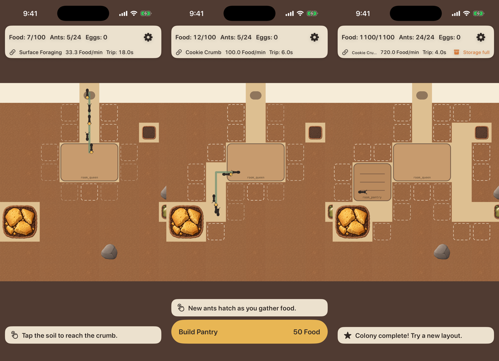
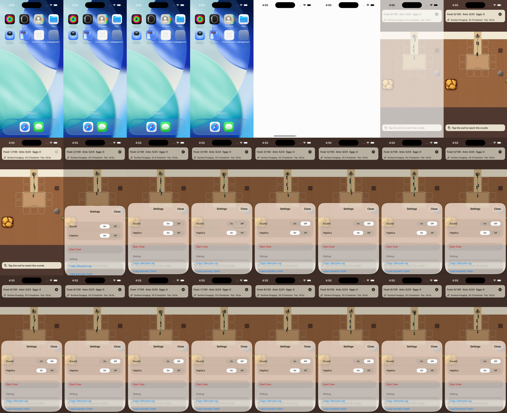

# A01-01 接入报告：地形与食物源首批（9 张）

```text
资源版本：A01-01 1.0.0（Codex，main 81ef65e），9 张运行时 PNG / 5 个资源组，manifest 状态保持 reviewed
分支 / PR：claude/a01-01-art → PR #14（base claude/d13-lifecycle，生命周期修复之上独立提交）
提交：df5ac9b 合入 main；ceef76e 导入与场景调整；8b09320 核心 target 暂不指定 App 图标名
CI：run 38193335116（8b09320）全部通过
目标：核心 AntKingdom；发行 CrumbKingdom 等 m4 叠到本分支后另做截图（同一资源目录与名称映射）
真机：NOT_RUN
```

## 导入范围与方式

- `tools/import_art.py` 只导入 manifest 中 reviewed 及以上、并列出 `outputs` 的资源；资源组须整组交付才导入。
  这 9 张作为同名 imageset 的 **@3x** 单份写入 `ios/AntKingdom/Resources/Assets.xcassets`，逐字节复制，不改像素：
  144 px → 48 pt，288 px → 96 pt。`--check` 校验 imageset 与交付文件逐字节一致、无多余或空 imageset，已加入 validate.yml。
- 原稿（masters）、接触表、QA 图、提示词、导出脚本都不进 App。新增运行时 PNG 合计 **507,738 bytes**（约 496 KiB）。
- 核心 target 暂不指定 App 图标名：A06 `app_icon` 未交付，不放占位图标；导入后改回。

## 场景调整（不改占地、碰撞、路线）

- **石块**：贴图透明区下面铺同一格的土层（固定变体），灰色方块底和占位划痕都去掉。
- **食物源**：有贴图时按完整逻辑格绘制（Cookie 2×2 = 96 pt；Sugar、Sap 1×1 = 48 pt），不再缩进 3 pt，
  去掉占位填色和描边；有货/耗尽贴图随真实库存切换（Sugar 初始余量为 0，所以开局显示耗尽图）。选中描边独立绘制，不受影响。
- **土层**：按格坐标固定选择 3 个变体之一，不按帧随机、不镜像不旋转。

## 测试与证据

| 项 | 结果 |
|---|---|
| `FeedbackAndAssetTests.testA01ArtLoadsAtItsPointSize` | 9 个名称都能从 App 加载，尺寸 48 / 96 pt、scale 3 —— 通过 |
| 资源整组导入检查（原有） | 通过（没有半套） |
| 单元 14/14；UI 13/13 标准（iPhone 17 / iOS 26.2）+ 3/3 录像轮 + 13/13 小屏（iPhone SE / iOS 18.5）；TestFlight 配置无签名编译与发行检查 | 通过（run 38193335116） |
| `check_assets.py` | 9 张显示“已导入但 manifest 未批准”；`--strict` 仍失败（其余资源未交付） |



上图为 CI 模拟器截图（iPhone 17 / iOS 26.2，非真机）：左 fresh、中 connected（Cookie 有货、Sugar 耗尽）、右 replay600（建仓后满仓，含石块）。
完整截图在 CI artifact `ios-evidence-81`。

## D-15：食物源透明边缘下的浅色方板（2026-10-12）

- Codex 复核（followup-review）发现：Cookie / Sugar（以及同一路径的 Sap）透明 padding 露出浅色矩形。
- 根因：不可通行的 source 格在底层 tile 没有正式底纹，`baseColor` 默认返回通路色。
- 修复：f7cf6e9。source 格（含 empty）底层铺同一格的正式土层贴图与土色。
  - 没有裁 alpha，没有扩大贴图。
  - Cookie 96 pt、Sugar / Sap 48 pt，中心锚点不变。
  - 源格照常不可通行，路线、碰撞、经济不变。
- 前后对照、补给循环录屏、两个 target 截图都在 [A01-02 报告](A01-02-2026-10-11.md) 的“D-15 修复与 A01 剩余验收”一节（证据来自含本修复的 2afa2ae 与发行栈 60691ea）。

本分支 CI [38205191986](https://github.com/qianquandong/AntKingdom/actions/runs/38205191986)（f7cf6e9）：
- attempt 1：核心包、Linux、单元测试通过。标准机型 UI 有 1 条失败：`FeedbackSettingsUITests.testFeedbackOffAndReduceMotionStillConnectCookie`，“Haptics must switch to Off”。
  - 录像与合成事件显示，点击落在 Haptics 的 Off 段正中（329.7, 604.2 pt），Sound 先切到 Off 正常，Haptics 16 秒内没有任何按下反馈，见下图。
  - 本修复只改地图源格底纹，不涉及设置页；同一用例在 a01-01 / a01-02 前几次 run 都通过。
  - 记为间歇性 UI 测试问题 **T-05**（与 T-03 同一区域，iOS 26.2 分段控件偶尔不响应合成点击）。根因未确认，不改断言。
- attempt 2（只重跑失败 job）：单元与两台模拟器的 UI 测试全部通过。
  - 这次重跑只作为 D-15 截图的产出，不作为 T-05 已解决的证据。
  - T-05 若再出现，加 UI 层诊断（点击前后读取设置探针）后定位。



## 尚未完成的验收（如实列出）

- 3×3 土层近景与放大采样：已有 Debug 检视页截图（A01-02 报告），采样接缝 / 闪线需要真机，NOT_RUN。
- Cookie 完整“有货 → 耗尽 → 补给”录屏：PR #18 调整场景库存后的 CI 回填（Sugar 已录到完整循环）。
- 物理 iPhone：NOT_RUN。

需要 Codex：根据截图复核后更新 manifest 状态（approved / integrated）；若在设备上看到接缝、色边，按 A01-01 README 回传缩放比例与原图。
