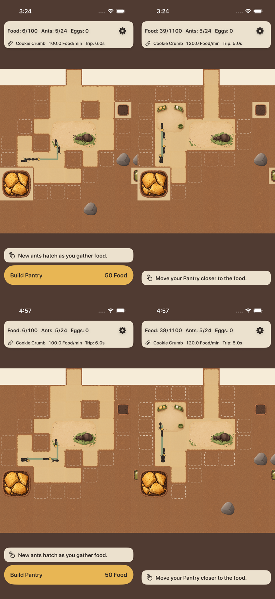
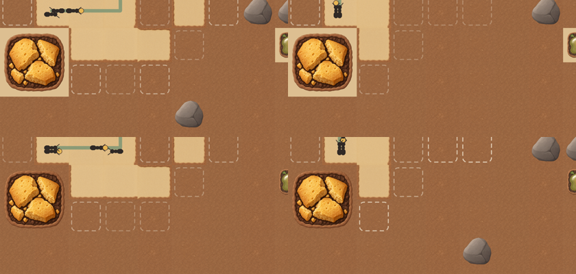
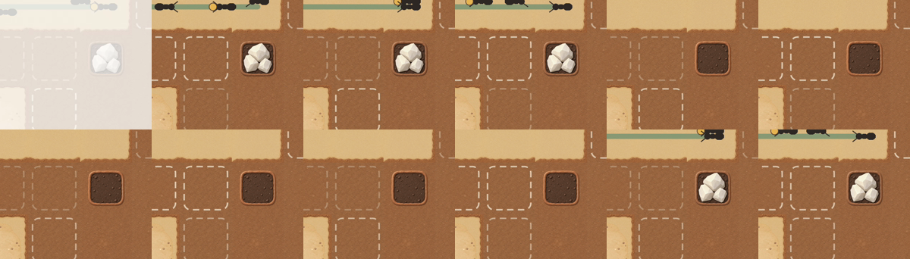
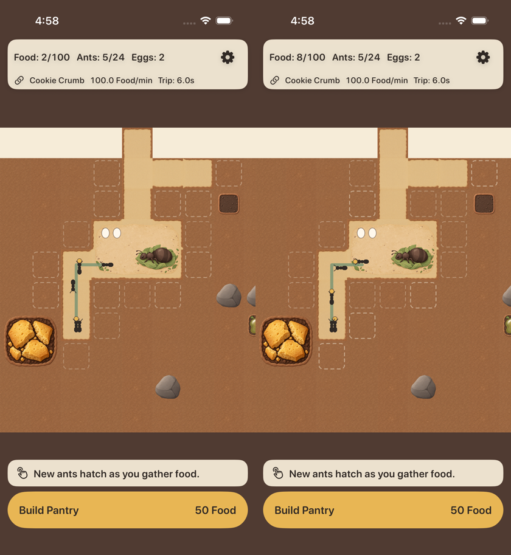
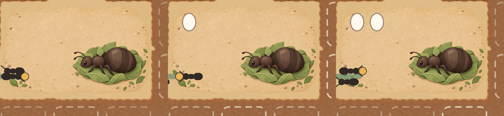
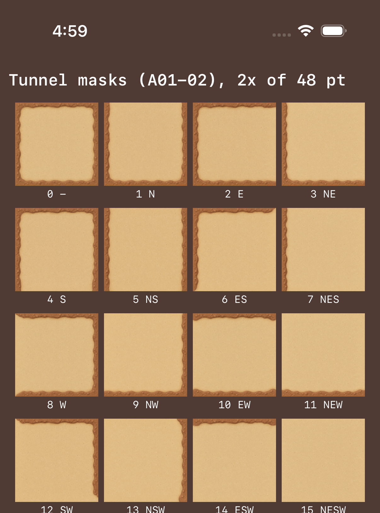
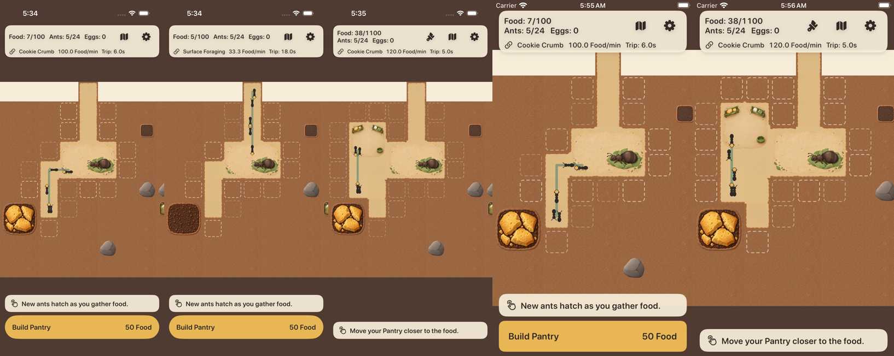

# A01-02 接入报告：16 种通路、蚁后房间与仓库（18 张）

```text
资源版本：A01-02 1.0.0（Codex，main 9a1575b），18 张运行时 PNG / 3 个资源组；manifest 保持 reviewed
分支 / PR：claude/a01-02-art → PR #15（base claude/a01-01-art → #14 → D-13 #12）；Issue #13
提交：合入 main 9a1575b；a8b7d09 导入与场景调整；e563b12 小屏对照截图改由 UI 测试生成
CI：[38199223850](https://github.com/qianquandong/AntKingdom/actions/runs/38199223850)（e563b12）全部通过；[38196166437](https://github.com/qianquandong/AntKingdom/actions/runs/38196166437)（a8b7d09）只有新加的小屏 simctl 截图启动超时，标准截图全部成功
目标：核心 AntKingdom（同一资源目录与名称映射也将用于发行 CrumbKingdom，等 m4 叠上来后另做截图）
真机：NOT_RUN
```

## 导入

- `tools/import_art.py` 按 manifest 导入：`terrain_tunnel_masks_0…15`（各 144 px → 48 pt）、`room_queen`（432×288 px → 144×96 pt）、
  `room_pantry`（288 px → 96 pt），全部 @3x 单份、逐字节复制；两批累计 **27 张 / 8 组**。
- 新增运行时 PNG **781,979 bytes**（两批累计 **1,289,717 bytes**）。masters、reference_sources、提示词、QA 图、导出脚本不进 App。

## 场景

- **通路**：沿用现有四邻规则（N1 E2 S4 W8，N = 地图 y − 1）。地图 y 向下、场景 y 取负，只影响位置；图片不翻转、不交换编号。
  开格时重算当前格与四邻；读档后首帧按全部可通行格重算。
- **房间**：完整逻辑占地绘制（Queen 144×96 pt，Pantry 96 pt），不再缩进成 138×90；有贴图时去掉占位填色、描边与 Debug 资源 ID；
  Pantry 贴图加载后不再创建三条占位货架线。房间是可通行装饰层，碰撞、卸货点、占地都不变。
- **层级**：卵（Queen 左上起 (22,22)、(40,22) pt）在房间贴图之上；路线、繁忙标记、蚂蚁、选中与摆放反馈的图层都高于房间。
- **截图场景** `tunnel_gallery`（仅 Debug）：按可挖前沿顺序挖开 16 格，通路网同时出现遮罩 1–15。
  遮罩 0（四邻都不通的独立格）在游戏中不会出现——每个挖开的格都与已有通路相连；它的选图由 `testTunnelMaskBits` 覆盖。

## 测试

| 项 | 结果 |
|---|---|
| `DebugScenarioTests.testTunnelGalleryCoversEveryReachableMask` | 遮罩 1–15 全部出现在可见通路格上 —— 通过（核心包 91/91） |
| `FeedbackAndAssetTests.testA01ArtLoadsAtItsPointSize` | 27 张都能加载，尺寸 48 / 96 / 144×96 pt、scale 3 —— 通过 |
| 资源整组导入检查 | 通过 |
| 单元 14/14；UI 14/14 + 1 跳过（iPhone 17 / iOS 26.2）+ 录像轮 3/3 + 14/14 + 1 跳过（iPhone SE / iOS 18.5）；核心包 91/91；差分 30/30；无签名编译与发行检查 | 通过（run 38199223850） |


上图为 CI 模拟器截图（iPhone 17 / iOS 26.2，非真机）。左：tunnel_gallery（直道、转角、三岔、四向、尽头；开口处没有横向土边）；
右：pantry_built（Pantry 贴图，无占位货架线；Queen 贴图上方显示卵区）。


小屏（iPhone SE (3rd generation) / iOS 18.5，CI 模拟器）同场景对照：左 tunnel_gallery、中 pantry_built、右 connected；
由 `ArtScreenshotsUITests` 在标准与小屏两个 UI 测试步骤各截一组（CI artifact `ios-evidence-84` 的 attachments / attachments-small）。

## D-15 修复与 A01 剩余验收（2026-10-12，Codex 复核 followup-review / Issue #16）

固定提交 2afa2ae（含 498196d 合入的 D-15 修复 f7cf6e9），CI [38205368547](https://github.com/qianquandong/AntKingdom/actions/runs/38205368547) attempt 1 **全部通过**：
- 核心包 93/93；单元 14/14。
- UI：iPhone 17 / iOS 26.2 为 17/17 + 1 跳过，iPhone SE (3rd generation) / iOS 18.5 为 17/17 + 1 跳过（跳过的是需 `AK_ROUNDS` 的往返用例）。
- 录像：Pantry 3/3、A01 平移缩放 1/1、两段补给录屏。
- TestFlight 配置无签名编译与发行检查 PASS。
- 证据为 CI 模拟器截图 / 录像（artifact `ios-evidence-87`），**不是真机**。

### D-15：食物源透明边缘下的浅色方板

- 根因：不可通行的 source 格在底层 tile 没有正式底纹，`baseColor` 默认返回通路色，于是 Cookie / Sugar / Sap 的透明 padding 露出浅色矩形。
- 修复（f7cf6e9）：source 格（含 empty）底层铺同一格的正式土层贴图与土色。
  - 没有裁 alpha，没有扩大贴图。
  - Cookie 96 pt、Sugar / Sap 48 pt，中心锚点不变。
  - 源格照常不可通行，路线、碰撞、经济不变。



上：修复前（d5251f6，Codex 复核截图 A01-02-core-tunnel-pantry.png）。下：修复后（2afa2ae，同一 iPhone 17 / iOS 26.2 模拟器、同两个场景 tunnel_gallery / pantry_built，同样缩放）。
局部放大（上前下后）：Cookie 与右缘 Sugar 下的浅色方板消失，露出正式土层：



**补给循环录屏**（CI 场景 `source_cycle_cookie` / `source_cycle_sugar`，各约 25 秒）。Sugar 有货 → 耗尽（空盘）→ “Fresh food has arrived!” 补给，全程在土层上，位置与大小不变；每秒一帧：



Cookie 录屏只录到“空盘 → 补给 → 有货”：场景只剩 4 Food，在首个可见帧之前就搬完了。
- 已在 PR #18（claude/a02-01-art 0bd98b2）把 Cookie 改为 15 Food、Sugar 改为 8 Food，下一次 CI 会录到完整“有货 → 耗尽 → 补给”。
- Sap 是单态，只出现在默认视图右缘。
- 选中描边独立可见（与 D-15 无关，沿用原实现）。

### A01 剩余验收

| 项 | 证据 | 结果 |
|---|---|---|
| 16 种遮罩 / 64 条边逐项核对（含 0 号独立 fixture） | Debug 检视页 `-ak-gallery`：16 格各 88 pt（48 pt 原尺寸约 1.8 倍），标注编号与开口方向 N1 E2 S4 W8；下方 48 pt 原尺寸两排与土层 3×3。截图为原分辨率 1206 px 宽，每格约 264 px，可逐边放大 | 截图已产出，**待 Codex 逐边复核** |
| 连续挖格 + 重开 | `testDigThenRelaunchKeepsTunnelEdges`：挖开 5 格 → 杀进程 → 冷启动，探针 dug=5 两次一致；前后截图通路边相同，无旧边 | PASS（模拟器） |
| Pantry 建造 / 移动 | `PantryFlowUITests` 3/3 + 录像 C05-pantry-flow；pantry_built 截图无占位货架线 | PASS（模拟器）；移动后无旧贴图、无重复节点，由录像供复核 |
| Queen 0 / 1 / 2 卵 | connected / eggs_one / eggs_two（孵化订单关闭、已有卵照常） | 截图如下（A02 卵图未接入，本分支为占位卵） |
| 缩放与慢速平移 | `ArtPanZoomUITests`（慢速拖动 5 段 + 两次捏合，断言不挖土）录像 A01-pan-zoom；connected / tunnel_gallery 的最大缩放 1.6 倍截图 | 录像供复核；模拟器只是预检，闪线 / 采样接缝需真机 |
| 总览截图 | 一次快速大幅捏合只缩回一部分，本 run 的 “overview” 仍是放大状态，**不算总览证据** | 已在 PR #18 改为两次慢捏合；默认视图本身接近最小缩放（约 0.93 倍，整图按宽度装下） |
| 两个 target | 发行 CrumbKingdom 共用 Assets.xcassets 与 GameScene；发行栈已 rebase 到本分支（PR #8 base 改为 claude/a01-02-art），m5-ads 新增 `ReleaseArtScreenshotsUITests` 在标准与小屏各截一组 | PASS（模拟器截图，见下） |
| manifest / strict | manifest 保持 reviewed；`check_assets.py --strict` 仍失败 | 未改 |







**发行 CrumbKingdom target**：发行栈 claude/m5-ads 60691ea（已 rebase 到本分支，含 D-15），CI [38206933405](https://github.com/qianquandong/AntKingdom/actions/runs/38206933405) 的发行轨 job 全部通过：
- 单元 37/37；UI 18/18（iPhone 17 / iOS 26.2），其中 `ReleaseArtScreenshotsUITests` 通过，小屏 iPhone SE (3rd generation) / iOS 18.5 只跑该类，1/1。
- TestFlight 配置无签名编译与发行检查 PASS。
- 截图在发行轨实际运行下截取（CampaignModel → 章节），不是从共享目录推断。



两个 target 使用同一批 27 张资源与同一 D-15 渲染：Cookie、Sugar（右缘）、空源都在土层上，无浅色方板；Pantry 无占位货架线。

## 尚未完成（如实列出）

- 64 条边逐项结论：需要 Codex 看检视页截图给出；Claude 不自判美术通过。
- Cookie 完整“有货 → 耗尽 → 补给”录屏与真正的总览截图：PR #18 的 CI 产出后回填。
- 采样接缝、闪线、真机清晰度：需要物理 iPhone，NOT_RUN。
- 物理 iPhone：NOT_RUN（核心测试包 core-test-d13-2 为占位资源；带 A01 的包需要用户在本机签名本分支，步骤同 D-13 报告第 6 节）。
