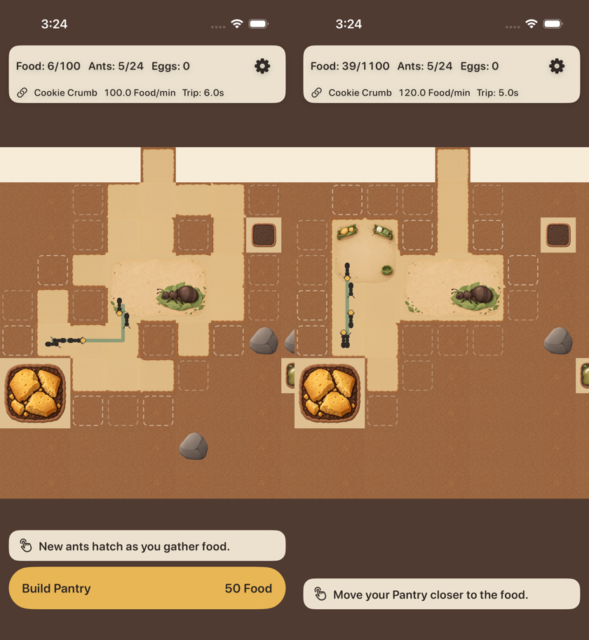
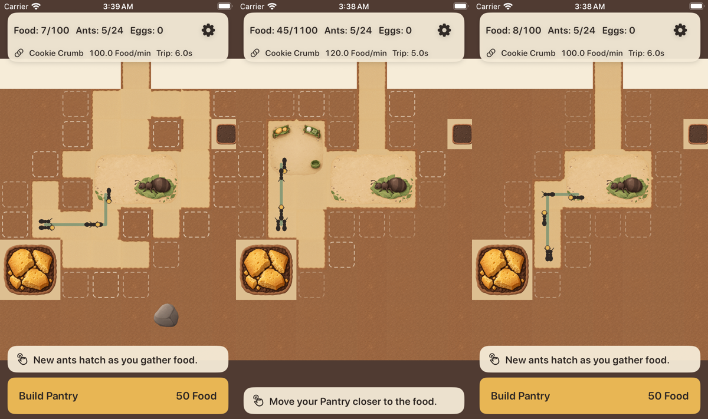

# A01-02 接入报告：16 种通路、蚁后房间与仓库（18 张）

```text
资源版本：A01-02 1.0.0（Codex，main 9a1575b），18 张运行时 PNG / 3 个资源组；manifest 保持 reviewed
分支 / PR：claude/a01-02-art → PR #15（base claude/a01-01-art → #14 → D-13 #12）；Issue #13
提交：合入 main 9a1575b；a8b7d09 导入与场景调整；e563b12 小屏对照截图改由 UI 测试生成
CI：[38199223850](https://github.com/qianquandong/AntKingdom/actions/runs/38199223850)（e563b12）全部通过；[38196166437](https://github.com/qianquandong/AntKingdom/actions/runs/38196166437)（a8b7d09）只有新加的小屏 simctl 截图启动超时，标准截图全部成功
目标：核心 AntKingdom（同一资源目录与名称映射也将用于发行 CrumbKingdom，等 m4 叠上来后另做截图）
真机：NOT_RUN
```

## 导入

- `tools/import_art.py` 按 manifest 导入：`terrain_tunnel_masks_0…15`（各 144 px → 48 pt）、`room_queen`（432×288 px → 144×96 pt）、
  `room_pantry`（288 px → 96 pt），全部 @3x 单份、逐字节复制；两批累计 **27 张 / 8 组**。
- 新增运行时 PNG **781,979 bytes**（两批累计 **1,289,717 bytes**）。masters、reference_sources、提示词、QA 图、导出脚本不进 App。

## 场景

- **通路**：沿用现有四邻规则（N1 E2 S4 W8，N = 地图 y − 1）。地图 y 向下、场景 y 取负，只影响位置；图片不翻转、不交换编号。
  开格时重算当前格与四邻；读档后首帧按全部可通行格重算。
- **房间**：完整逻辑占地绘制（Queen 144×96 pt，Pantry 96 pt），不再缩进成 138×90；有贴图时去掉占位填色、描边与 Debug 资源 ID；
  Pantry 贴图加载后不再创建三条占位货架线。房间是可通行装饰层，碰撞、卸货点、占地都不变。
- **层级**：卵（Queen 左上起 (22,22)、(40,22) pt）在房间贴图之上；路线、繁忙标记、蚂蚁、选中与摆放反馈的图层都高于房间。
- **截图场景** `tunnel_gallery`（仅 Debug）：按可挖前沿顺序挖开 16 格，通路网同时出现遮罩 1–15。
  遮罩 0（四邻都不通的独立格）在游戏中不会出现——每个挖开的格都与已有通路相连；它的选图由 `testTunnelMaskBits` 覆盖。

## 测试

| 项 | 结果 |
|---|---|
| `DebugScenarioTests.testTunnelGalleryCoversEveryReachableMask` | 遮罩 1–15 全部出现在可见通路格上 —— 通过（核心包 91/91） |
| `FeedbackAndAssetTests.testA01ArtLoadsAtItsPointSize` | 27 张都能加载，尺寸 48 / 96 / 144×96 pt、scale 3 —— 通过 |
| 资源整组导入检查 | 通过 |
| 单元 14/14；UI 14/14 + 1 跳过（iPhone 17 / iOS 26.2）+ 录像轮 3/3 + 14/14 + 1 跳过（iPhone SE / iOS 18.5）；核心包 91/91；差分 30/30；无签名编译与发行检查 | 通过（run 38199223850） |



上图为 CI 模拟器截图（iPhone 17 / iOS 26.2，非真机）。左：tunnel_gallery（直道、转角、三岔、四向、尽头；开口处没有横向土边）；
右：pantry_built（Pantry 贴图，无占位货架线；Queen 贴图上方显示卵区）。



小屏（iPhone SE (3rd generation) / iOS 18.5，CI 模拟器）同场景对照：左 tunnel_gallery、中 pantry_built、右 connected；
由 `ArtScreenshotsUITests` 在标准与小屏两个 UI 测试步骤各截一组（CI artifact `ios-evidence-84` 的 attachments / attachments-small）。

## 尚未完成（如实列出）

- 逐条核对 16 种遮罩的 64 条边：本次只有整体场景截图，没有逐格放大图——需要 Codex 复核截图；如需逐格放大，可加放大截图步骤。
- 连续挖格与保存重开后的旧边残留、Pantry 移动前后、0/1/2 卵、孵化暂停与完成的截图：现有 UI 测试覆盖逻辑（挖格、建仓/移动、读档），
  但没有专门的美术截图。
- 慢速平移与缩放下的闪线检查：模拟器截图看不到，需要真机。
- 发行 CrumbKingdom 的截图：等 m4 叠到本分支后。
- 物理 iPhone：NOT_RUN（需要用户设备，安装步骤见 D-13 报告第 6 节）。
