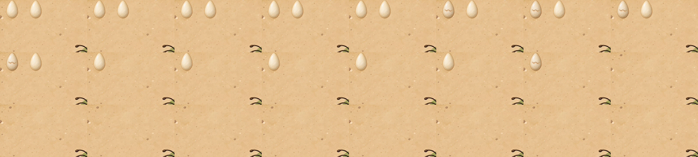
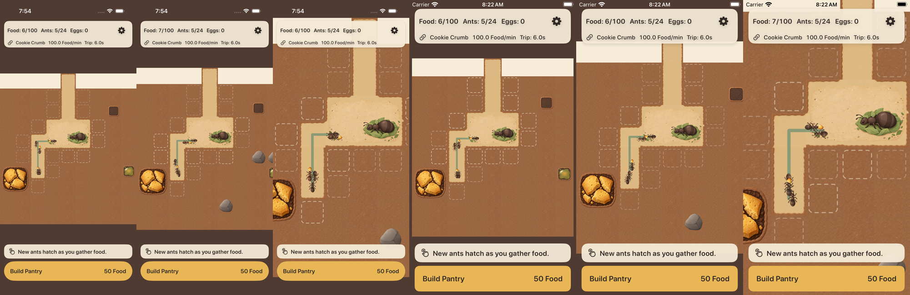
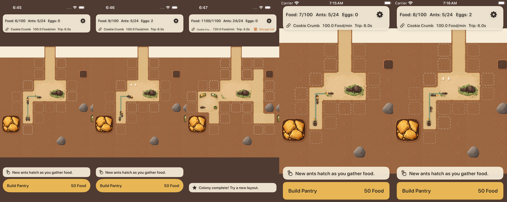
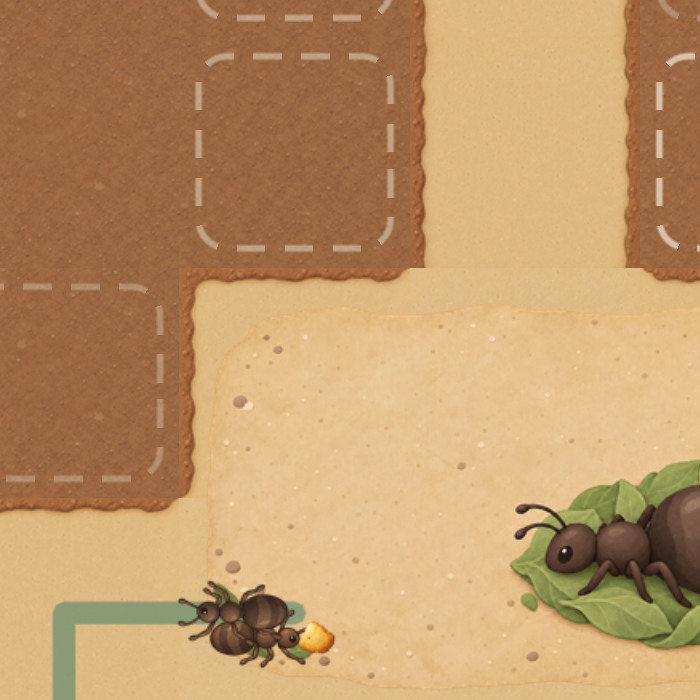
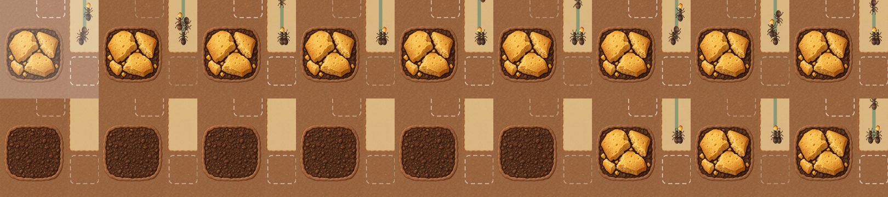

# A02-01 接入报告：工蚁 14 帧、独立货物与卵两态（17 张）

```text
任务 ID：A02-01 集成（Issue #17）；资源版本 A02-01 1.0.0（Codex，main 4d1f480），manifest 保持 reviewed
分支 / PR：claude/a02-01-art（base claude/a01-02-art，含 D-15 修复）；合入 main 4d1f480（991f38b）
提交：e1a6363 导入；09dbe93 动画/货物/卵与测试、动作录像；0bd98b2 A01 证据修正；d07c9b4 小屏超时上限；
  7b627e0 -ak-zoom 截图与录像等待（证据工具）；本报告
目标：核心 AntKingdom。发行 CrumbKingdom 共用同一资源目录与 GameScene，发行栈（m4→m5）叠到本分支后另做截图
CI：固定 7b627e0，[38219003690](https://github.com/qianquandong/AntKingdom/actions/runs/38219003690) attempt 1 **全部 job 通过**（详见“测试”末尾）；更早的 d07c9b4 run 38212447159 如实记录
真机：NOT_RUN（签名与设备见 D-13 报告第 6 节，SIGNING_BLOCKED / NOT_INSTALLED）
顺序：按 Codex 复核，先交 #16 核心包、D-14、D-15；本批不阻塞核心包，核心测试包 core-test-d13-2 不含本批
```

## 导入（A02-T01 文件部分）

- `tools/import_art.py` 按 manifest 导入 17 张 @3x：`ant_worker_{idle_1–2, walk_1–6, carry_1–6}`（96 px → 32 pt）、`ant_cargo`（48 px → 16 pt）、`egg_states_{normal,ready}`（96 px，catalog 32 pt，节点显式 24 pt）。逐字节复制，不改像素。
- `import_art.py --check` 新增一项：每张交付文件的 SHA-256 与像素尺寸必须与资源包 `metadata.json` 一致（三批共 44/44 一致）；篡改一个文件的 SHA 会报错（本地负面自检）。
- 只导入 `assets/game/ants/` 的运行时 PNG，不导入原稿、前置图、提示词、QA 图、预览 HTML/GSAP、导出脚本。新增运行时 **98,425 bytes**（三批累计 1,388,142 bytes PNG）。
- `check_assets.py --strict` 仍失败（地表、反馈、UI、音效、发行外观未交付），发行门槛不放宽。

## 场景

- **身体**：idle 2、walk 6、carry 6 共 14 帧整组可加载才用正式身体，缺任何一帧就整组回退占位，不以 `walk_1` 存在判断。
  - 播帧只换纹理：idle 4fps，walk/carry 10fps，帧序 1→N→1。不加 SKAction，不改世界位置（位置只由路线计算）。
  - 每只蚂蚁一个身体精灵。
- **货物**：独立一层，位于父节点局部 `(11,0)pt`，随父节点旋转。装货阶段显示，卸货、待命、无路线徘徊时隐藏。
  - 身体帧里没有食物，所以只有一份货物。
  - 收入只来自 Colony 平均流量账本，动画不发钱。
- **卵**：普通与将孵化两态都在才用正式图。剩余孵化时间 ≤ 2 秒切 ready，只换纹理，24 pt 大小与位置不变（Queen 左上起 (22,22)/(40,22) pt）；0 枚卵不显示。
  - “暂停孵化”只停新订单，已有卵照常倒计时、切换、孵化。
  - 满仓只让运输待命，不冻结卵。
  - 发行轨的广告暂停按 D-14 停止整个模拟，两种暂停不混用。
- 图层沿用 A01-02：卵在房间之上；路线、蚂蚁、选中与摆放反馈高于房间。

## 测试

| 项 | 内容 | 结果 |
|---|---|---|
| `testA02ArtLoadsAsCompleteGroups`（A02-T01） | 17 张按 @3x 加载（32 / 16 / 32 pt、scale 3）；14 帧整组、卵两态可用 | PASS |
| `testAntsHaveOneBodyAndOneCargoAndDoNotAccumulateNodes`（A02-T03 结构） | pantry_built 场景 400 次更新：每只 1 身体 1 货物、无占位残留、无 SKAction；货物 (11,0)、zRotation 0（随父节点）；有蚂蚁带货；满仓全部不带货；会话状态不变 | PASS |
| `testAssetsAreAllOrNothing…` | 没有半套资源 | PASS |
| 截图 `ArtScreenshotsUITests` | connected / pantry_built / tunnel_gallery / eggs_one / eggs_two / replay600 + 放大，标准与小屏 | PASS；7b627e0 起放大 / 总览用 Debug `-ak-zoom` 直接设定，总览真正缩到最小（见下图） |
| 录像 A02-eggs_two | 孵化订单关闭，两枚卵照常倒计时、最后 2 秒切 ready、到点孵化、不新增卵 | d07c9b4 时**未录到**（recordVideo 晚出帧，首帧时第一枚卵已孵化）；7b627e0 改为等 “Recording started” 再启动后录到完整过程：两枚 normal → 第一枚 ready（裂纹）→ 孵化（Ants 5→6）→ 第二枚 ready → 孵化（Ants 7），Eggs 2→1→0，孵化订单关闭期间不新增卵 —— PASS（录像） |
| 录像 A02-ant-motion（`AntMotionUITests`） | 默认 32 pt → 拖动并放大（钳制 1.6 倍）→ 回默认；手势不挖土；录到卵出现与孵化（5 → 6 只） | PASS，录像供 Codex 慢放复核 |

CI [38212447159](https://github.com/qianquandong/AntKingdom/actions/runs/38212447159)（d07c9b4）attempt 1：
- 核心包 93/93；单元通过。
- 标准机型 UI **18/18** + 1 跳过（iPhone 17 / iOS 26.2）；Pantry、A01、A02 录像全部完成；Linux 核心包通过。
- 小屏 iPhone SE / iOS 18.5：16/18 + 1 跳过；`AntMotionUITests` 与 `ArtPanZoomUITests` 两条在 `app.launch()` 报 “Failed to get background assertion … Timed out”。这是模拟器启动基础设施失败，发生在测试逻辑之前，与 m5-store 38206627796 attempt 1 相同。
- attempt 2（只重跑失败 job）被后续推送 7b627e0 的新 run 按 concurrency 取消。

**固定提交 7b627e0**，CI [38219003690](https://github.com/qianquandong/AntKingdom/actions/runs/38219003690) attempt 1 全部 job 通过：
- 核心包 93/93（Linux 与 macOS）；单元 16/16（含 A02-T01 / T03）。
- UI：iPhone 17 / iOS 26.2 为 18/18 + 1 跳过，iPhone SE (3rd generation) / iOS 18.5 为 18/18 + 1 跳过（跳过的是需 `AK_ROUNDS` 的往返用例）。
- 录像：Pantry 3/3、A02 动作 1/1、A01 平移缩放 1/1、补给与卵录像。
- TestFlight 配置无签名编译与发行检查 PASS（`-ak-zoom` 等调试标记 absent）。



请 Codex 判断一处表现：第一枚孵化后，剩下那枚按“1 枚卵”的位置 (22,22) 绘制，即从 (40,22) 左移一格。卵的数量与 ready 切换都正确。如需保持原槽位不动，请给出规则，Claude 再改（只改表现，不改孵化）。







A01 补充：Cookie 改为 15 Food 后，录屏完整记录了有货（约 8 秒）→ 耗尽（空盘约 6 秒）→ 补给。全程在土层上，位置与大小不变。每秒一帧：



## 尚未完成（如实列出）

- A02-T02 观感（6→1 循环跳动、闪亮、缺腿）：录像供 Codex 复核；模拟器录像只是预检，真机清晰度 NOT_RUN。
- A02-T03 四向转弯与改路、取消：结构测试和录像覆盖默认路线，没有专门的四向转弯脚本。
- A02-T05 移动仓库时的蚂蚁与 Pantry 层级：沿用 A01 截图，无专门录像。
- A02-T06 发行 CrumbKingdom 两屏截图：等发行栈 rebase 到本分支后由 `ReleaseArtScreenshotsUITests` 产出。24 只同屏帧率/内存：模拟器数字无参考价值，真机 NOT_RUN。
- 物理 iPhone：NOT_RUN。
