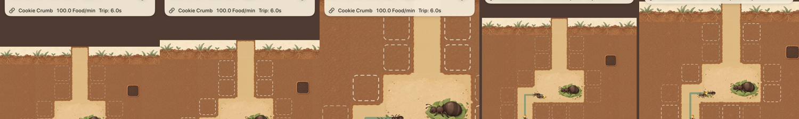
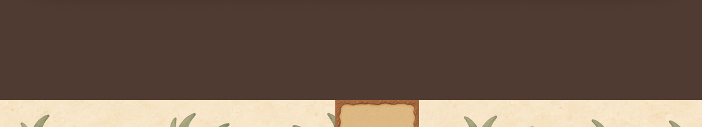
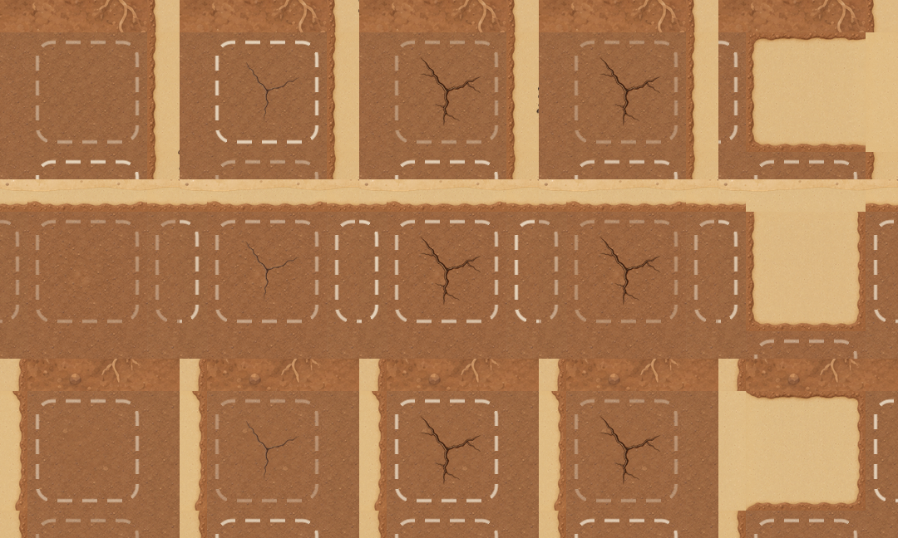

# A02-02 接入报告：地表背景、两级裂纹与土屑（4 张）

```text
任务 ID：A02-02 集成（Issue #19）；资源 A02-02 1.0.0（Codex，main f484bd0），manifest 保持 reviewed
分支 / PR：claude/a02-02-art → PR #20（base claude/a02-01-art = 新美术测试包 core-art-test-1 的候选线）
提交：955c883 合入 main f484bd0 并导入 4 张（累计 48 张）；e556c28 地表裁切 / 命中事件 / 测试与录像；8fc394c 执行看板；本报告
CI：e556c28，[38343244262](https://github.com/qianquandong/AntKingdom/actions/runs/38343244262) attempt 1 全部 job 通过
目标：核心 AntKingdom。发行 CrumbKingdom 未叠上本批（发行栈当前在 cbc3275，见下）
不进 core-art-test-1（首包为前三批 44 张）；走下一 build
真机：NOT_RUN
```

## A02B-01 资源

- `import_art.py` 导入 4 张 @3x，逐字节复制，SHA-256 / 像素与 metadata 一致（累计 48/48）；`dig_feedback` 三图整组。
- 加载测试（DigFeedbackArtTests）：
  - `surface_backdrop` 432×96 pt；
  - `dig_feedback_crack_1/2` 48 pt；
  - `dig_feedback_crumb` 12 pt；scale 均为 3。
- 只导入 `assets/game/**` 运行时图；原稿、检视图、裁切演示图不进 App。

## A02B-02 地表等比裁切

- `SurfaceBackdrop.cropRect` 按目标行宽高比居中等比裁切。当前 9 列 × 1 行（432×48 pt）得到单位矩形 **(0, 0.25, 1, 0.5)**，即像素 (0, 72, 1296, 144)。
- 用 `SKTexture(rect:in:)` 子纹理显示，不再把 432×96 pt 整图压成一行。
- 测试：
  - 裁切矩形；
  - 5 种目标尺寸都不拉伸、居中、在源内；
  - 真实子纹理宽高比 = 9。
- 纯装饰：不改 `.surface` 通行、命中、入口与收入；入口 E 的通路仍画在地表之上。





## A02B-03 三击

- `DigFeedbackUITests.testThreeHitsOnEachSoilVariant`：三种 Soil 各一格，变体 = x % 3 + 1，即 (3,1) → 1、(4,5) → 2、(5,1) → 3。
- 每格 0 → 1 → 2 → 3 次命中截图；每次命中后土屑清零；三次只开 1 格。
- 下图每行一种 Soil，列依次为 0 次、1 次、2 次、2 次后 150 ms、3 次（iPhone 17 模拟器）：
  - 第 2 级在原位加深并长出新分叉；
  - 第 3 次开通后没有残留裂纹或方底；
  - 2 次后 150 ms 截图时土屑已淡出（约 0.35 秒），数量由探针断言。
- 连续录像：`A02B-three-hits.mov`（CI artifact `ios-evidence-107`）。



## A02B-04 / 05 事件、手势、减少动态

- 命中事件 `GameController.onDigHit`：只在会话接受的命中时调用一次（单击与长按）。
  - 测试：第 1、2 次各一次，第 3 次开通不经此；不可挖、已挖、读档恢复都不触发。
  - 第 2 次命中放 3 颗土屑；开通由通路变化放 6 颗；Reduce Motion 只 1 颗原地淡出；约 0.35 秒后全部移除。
- 正常与 Reduce Motion 各 50 次有效命中（16 格 × 3 + 2）：结束后探针 `fx=0`（无残留节点），`dug=16`（只开了这些格）。两机型都通过。
- 拖动 / 缩放不挖土：沿用 ArtPanZoomUITests。
- 音效 / 触觉关闭不影响逻辑：沿用 FeedbackSettingsUITests；没有按“各 50 次”单独重做。

## 测试与 CI

CI 38343244262 attempt 1：
- 核心包 104/104（Linux、macOS）；单元 29/29。
- UI：iPhone 17 / iOS 26.2 与 iPhone SE (3rd generation) / iOS 18.5 各 24/24 + 1 跳过（跳过的是需 `AK_ROUNDS` 的往返用例）。
- 录像全部完成；TestFlight 无签名编译与发行检查 PASS。

## 尚未完成（如实列出）

- 发行 CrumbKingdom：发行栈（PR #8–#10）还在 cbc3275，没有叠上本批；下一步 rebase 后补两 scheme 证据。
- 物理 iPhone 新地表 + 完整三击录像：NOT_RUN。
- 超出 9 列的地图（A04）：等比裁切会裁掉更多上下部分，不假设可横向无缝重复，需另行检查。
