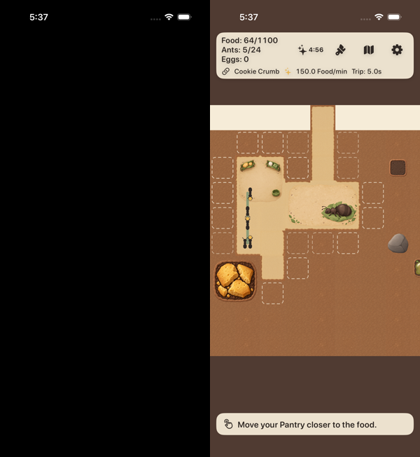

# D-14 报告：奖励广告暂停没有进入生命周期状态机

```text
任务 ID：D-14（Codex 复核 docs/reviews/2026-10-11-followup-review.md；Issue #16 第 2 项）；关联 D-13 / Issue #11、PR #10
日期 / 执行人：2026-10-12 / Claude（Opus 5.5）
Git commit / PR：claude/m5-ads → PR #10（base claude/m5-store）
  e3a4b73 修复 + 测试；60691ea 发行轨美术对照截图（A01 / D-15）；b70ca58 本报告与 CI 小屏超时上限
  复核基线 ff92393 已随栈 rebase 到 A01-02（旧→新 SHA 见第 6 节）
测试环境：核心包 Docker swift:6.2（Linux）；App/UI：GitHub Actions macos-15 / Xcode 26.3 / iOS SDK 26.2 模拟器
状态：代码与自动化 = CODE_FIXED / CI_SIM_PASS（固定 b70ca58，CI 38212443075 attempt 1 全部通过）；真实 AdMob SDK 时序、真机锁屏 = NOT_RUN（需账号与设备）
```

## 1. 问题（Codex 复现，已确认）

`CampaignModel` 的 `rewards.suspend(true)` 只设置 `controller.isSuspended`，生命周期不知道广告正在展示：

| 场景 | 原实现 | 原因 |
|---|---|---|
| 广告无帧 30 秒 → 按 Home → 后台 65 秒 → 回来 | 结算 **95** 秒 | `enterBackground` 用广告开始前的最后一帧作为离开时刻 |
| 广告无帧 30 秒 → 关闭回调之前先出一帧 | `.resumed`，Food 0→约 12.5 | `GameController.frame` 先调用 `admitFrame`（帧停顿检测），后判断 `isSuspended` |

只在广告结束时 `restartFrameClock()` 处理不了以上两种情况。

## 2. 修复：有意暂停是生命周期的第三种状态

| 事件 | 负责人 | 规则 |
|---|---|---|
| 广告开始展示 | `CampaignCoordinator.beginAdPause()` → `LifecycleCoordinator.beginIntentionalPause()` | 先把此前的有效前台秒记入奖励账本，再进入暂停；重复开始以第一次为准 |
| 暂停期间的帧 | `admitForegroundFrame()` → `.hold` | 不推进、不保存、不做帧停顿结算。广告期间 SpriteKit 有帧或没帧，结果一致 |
| 暂停中切后台（Home / 锁屏） | `enterBackground()` | 离开时刻取后台回调时刻，不用广告前的最后一帧：广告时长既不算前台也不算离线。回调迟到的一小段不算，宁少不多 |
| 回到前台、广告仍开着 | `becomeActive()` | 只结算真正的后台区间一次；保持暂停，帧继续 hold，直到广告关闭 |
| 广告关闭（完成 / 提前关闭 / 展示失败） | `endAdPause()` → `endIntentionalPause()` | 解除暂停，下一帧只作基准（不补算暂停时间），之后帧停顿检测照常；重复关闭或没有对应开始的关闭被忽略并写日志 |
| 广告在后台被关闭 | 同上 | 只解除暂停；后台区间仍由 `.active` 结算一次 |
| 广告期间切章 / 全部重置（界面不会发生，防御） | `CampaignCoordinator` | 暂停随新的章节生命周期保留 |

App 接线：`rewards.suspend(true/false)` 调用 `beginAdPause()` / `endAdPause()`，再设置控制器标记，并重置场景帧时钟。
`RewardModel.watch()` 对完成、提前关闭、展示失败都恰好调用一次 `suspend(false)`；无填充时不展示、也不暂停。
`GameController.isSuspended` 保留为表现层的第二道保险，收益以生命周期为准。删除了 `restartFrameClock()`。

不变的规则：
- D-13 的恢复首帧 hold、后台保存不吃离线起点、回拨与高水位、帧停顿检测都保留。
- 离线 25%、最多 1 小时、离线不享受 boost、不足 60 秒不弹总结都不变。
- 规则数值、Python 基准、文案均未改。

边界（如实记录）：
- 广告展示中进程崩溃（没有经过后台）时，冷启动从最后一次成功保存起算，与任何崩溃相同。
- 从 App 切换器强杀一定先经过后台，此时从后台回调时刻起算，有测试覆盖。

## 3. 测试

### 3.1 核心包（Docker swift:6.2）：**157/157 通过**（原 143 + A01-02 场景 3 + D-14 11）

`D14AdPauseTests`（11 条）。前两条是 Codex 复现用例，只在 `suspend(true)` 的位置改接 `beginAdPause()`，断言不变：

1. `testHomeDuringAdDoesNotCountTheAdAsOffline`：广告期间有帧 / 无帧两种，按 Home 后台 65 秒。结算正好 65 秒，状态与“广告开始时的状态 + 65 秒离线参考模拟”逐字段相同。
2. `testFrameBeforeAdDismissalDoesNotSettleTheAdGap`：关闭前一帧为 `.hold`，状态不变；boost 120 秒不消耗、有效前台秒不增加；关闭后第一帧只作基准，再一帧只推进 0.25 秒。
3. 回前台时广告仍开着：只结算 65 秒，之后 20 秒 hold，关闭后正常推进。
4. 广告在后台被关闭：`.active` 结算 65 秒，回来后不 hold。
5. 已在后台才收到开始：照常结算后台，暂停到结束为止。
6. 重复开始、重复关闭、无开始的关闭、双后台/双前台通知：只结算一次；暂停结束后，没有后台记录的 65 秒停顿仍由帧停顿检测结算一次。
7. 广告中按 Home 后被杀，65 秒后冷启动：结算 65 秒（不是 95 秒），新进程不处于暂停。
8. 广告期间写盘失败：回来只结算一次 65 秒；恢复写盘后冷启动不重复支付。
9. 1 小时封顶：广告 30 秒 + 后台 2 小时，结算 3600 秒、away 7200 秒，与参考模拟相同。
10. 广告期间系统时间回拨 600 秒：无负收益、无额外收益。
11. 广告期间切章、全部重置：暂停保留，关闭后照常。

`D13CampaignTests` 的广告用例改为开始/结束都经暂停 API，D-13 全部原回归不改断言并照常通过。

**变异检查**：在临时副本中把暂停 API 改成空操作，`endIntentionalPause` 只清帧时钟（等同原实现）：
- D-14 用例 **10/11 失败**。广告中按 Home 结算 **95 ≠ 65**；关闭前一帧被 `.resumed` 结算 30 秒、Food 12.5。
- 回拨用例与暂停无关，照常通过。
- 原始输出见 [d14-mutation.log](evidence/d14-mutation.log)。

### 3.2 发行轨 App（CrumbKingdomTests / CrumbKingdomUITests，CI 模拟器）

`AdPauseIntegrationTests`（4 条）驱动真实的 CampaignModel scenePhase 处理与 `rewards.suspend` 接线，经 `GameController.frame` 到 `RewardModel.watch`；墙钟可控，广告服务脚本化（present 挂起到测试关闭为止）：
- **关闭前帧**：广告无帧 30 秒后的第一帧和之后 5 秒的帧都不推进、不弹 Welcome Back；有效前台秒不变；boost 关闭后才开始；之后只推进广告后的 1 秒。
- **锁屏**：inactive → background（重复通知）→ 65 秒 → 恢复首帧早于 `.active` → 重复 `.active`。只结算 65 秒，与参考模拟逐字段相同；回来时广告仍开，10 秒 hold；重复的已赚得回调只授予 1 次；迟到的重复关闭幂等（日志 1 次结束、1 次忽略）；之后帧停顿检测照常。
- **完成 / 提前关闭 / 失败**：各暂停 1 次、结束 1 次、无忽略行；只有完成授予；广告时间不推进。无填充：不展示、不暂停。
- **写盘失败与强杀**：广告中按 Home 时写盘失败，仍只结算一次 65 秒。第二次观看中按 Home、后台保存后进程被杀，65 秒后冷启动结算 65 秒，与参考模拟相同。

其余：
- `RewardModelTests`：提前关闭 / 失败暂停与恢复各一次，无填充不暂停。
- `ReleaseLifecycleUITests.testHomeDuringAFullScreenAdSettlesOnlyTheBackground`：Debug 假广告 `-ak-ads long`，像真实 SDK 一样从顶层控制器全屏展示 40 秒、遮住 SpriteKit。看 8 秒后按 Home，约 20 秒后回来，广告仍开（截图 D14-ad-still-open-after-home）。断言：
  - 生命周期日志只有 1 次结算，且是 `.active` 结算；
  - 结算秒数 ≈ 实际后台时长（±3 秒，不含 8 秒广告）；
  - 后台行带 `paused`；
  - 结算在暂停结束之前；
  - 暂停结束 1 次；
  - HUD 显示 Boost。
- 发行检查新增 `fake.ad` 标记（Release 二进制中必须 absent）。

CI 结果：见第 4 节，全部通过。

## 4. CI 证据

固定提交 **60691ea**（e3a4b73 修复 + 发行轨美术截图），CI [38206933405](https://github.com/qianquandong/AntKingdom/actions/runs/38206933405) attempt 1：
- 核心包（Linux swift:6.2）：157/157。
- 发行轨 job（iPhone 17 / iOS 26.2）：
  - CrumbKingdomTests **37/37**，含 AdPauseIntegrationTests 4/4、RewardModelTests 9/9。
  - CrumbKingdomUITests **18/18**，含 `testHomeDuringAFullScreenAdSettlesOnlyTheBackground`。
- 小屏 iPhone SE (3rd generation) / iOS 18.5：发行轨美术截图 1/1。
- TestFlight 配置无签名编译 + 发行检查 PASS：`fake.ad` 等调试标记 absent；链接 StoreKit + AdMob，不弹 ATT。
- 核心 AntKingdom scheme（同一 run 的 Xcode job）：
  - 已通过：核心包（macOS）157/157；单元 14/14；标准机型 UI 17/17 + 1 跳过；Pantry / A01 录像全部完成。
  - **小屏 UI 步骤在 20 分钟上限被终止**。xcodebuild 被杀，没有输出，所以没有失败断言可看。
  - 同一组用例在 m4 / m5-store / a01-02 上用时 15–17 分钟。这是 A01 美术截图加入后的耗时上限问题，与 D-14 无关（D-14 只改发行轨）。
  - 下一提交把上限放宽到 35 分钟，不跳过任何用例。

**最终固定提交 b70ca58**（60691ea + 本报告 + 超时上限），CI [38212443075](https://github.com/qianquandong/AntKingdom/actions/runs/38212443075) **attempt 1 全部 job 通过**：
- 核心包 157/157（Linux 与 macOS 各一次）。
- 发行轨：CrumbKingdomTests 37/37、CrumbKingdomUITests 18/18（iPhone 17 / iOS 26.2）；小屏发行美术截图 1/1（iPhone SE / iOS 18.5）。
- 核心 AntKingdom scheme：单元与 UI 全部通过（标准 / 小屏各 17/17 + 1 跳过）；小屏步骤用时 15 分钟。
- 录像全部完成。
- 两个 target 的 TestFlight 配置无签名编译与发行检查 PASS。



e3a4b73 的单独 run 38206630959 被同分支下一次推送按 concurrency 取消，不是失败。

## 5. 未做 / NOT_RUN

- 真实 AdMob / UMP 广告的回调顺序（`adDidDismissFullScreenContent` 与已赚得回调的先后、展示中 Home/锁屏/来电）：NOT_RUN，需要用户的 AdMob App ID、奖励广告单元与设备。假广告覆盖了全屏遮挡与回调成对，不等于真实 SDK 已验证。
- 真机锁屏（模拟器 UI 测试只能按 Home；锁屏在集成测试里以 scenePhase inactive → background 模拟）：NOT_RUN。
- 本修复只在发行轨（PR #10）。核心测试包 AntKingdom 没有广告，D-13 核心包不受影响。

## 6. rebase 记录

为让发行轨用上 A01-01/A01-02 资源与 D-15 修复，m4 → m5-store → m5-ads 已 rebase 到 `claude/a01-02-art` 2afa2ae（PR #8 base 改为 claude/a01-02-art）。旧 tip：m4 a1749c4 → e77ff6e；m5-store 70bdbe0 → 0d32f28；m5-ads ff92393 → df9888c（rebase 后的广告重新计帧提交，已被本修复取代）。
